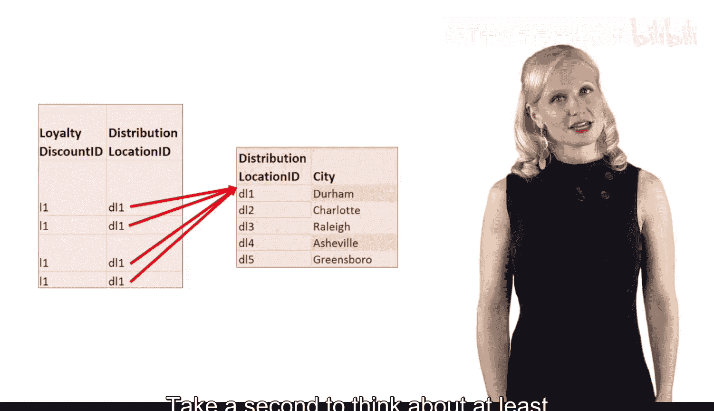
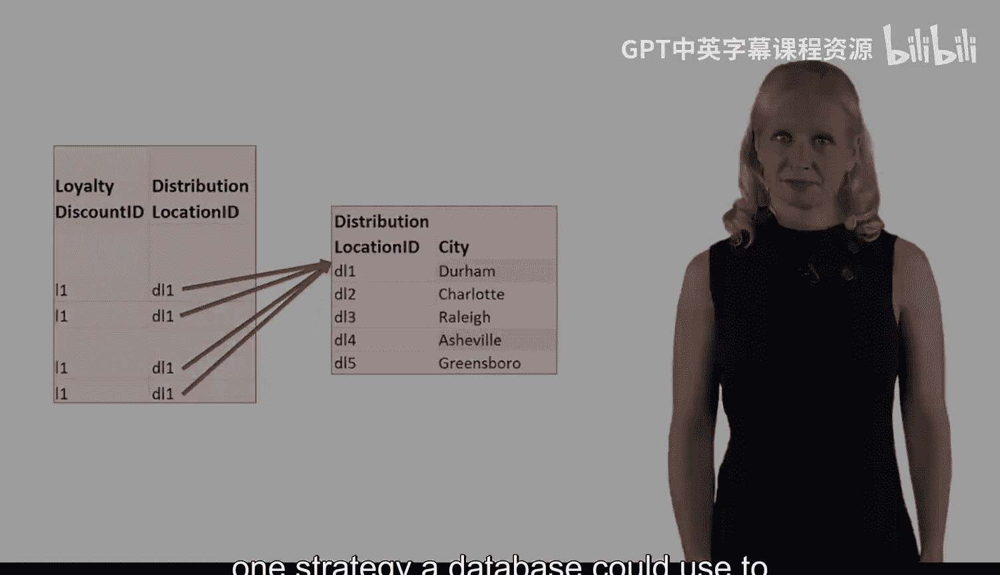
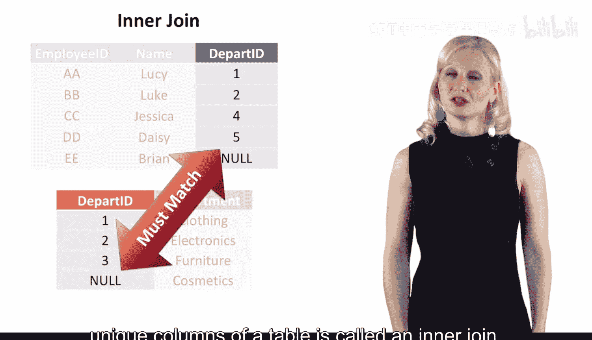
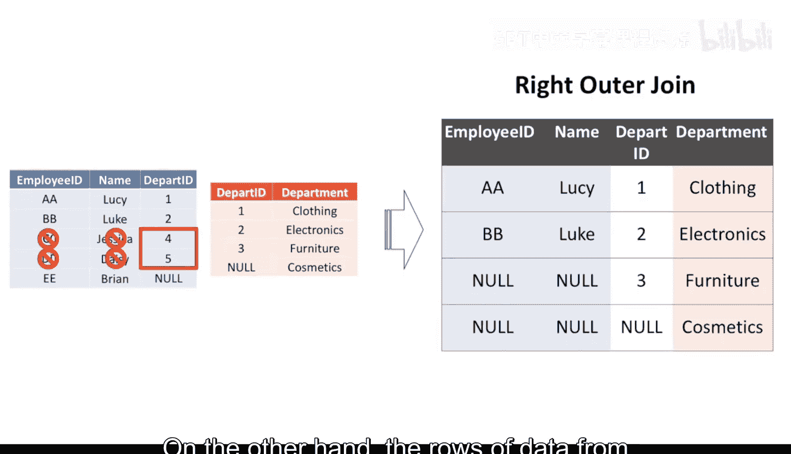
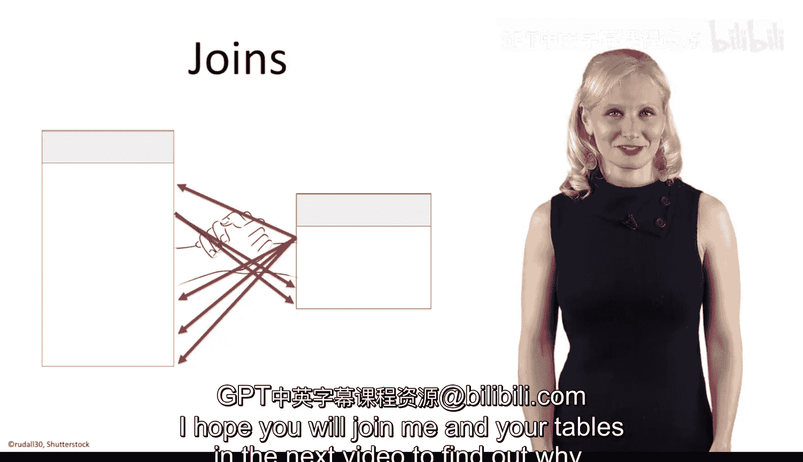

# 杜克大学《Excel 到 MySQL：商业分析（5课全）｜Excel to MySQL： Analytic Techniques for Business》中英 p150 21_04_01_连接查询基础概念.zh_en -BV1mS421X7yw_p150-

Yeah。We've talked a lot about how relational databases work by breaking large data sets up into smaller tables of data with unified themes。

We generally try to organize our themes so that we replicate individual data entries as rarely as possible。

 Of course， the strategy only works if we can put the tables back together when we need to。

We achieve this using a class of SQL commands called Joins。

Joints have a bad reputation amongst new SQL users。 But in my experience。

 joints are only hard to understand if you don't have a firm grasp of how relational databases are set up。

 Since you master the material in week one of this course。

 you do have a firm grasp of how relational databases are set up。

 So you will master joins very quickly。 By the end of this video。

 you'll understand how joins work and why there are different kinds of them。

To understand what joints are， let's consider the problem theyre meant to solve。

Recall the tables we made for our Egggarers roast coffeeoff database。

 Let's focus on just two of those tables， the orders table and the distribution center table。

 And let's zoom in a little bit。You can see that in order for us to learn any information about the distribution center of the items in the orders table。

 we have to link each row of the orders table data to the appropriate row of the distribution center table data by matching up the distribution location ID。

So far we've talked about linking tables as a general concept for organizing databases。

 but now we have to think about the details of how the database can actually make that link。

Take a second to think about at least one strategy a database could use to link these two tables together。

One of the first strategies that might come to mind is that the database could go through the distribution center I D column of the order table row by row and ask which distribution center I is this。

 It's DL1， Okay， In that case， it matches up with all the data in the DL1 row of the distribution center。

You could implement the strategy in Excel with a V lookup function。

 and it would work very well if your data set wasn't too large。

But what if you had to copy the V lookup function to 100 million rows spread across multiple spreadsheets in Excel？

Even if you were an Excel expert， it would take a bit of time to even paste the Vlookup formulas into all appropriate cells。

Although a computer is much quicker than a human at these types of operations。

 a similar concept still holds for a database， operations that make databases look information up are always relatively slow compared to other types of mathematical operations。

 And the more times the database has to look up that information or the wider the pool of information it has to search。

 The slower the database query will be。 So the row by row strategy is going to be inefficient。

 Is there another strategy we could use。For those of you who have done a lot of analysis using MatTlaB or R software。

 you might be thinking， isns't there some way we could do this using at matrixtri algebra。

 we treat each table as a matrix。Well， I sympathize with that statement。

 but I'm not sure what the strategy would be， given that in most cases。

 the tables you will be combining will not be of the same length there with。

Here is where set theory comes to the rescue。The theoretical way set theory combines two sets is by multiplying them。

 resulting in what is called the Cartesian product or cross product。 In the case of sets。

 multiplication doesn't mean multiplying numerical values。

 The Cartesian product is a set that contains all the possible pairs of items in two tables。

If this was our order table or set， and this was our distribution center table or set。

 this would be the Cartesian product of the two sets。

You can see that the Cartesian product gives every possible combination of the burs。

The way databases combine tables is by first， filtering the columns you are using to link the cables together by the criteria you specify in your query。

 Then it makes the Cartesian products of these filtered columns。 And finally。

 it dependsends any additional columns that you ask for in your query。

So the way you can join tables in your queries to get the data you want is to specify。

 I only want the Cartesian product of rows that have the same IDs in a unique ID column。

You need to know about Cartesian products because sometimes you get unexpected outputs when you join tables that have duplicate rows or columns that of many to many relationships。

 These outputs will only make sense if you remember the fundamental notion that Cartesian products under joins。

We're going to work our way up to understanding those types of situations。

 but let's start by thinking about joins in the perfect idyllic situation when you have no duplicate rows。

 and each row in one table is only connected to one row and another table。

Imagine that you have the following two tables that are linked by department ID D。

 There are at least four different ways you could combine these tables。

 The first would be if you wanted to find out all the employees who work in a current department。

In this case， you want a list of all of the employee rows which have matching department IDs in the department table。

This type of join， where a row only included if its value is contained in both unique columns of a table。

 is called an inner join。

The result of an inner join of these two tables will look like this。

Since there is no department ID of four or five in the department table。

 and no department ID of three in the employee table， the name Jessica， the name Daisy。

 and the Department of Furniture would be left out of the result。Also。

 notice that the employee Brian and the Department of Cosmetics were dropped from the results because no values can never be used to link rows in a join。

No values are not linked up to other length values。 They are simply excluded。

What if you wanted a list of all the employees in their departments。

 regardless of whether the employees department was in the current department table。In this case。

 you could use an outer join when you write an outer join。

 the order you enter the tables into your query matters。

 The name of the join defines which table will have all of its values included。

Let's assume we will enter the employee table first and the apartment table second in our query。

 In this case， the result of a left outer join of these two tables would result in all of the values on the table on the left when the employee's table being included。

Values of the table on the right would only be included if they have a value in their linking column that matches up with the linking column on the table on the left。

Here's what a result of the left join on our tables would look like。

You see here that all of our employees are included in the output。

 but the only departments that are included are those that have a matching value in the department ID column。

Notice that wherever there was a row in the employee table that didn't have a matching department ID in the department table。

 the department is listed as null。The row that had a null value in the employee's table is included in the output table this time because there was no criterion that it had to match up with the value in another column。

You could also retrieve a list of all of the current departments in their matching employees。

 regardless of whether any employees in the employee table were pointed to a department in the department table。

If we once again include the employee table first in the department table second in our query。

 we could acquire this list using a right outer join in right joins。

 all the results of the table on the right are included Vals of the table on the left are included only if they have a value in their linking column that matches up with the linking column in the table on the right。

 So the results would look like this。This time all of the department rows are included in the output。

 however， the furniture row has a null value in the employee table because there is no department ID3 listed anywhere in the department ID column of theEmploys table。

The row of data in the department table at a null value in department ID is included in the output。

 on the other hand， the rows of data from the employee table that do not have department IDs that appear in the department table are excluded。

At this point， you might be thinking， wait。Couldn't I get the same result if I ran the join we just described using a left join。

 but reversed the order of the table's answer to the query。 The answer is yes， Yes， you could。

Left and right， outer joins are fairly redundant。 They just give you flexibility in how you write your query。

 A left outer join with the tables written in this order gives you the same result as a right outer join with the tables written in this order。

There's one more type of join we haven't talked about， full outer joins。

Full outer joins would give you all of the employees and departments listed in one or the other table。

 regardless of whether they match up with values in the other table。

You might use this if you simply wanted to extract all of the data that meet a certain criterion so that you could examine every single piece of raw data in your analysis。

 The result of a full outer join between our two tables will look like this。

You can see all rows are included， and whenever there was a row that didn't have a matching value in the department ID column。

 no values are entered。One important thing to know is that not all database management systems support full ladderer joins。

 My SQL in particular， does not support full joins while Terraada does。

The fact that not all database management systems support full outer joins gives you a sense of how rarely they are used。

So those are the basic concepts behind joints。 They are summarized in this diagram that you might want to keep for future reference。

 Not too bad so far， right， I agree。That said， so far。

 we have only looked at the results of joining tables that have columns that have only one match per value in their linking column。

 The results do get slightly more complicated when you apply outer joins to tables to relationships。

 have cardinality constraints that are greater than one。 Or if some of your tables of duplicate rows。

 I hope you will join me and your tables。 in the next video to find out why。😊。

