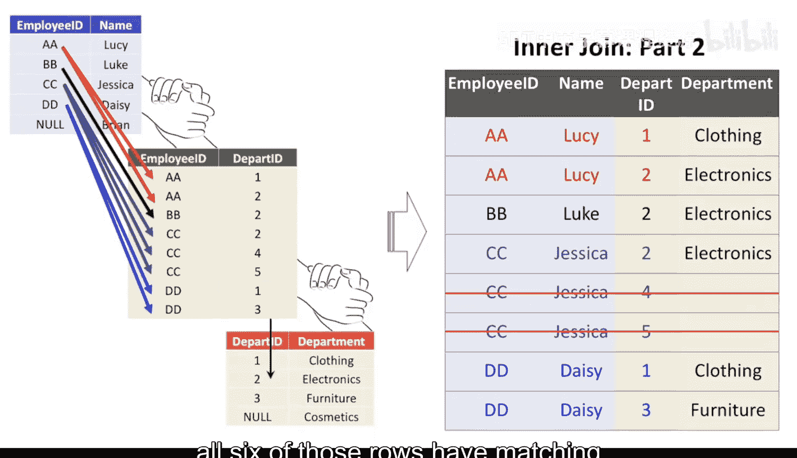
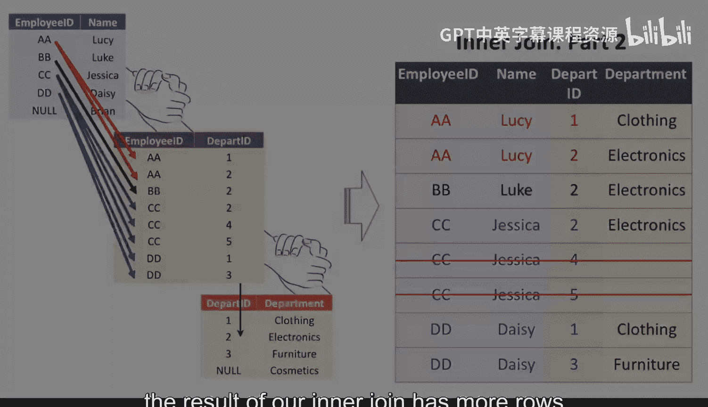
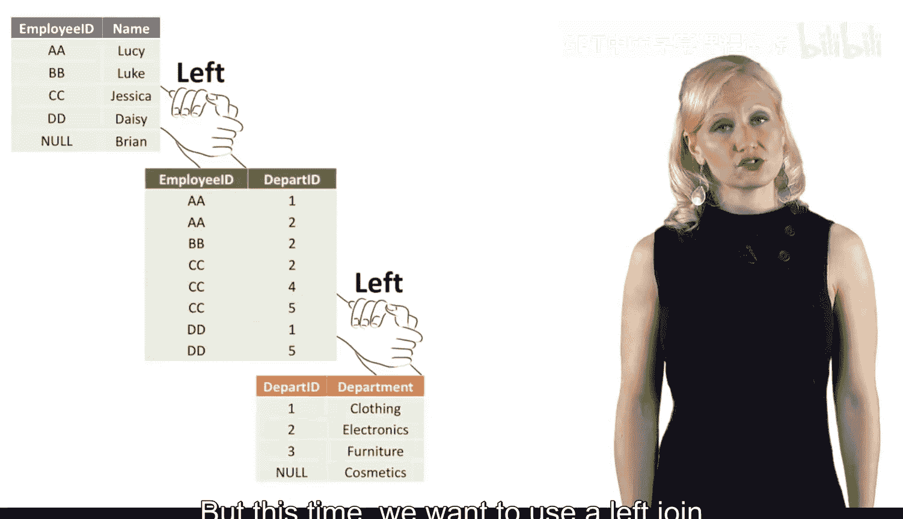
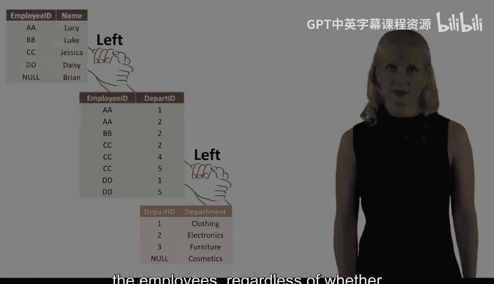
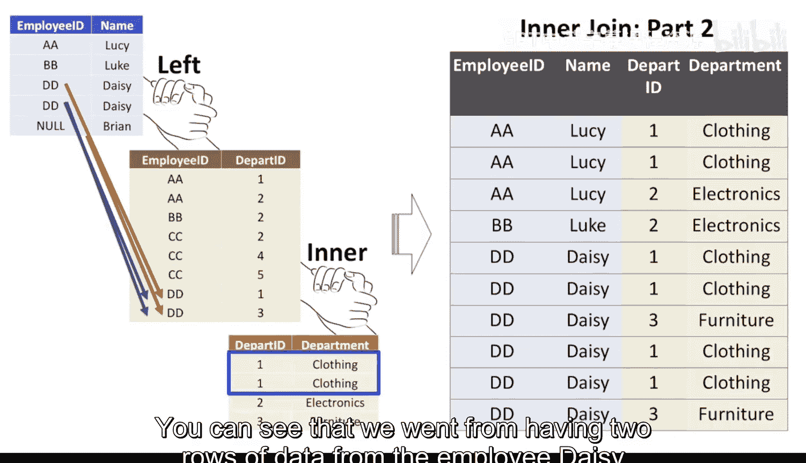
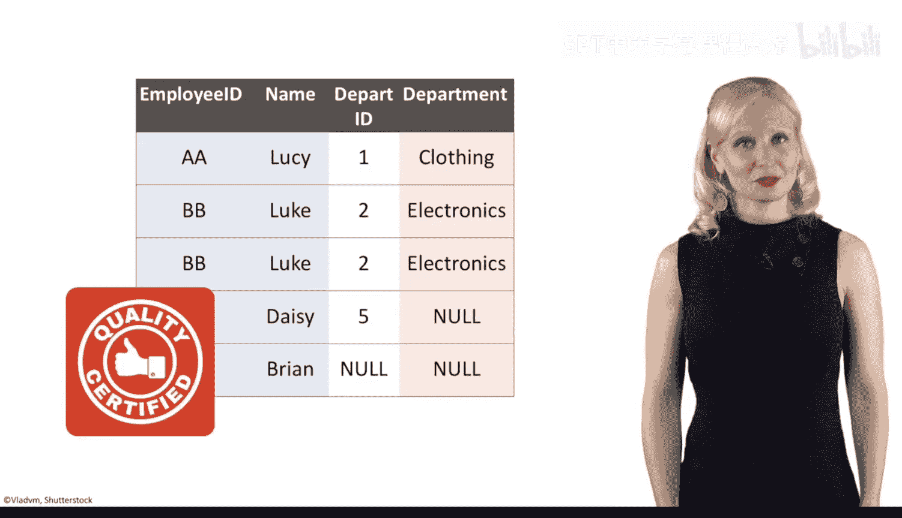

# 杜克大学《Excel 到 MySQL：商业分析（5课全）｜Excel to MySQL： Analytic Techniques for Business》中英 p151 22_04_02_多对多关系与重复数据的连接处理.zh_en -BV1mS421X7yw_p151-

In the last video， we went over some basic concepts about joints that are summarized in this diagram。

Inner joins keep everything that's common to two tables， not including null values。

 Left joints keep everything in the left table， including nulls。

 and include only matching information from the table on the right。

Right joins keep everything in the right table， including nullles。

 and include only matching information from the table on the left and full utterer joins。

 which are not supported by my SqL， include every row from both tables and match them up whenever possible。

All of these concepts are accurate， and this picture is a good reference that you will see often in textbooks or on the Internet。

 but it can also be a little misleading if you forget about the concept of Cartesian products。

 you'll see why when you start working with concepts whose maximum cardinality constraints are greater than one。

😊，For example， the diagram makes it look like all inner joins will have output tables that are smaller than the input tables。

 However， that will often not be true if values in one of your tables can be linked up to many values in the other table。

To see how that could happen， let's work through an example step by step。

Let's join employees with their departments again， but this time。

 each employee can be in many departments and each department can have many employees。

Recall from the first week of the course that in order to put concepts that have many to many relationships into a relational database。

 you always need to have a linking table that has foreign keys to the tables you ultimately want to link。

So under these circumstances， we will need to join three tables to ultimately combine employee and department information。

When you join multiple tables， you join two at a time。

And then join the results of each join with subsequent tables。Therefore。

 to join the information in the employee table with the information in the department table。

 first we have to join the employeess table to the assignment table。When we execute this join。

 the database will make all the possible combinations of rows between the tables or the Cartesian product as long as the employee IDs match。

In this case， sometimes there are multiple assignment rows with the same employee ID so the join will output each combination of employee and assignment rows that have the same employee ID numbers as a result。

 the inner join will output eight rows， even though the employee table is only five rows and has one null value that isn't included。

When we join the results of our first join， the department table。

 six of those initial eight rows will still be retained because all six of those rows have matching department Is in the department table。

 So in the end， the result of our inner join has more rows than either of the tables we are joining。

Remember that this is possible every time you look at the slightly misleading。

 but still very useful picture for reference。There's also another aspect of joints that's hard to appreciate when looking at this picture。

 and that happens when you join multiple tables together using different types of joints。

 which often means you accidentally join multiple tables together using different types of joints。

To see what I mean， let's link our employee and department tables up again。But this time。

 we want to use a left joint because we want a full list of all the employees regardless of whether they are assigned to a department。

You can see this time the result of our first join has nine rows because the known value in row5 of the employee table is included。

 so far so good。If we then use another left join to connect the result of that first join to the department table。

 we would retain all nine rows in the output and three of those rows would have no values in the department column。

But now， what if we forgot the word left in our second join statement so that we accidentally computed an inner join between the results of our first join and the department table？

Now， four of our nine rows would be removed because they don't have department IDs that are present in the department table。

If you had a really large data set and were aggregating over the results rather than looking at each row of the join output on its own。

 a query would certainly run， but your results would not be what you think they are。

 and it might be hard to notice that made your mistake。

Sometimes you do intentionally want to vary your join types when you're combining tables。

 so I don't want you to think that you always have to use the same join type。Instead。

 I just want you to remember that the order in which you run your joins matters。

 so you need to make sure you are applying the correct type of join to the correct pairs of tables at the correct point in your query。

There's one more thing you need to remember about joins。

 and that's what happens when you join tables that have duplicate rows。

Joins retain to book at rows and output tables because there's no mechanism within the concept of a join on its own that would remove them。

So a left joint of these two tables would look like this。

The duplicated row in the employee table gets passed along to the results of the join。

But thanks to Cartesian products， things can get a little challenging when you join two tables that not only have duplicates。

 but that also have many to many relationships。 Essentially what happens is that your duplicates get multipied。

Let's go back to a join of the employees pointed to in department tables。 Now。

 we have a pair of duplicate rows in the employees's table and a pair of duplicate rows in the department's table。

When we make a first inter join with the employees and appointed two table。

 each of those duplicates is going to get multiplied by all the rows in the linking table that have the same employee ID D。

 so the output will give you a duplicate of each of the rows in the linking table that have the employee ID D of D D。

But it gets even more complicated than that。When we interjoin the output of that first join to the department's table。

 each of the rows that have a department ID of one will get duplicated。

 so the final results will look like this。You can see that we went from having two rows of data from the employee Daisy to six rows of data from the employee Daisy。

 even though only two of those rows represent real records。

This is what can happen when you join duplicates。 You can imagine how out of hand these multiplicative effects can get if you join lots of duplicates。

 In fact， we are going to see an example of that with our Dotion data set。

Now that you have seen the types of things that can happen with messy datasets。

 you might be able to sympathize with the database people who want to use different terminology for the design of a database versus a real database。

Datase design， based in set theory assumes there are no duplicate rows。 In real life。

 There are duplicate rows， and they can be very challenging to work with。

 So using terminology that differentiates theory from real life can be useful。

In terms of what to do about these duplicate rows， here are some good practices to follow。First。

 whenever possible， it's a good idea to clean your data and get rid of as many duplicates as you can before doing your analysis。

 But sometimes that's not practical or possible。 So you should get in the habit of looking at small testing examples of a rows that will be outputted by every pair of tables you join before you link multiple joins together in one query。

 Step by step， make sure each individual join you are going to run。

 gives you the results to expect before you start aggregating the results of a join or doing anything else fancy。

This will also help that you make sure you don't enter the wrong kind of join at a given step。

Taking the time to double check each part of your query at the beginning of your analysis will save you from having a lot of trouble later on due to misinterpreting results that you didn't know were incorrect。

 So I highly recommend this habit。It will make sure that you have control of your joins rather than letting them control you With all this knowledge。

 you are ready to join some tables。 Have fun。 and don't forget about Cartesian products。😊。

