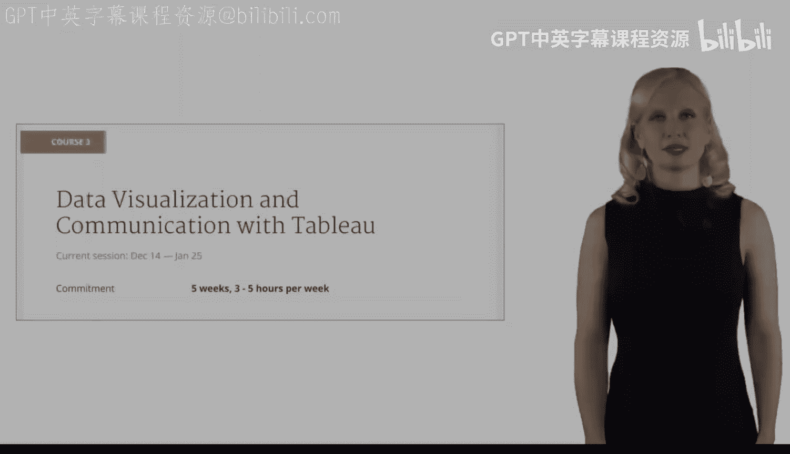

# 杜克大学《Excel 到 MySQL：商业分析（5课全）｜Excel to MySQL： Analytic Techniques for Business》中英 p155 26_05_01_从制定分析计划开始.zh_en -BV1mS421X7yw_p155-

Yeah。Congratulations on working through all those SQL lessons。

 you should really be proud of yourself。You've now learned everything you need to know to retrieve the data that will allow you to start figuring out how to increase Dian's test completion rate。

 which is the business problem Dian would like us to help them solve。

 You're ready to start our analysis， right。not quite yet。I love that you are excited to jump in。

 and believe me， I am really excited to analyze the ogniition data set， too。

 but here's what you need to think about。😊，Your job as a business analyst isn't just to do something exciting。

 It's to do something that will clarify exactly what a business should do to solve a problem。

 In other words， to create value。And even more， it's to do this as quickly and efficiently as possible and preferably in a fashion that allows you to update the people invested in your project or your stakeholders on your progress。

I am going to give you a piece of advice from years of data analysis。

 which I talk about a lot in the data visualization and communication with Tableau course in this specialization。

Do not enter a data analysis project。 Don't even start looking at the data without a structured analysis plan。

 and the bigger the data， the more structured the plan should be。

Remember I mentioned in earlier video that a data analysis project needs to provide insight into business processes that a business has the ability and willingness to improve in order to create new value。

Data analysts need to always be thinking about the following questions what questions will provide actionable insight。

 will the answers to my questions matter are the answers to my questions correct？

We talked about the last question when we were learning how to write aggregate queries。

 Now it is time to talk about the first two questions。

You may have heard the term analysis paralysis before， it's a real thing。

It's what happens when you are so overwhelmed by all the ways you can analyze a data set that you end up doing nothing at all。

 Even more dangerous， though， is what I call analysis free for all。

 This is when you just start analyzing whatever seems fun or interesting。 When you do that。

 you end up with all kinds of interesting but disconnected results that you don't know how to make sense of。

 even if you've been implementing complex， beautiful graphs and analyses for months。

When you have tough to present what you found to your stakeholders using this analysis strategy。

 you may be able to piece together some type of desperate data story from the different analyses you've tried。

 but the story usually has little to do with the original business problem that needed to be solved。

The dangers of analysis， paralysis and analysis free for all start at the very beginning when you want to begin playing around with the data so they you can get a feel for what they tell you。

Although playing around is useful and actually necessary。

 you can also end biasing your strategy in ways that may be irrelevant to your goals。

 So it is very important that you have a plan about exactly what analyses you are going to implement to address the business problems it's your job to solve before you start running analyses。

 That plan should be inspired by these two guiding questions。

We don't have time to go over exactly how to make analysis plans in this course。

 but I described one of my favorite methods in the data visualization and communication with Tableau course earlier in this specialization。

 I call that method structured pyramid analysis plans， or Sps。

Since we won't be able to make one together right now。

 I provide an outline for you in the course materials。 In essence， what you will see is a specific。

 measurable， attainable， relevant and time bound goal for the project。

 otherwise known as a smart goal at the top of a pyramid。😊。

The variables you will use to assess the goal will be written underneath the goal。

 and underneath those variables， you will see ever widening layers of categories and subcategories of issues that will be important to analyze in order to achieve your smart goal。

Under normal circumstances， these categories would be derived from conversations with your stakeholders and your analysis team during a process called solicitlicitation to make sure the categories are relevant to your solutions。

 the solutions your company is willing and able to implement。

One of the features of the SPAap framework is that you are supposed to write down the exact variable or column name you need to address a question about a certain category or subcategory of factors。

 The utility of the step should be much more clear now that you are actually the one who will be writing the SQL queries to retrieve the data for the analysis。

 The more specific you can be about what variables you need to analyze。

 the more able you will be to determine whether it's actually possible to analyze those variables。

 given the tables you have in your database。Being clear about what variables you need and how you will combine them will also make it much easier and more efficient for you to proceed through and write the appropriate SQL queries for each category of questions。

Another thing we learned about in data visualization and communication with Tableau is that data analysis only plays a role in one or two parts of the lifecycl of a data analysis project。

 and SQL queries play an even more constrained role than that。

SQL queries are solely in this part of the project life cycle。

 where we are retrieving the data and making computations。 Of course。

 the SQL queries are absolutely critical for the project to be successful。

 which is why data analysts who know how to use SQL queries are so highly coveted。

 But it's important to keep in mind that queries are just one part of your job。😊。

You need to make sure that you are implementing queries that address the right questions in the right way to lead you towards a strong hypothesis about what business changes could achieve your smart goal。

With that in mind， Im going to do my best in the next few lessons。

 taking into consideration that our primary goal is to learn SQL to make this SQL queries we practice address real analysis questions that could help us arrive at some insights to present to Dian。

The analysis questions I address will be based on the SAP included in the course materials。

When you start doing SQLqueries in your own business。

 I highly recommend that you make a similar analysis plan for yourself。

If you need help learning how to do that， please refer to the materials posted in week one of data visualization and communication with Tau in this specialization。

Now that we know about analysis plans， let's go help dogians solve their business problem。

