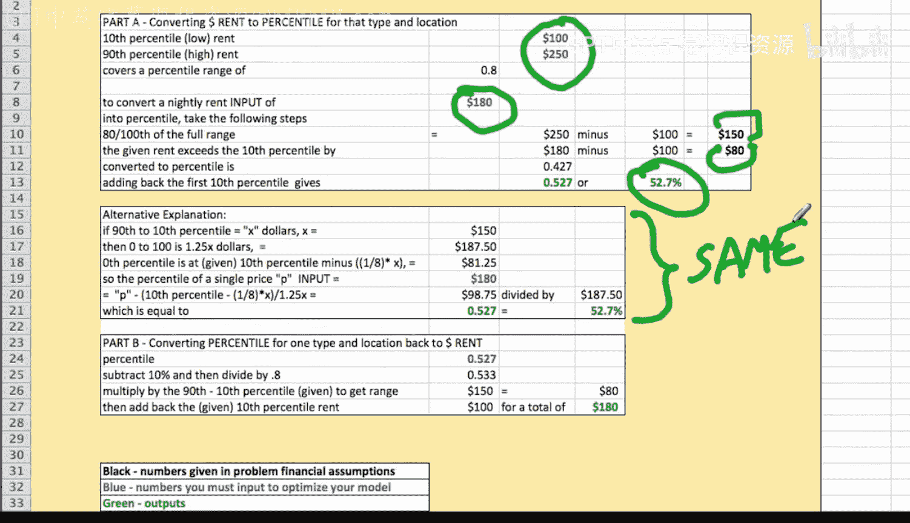

# 杜克大学《Excel 到 MySQL：商业分析（5课全）｜Excel to MySQL： Analytic Techniques for Business》中英 p165 09_03_04_使用美元到百分位转换指导表.zh_en -BV1mS421X7yw_p165-

This Excel spreadsheet。Spells out the arithmetic for converting a dollar value nightly rent into a percentile nightly rent。

 when you know the 10th and 90th percentile rents for that area。

 So what this means is we're comparing our specific dollar rent to two guidepost。

 one at the 10th and one of the 90th percentile， and we're saying。If we're halfway between these two。

 then since there's 80% between them， half of the way would be 40%。

 so we'd be at the 50th percentile， 40 plus 10。If we're closer to the high end。

 we'll be closer to the 90th， closer to the low end is closer to the 10th。

So for each individual property， you're going to input your 10th and 90th percentile rent。

And this is going to give you a value for the range。Between them。

Then you're going to take your input rent。And you're going to convert it。To a measure of。

How far it is past the 10th percentile。 So here it is $180 is 80 past the 10th percentile。

And that would put us at 0。427， but of course we need to add back the 10th percentile。

 so that gives us a percentile of 52。7%。There is an alternative explanation of the same thing。

 this is the same， and you can try this for yourself。

