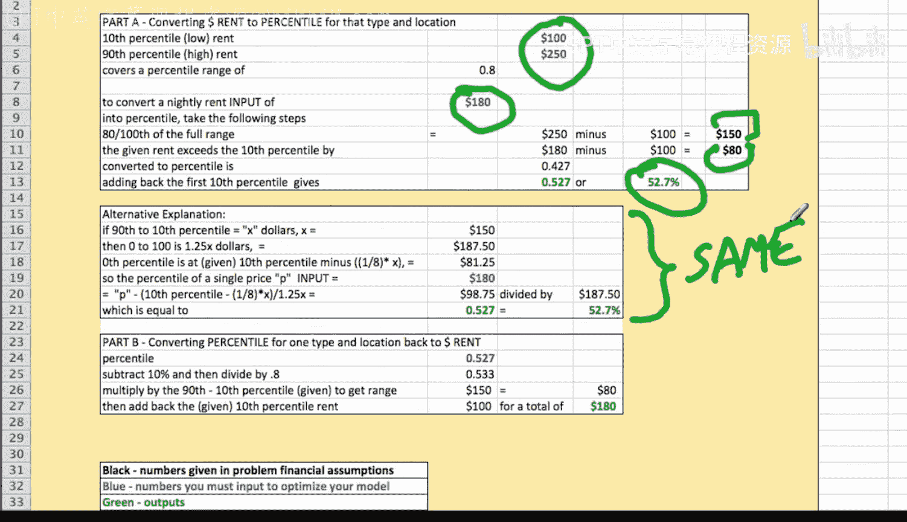

# Excel 到 MySQL：商业分析：5.3.4：使用美元到百分位转换指导表 📊

在本节课中，我们将学习如何使用一个特定的 Excel 表格，将具体的美元租金数值转换为对应的百分位排名。这个转换过程依赖于已知区域的第10百分位和第90百分位租金作为参考点。

上一节我们介绍了百分位数的概念，本节中我们来看看如何利用两个关键的百分位参考点进行具体的数值转换。

这个 Excel 表格清晰地展示了将具体的美元租金转换为百分位排名的算术过程。其核心思想是，将我们拥有的具体租金数值，与两个已知的“路标”进行比较：一个是第10百分位的租金，另一个是第90百分位的租金。

这意味着，我们通过比较具体租金与这两个参考点的相对位置，来确定其百分位排名。例如，如果我们的租金恰好位于这两个参考点的正中间，那么由于第10和第90百分位之间跨越了80%的数据，中点就对应着第50百分位（10% + 40%）。如果租金更接近高端参考点，则百分位排名更接近90%；如果更接近低端参考点，则百分位排名更接近10%。

以下是使用该表格进行计算的具体步骤：

1.  **输入参考值**：针对每一个特定的房产，你需要在表格中输入该区域已知的**第10百分位租金**和**第90百分位租金**。
2.  **计算范围**：表格会自动计算出这两个百分位租金之间的**差值范围**。
3.  **计算超出部分**：接着，输入你拥有的具体**租金数值**。表格会计算该租金超出第10百分位租金多少金额。例如，若第10百分位租金为$100，你的租金为$180，则超出部分为 **$80**。
4.  **计算比例并转换**：然后，表格会将这个“超出金额”除以之前计算的“差值范围”，得到一个比例。这个比例表示你的租金在从第10到第90百分位的区间内所处的位置。用公式表示即：
    `比例 = (输入租金 - 第10百分位租金) / (第90百分位租金 - 第10百分位租金)`
5.  **得出最终百分位**：最后，将这个比例乘以80%（即第10到第90百分位所覆盖的区间），再加上基础的10%，就得到了最终的百分位排名。公式如下：
    `最终百分位 = 10% + 比例 * 80%`
    按照上面的例子，如果计算出的比例是0.427，那么最终百分位就是 **10% + 0.427 * 80% = 52.7%**。

上图展示了这个计算过程的实际表格布局，你可以清晰地看到每个输入单元格和计算步骤。

对于同样的计算逻辑，还有一种等价的解释方法，其本质完全相同。你可以自己动手尝试，在Excel中构建这样一个表格来加深理解。

本节课中我们一起学习了如何利用第10和第90百分位作为锚点，将具体的美元租金数值转换为有意义的百分位排名。这个方法使我们能够在统一的尺度上比较不同房产的租金水平，是商业分析中数据标准化和比较的实用技巧。