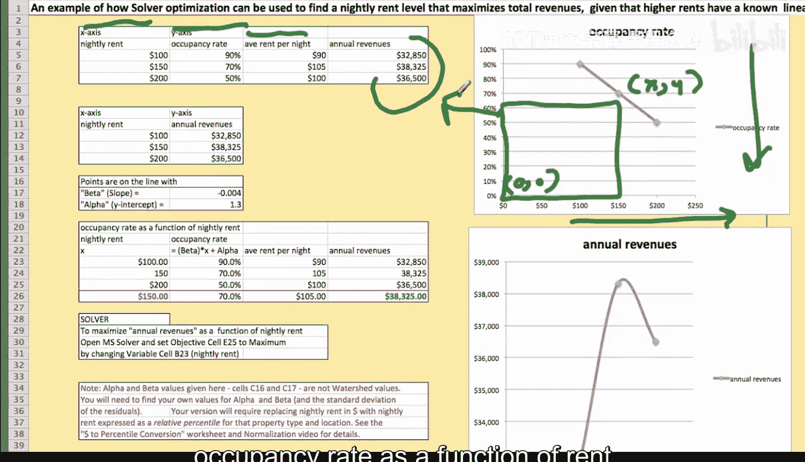

# 杜克大学《Excel 到 MySQL：商业分析（5课全）｜Excel to MySQL： Analytic Techniques for Business》中英 p167 11_03_03_使用求解器收益最大化指导表.zh_en -BV1mS421X7yw_p167-

In the upper left， we have various rents and occupancy rates。Here。And here。

The rent times the occupancy rate is going to be the average rent per night。

And the rent times the occupancy rate。Times 365 gives you your annual revenues。

So that is pretty easy to understand， I hope。You are given here a model。

That indicates that as rents get higher。Occupancy rates get lower。So beta is less than zero。

 it's negative， the line slopes down to the right， and this is consistent with what we've learned in the past if you take the same product and charge a higher price for it。

In general， there is less demand for it， so occupancy rates tend to go down as a function of increasing prices。

What we want to do is find the place where the rent times the occupancy rate is at a maximum。

What this means is that we are looking for the area。Between the origin 0。

0 in the lower left and the point x。Lie in the upper right。

And to find the point that has the rectangle with the largest area。

Which corresponds to annual revenues？When multiplied by 365。We are going to use solver。

Everything about this spreadsheet can be modified so you can change the slope of the line。

 you can change the value for the y intercept alpha。

And the idea here is to play around with the spreadsheet and get comfortable with the idea of using solver to find the perfect rent to maximize total revenues。

When you know occupancy rate as a function of rent or you have a forecast for occupancy rate as a function of rent that you believe in as a good forecast。

