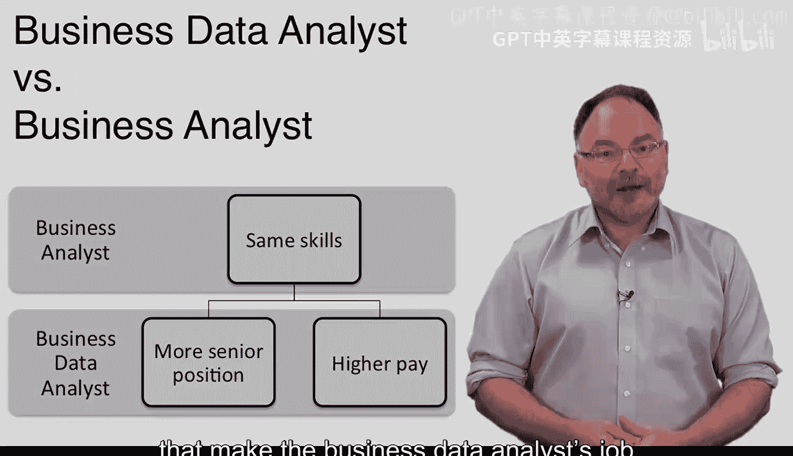
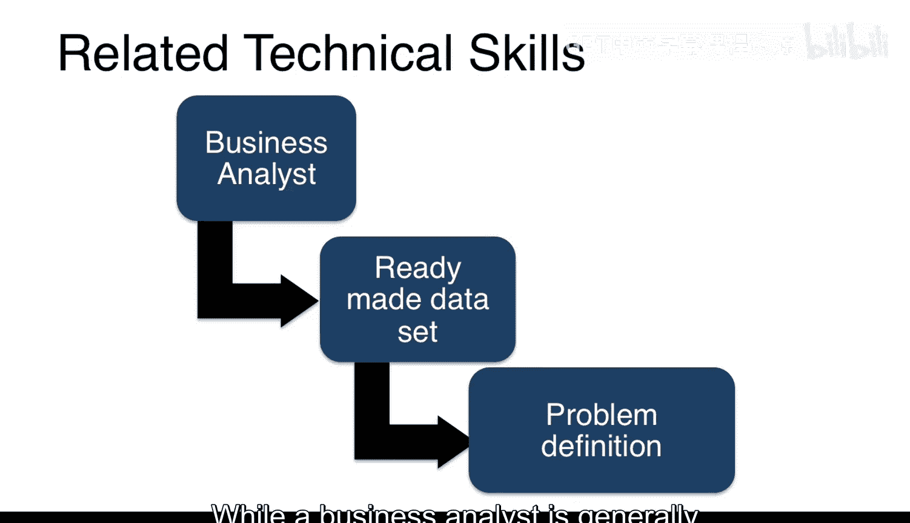
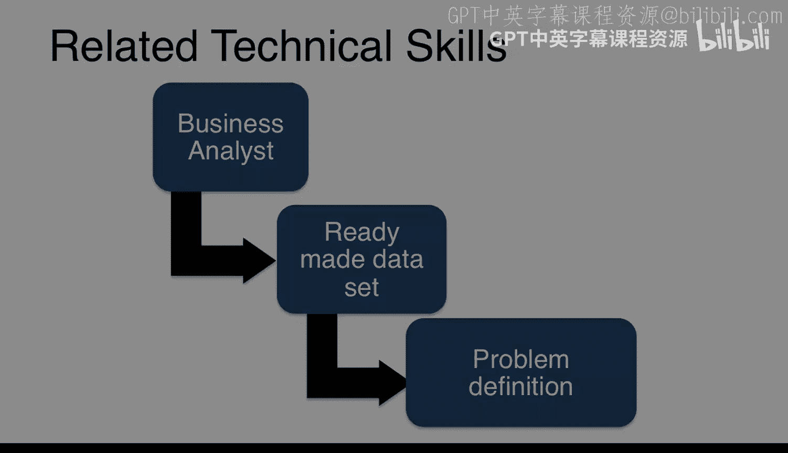

# 杜克大学《Excel 到 MySQL：商业分析（5课全）｜Excel to MySQL： Analytic Techniques for Business》中英 p17 17_03_04_区分业务数据分析师与业务分析师角色.zh_en -BV1mS421X7yw_p17-

In many respects， a business data analyst's work is similar to that of a business analyst。

All of the skills required of a business analyst are also required of a business data analyst。

The business data analyst role differs from the business analyst role in two main ways。

Two additional requirements or skills that make the business data analyst job more senior and generally higher paying。

 First is a conceptual or analytical skill。 The business data analyst is expected to be able to think flexibly about how the data a company is currently collecting could be recombined and analyzed in new ways to understand the business better。

Where business analyst is generally given a specific problem to analyze based on information that has been assembled by someone else。

A business data analyst may need to be able to pull together information from data sources scattered throughout the company。

And should be able to figure out where to go in the organization to find the relevant data。

In other words， a business data analyst should be able to figure out the right questions to ask in order to identify opportunities for business process changes that may be suggested by the data second is a related technical skill。

While a business analyst is generally given a ready made data set or problem definition。

A business data analyst is expected to be able to run SQL or structured query language queries to pull useful data out of much larger databases。

 or even from distributed collections of unstructured data scattered in multiple locations within the organization。

And to combine that pulled data into new data sets that did not previously exist to support the data analyst's research agenda。

Learning SQL is not difficult。You can learn enough SQL in a few weeks to meet the expectations for most business data analyst positions。

 however。This technical knowledge does form a great divide。

 people who do not have SQL skills are dependent upon others。Typically。

 the IT department or database administrators within the organization to create usable data sets for them。

While people with SQL skills can by themselves access and reorganize almost any raw data in the organization。

This level of autonomy and selfsufficiency greatly increases the productivity of a business data analyst and allows them much greater room for creativity because they can explore hunches or pursue leads that may not turn into anything without burdening other employees who would otherwise need to gather and scrub or recombine the necessary data for them。

