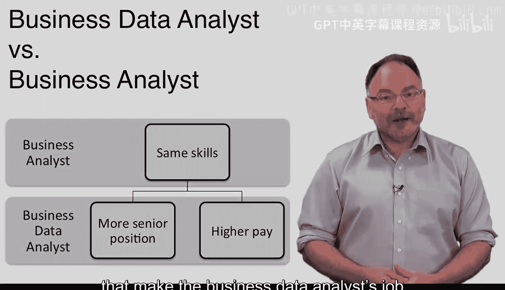
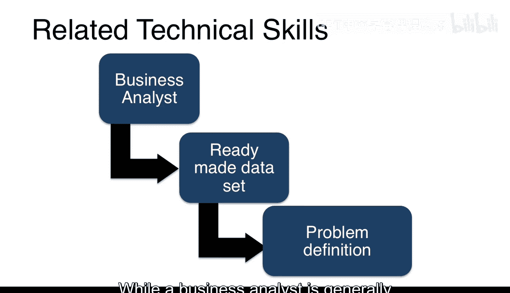
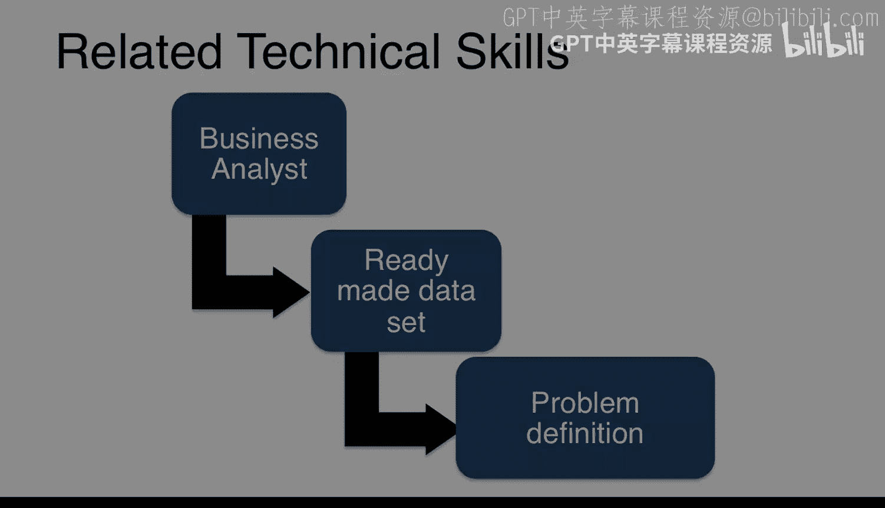

# 商业分析：P17：区分业务数据分析师与业务分析师角色 📊

在本节课中，我们将探讨业务数据分析师与业务分析师这两个角色的核心区别。我们将重点分析使业务数据分析师职位更具资深性、通常薪酬也更高的两项关键技能。

在许多方面，业务数据分析师的工作与业务分析师相似。业务分析师所需的所有技能，业务数据分析师同样需要具备。

然而，业务数据分析师角色与业务分析师角色主要在两个方面存在区别。正是这两项额外的要求或技能，使得业务数据分析师职位更为资深，且通常薪酬更高。

## 第一项区别：概念与分析技能 🔍

上一节我们提到了两者在技能要求上的重叠，本节中我们来看看第一项关键区别：概念与分析技能。

业务数据分析师需要具备灵活思考的能力，能够思考如何将公司当前收集的数据以新的方式进行重组和分析，从而更好地理解业务。

以下是两种角色的典型工作场景对比：

*   **业务分析师**：通常会被分配一个具体的问题进行分析，这些问题基于由他人整理好的信息。
*   **业务数据分析师**：可能需要能够从分散在公司各处的数据源中整合信息，并且应该能够判断在组织中的何处可以找到相关数据。

换句话说，业务数据分析师应该能够提出正确的问题，以识别出数据可能暗示的业务流程改进机会。

## 第二项区别：相关技术技能 💻

了解了概念技能的区别后，我们接下来看看与之相关的第二项关键区别：技术技能，特别是**SQL**的应用。

业务分析师通常会被给予一个现成的数据集或问题定义。而业务数据分析师则被期望能够运行**SQL**（结构化查询语言）查询，从庞大得多的数据库中提取有用的数据，甚至是从组织内多个地点分散的非结构化数据集合中提取。

以下是**SQL**技能带来的核心能力：
*   **数据提取**：使用类似 `SELECT * FROM sales_data WHERE region = 'Asia';` 的查询语句从原始数据库中提取特定数据。
*   **数据整合**：将提取的数据组合成此前不存在的新数据集，以支持分析师的研究计划。

学习**SQL**并不困难。你可以在几周内掌握足够的**SQL**知识，以满足大多数业务数据分析师职位的期望。然而，这项技术知识确实构成了一道巨大的分水岭。

不具备**SQL**技能的人需要依赖他人（通常是组织内的IT部门或数据库管理员）来为他们创建可用的数据集。而拥有**SQL**技能的人则可以自行访问并重组组织内几乎任何原始数据。

这种自主性和自给自足的能力极大地提高了业务数据分析师的工作效率，并为他们提供了更大的创意空间。因为他们可以自行探索直觉或追踪线索，而无需麻烦其他员工来为他们收集、清洗或重组必要的数据。

---

**本节课总结**：我们一起学习了业务数据分析师与业务分析师的两个核心区别。第一是**概念与分析技能**，即主动利用现有数据发现新见解的能力；第二是**SQL技术技能**，它提供了数据访问的自主权，是提升工作效率和创造力的关键。掌握这两项技能是迈向资深业务数据分析师的重要步骤。