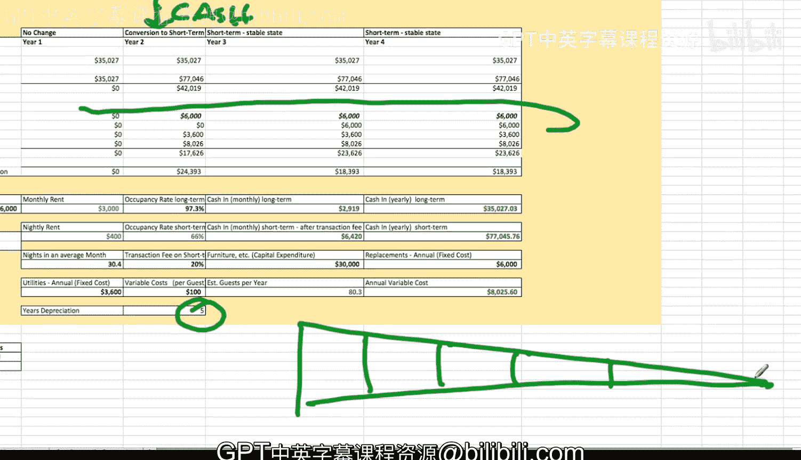

# 杜克大学《Excel 到 MySQL：商业分析（5课全）｜Excel to MySQL： Analytic Techniques for Business》中英 p170 14_04_04_使用年度现金流与利润计算表.zh_en -BV1mS421X7yw_p170-

I suggest that you set up a cash flow statement， something like this。

Where your first column will be first column of numbers will be the long term rental situation。

And then the next column will be the conversion year year two。

And then the next column will be the first steady state year when you don't have those big upfront conversion costs。

 and that's year three。Then you can continue year four and so on。

 but subsequent years should have the same exact financial structure as year three。

So now what we have is a statement of cash flows。For our conversion year and for our steady state year。

We're going to focus， as we discussed before， on profitability in our steady state year as the metric to evaluate the increase in business value for watershed。

So that's something that we talked about in the valuation video。

But what you have here is you have all of the financial assumptions that you have extracted or elicited from your interviews。

And this is a comprehensive list of all of the ones that you will need to do the problem。

The critical difference that I want to draw your attention to between the cash flow and the profitability statement is the line that represents depreciation。

So this is our depreciation and what we've done here is。In year 2。

 the year of the conversion right here on the cash flow statement， we have a lump sum of cash。

We are spending significant cash。But on our profit and loss statement。

 we are allocating that amount of cash out over a certain number of depreciation years。

So you can think of this with straight line depreciation as looking something like this。

 where we divide。Into five units and the value， which we have here as 30。

000 at the beginning is dropping by 6，000 per year until it gets to zero。

The theory behind this is that it would seem like we were very not running a good business in our first year。

 but that we were maybe brilliant in our subsequent years， if we allocated all $30。

000 that is needed to run the business over five years， we allocated that all to the first year。

So if you're wearing out capital equipment by manufacturing something or by providing a service。

 you allocate the costs of that item across the time period that you are using it。

And so here we've made an assumption of a five year use period。

 and it's this item that causes the difference between our cash flow and our profit and loss statement in this very simplified watershed model。

