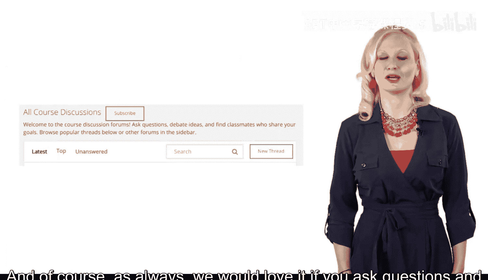

# 杜克大学《Excel 到 MySQL：商业分析（5课全）｜Excel to MySQL： Analytic Techniques for Business》中英 p171 15_05_01_使用Tableau进行敏感性分析.zh_en -BV1mS421X7yw_p171-

。At this point in the course， you have finished your model that analyzes the potential profitability of converting watershed properties into short term rentals。

 Great job。 You should be very， very proud of yourself。

 It took a lot of steps in careful thinking to get you to this point。

 So you should definitely celebrate this milestone。

 Once you've done a little dance and celebrate it adequately。

 get ready to dive in again because over the next few weeks。

 We are going to use tableau and data visualization to maximize the impact of your model。😊。

In the data visualization and communication with Tableau course。

 we talked in depth about how data visualization is a efficient way to first determine what factors are important to include in your computational models or analyses。

 and second， to persuasively communicate the significance of your models or analyses。

One other use of data visualization that I mentioned but didn't have a chance to emphasize fully until this capstone is that data visualization can also be used to test the reliability of your computational models。

Remember how I talked about stress testing your story and watching out for logical fallacies in the data visualization and communication with Tableau Cose。

We discussed how when you see an effect in your data that you think is important for your business。

 it's a good idea to make sure you can replicate that effect in different data sets。

 or at least see if if the effect persists in different subsets of your data。Well。

 there are variations of those ideas that can be applied to predictive models as well。

What you want to know is how much do assumptions affect the results of your model and therefore。

 your conclusions about how you or your company should proceed。 In other words。

 what happens if you put in or take out a variable in your model。

What happens if you change the actual value of financial assumptions。

 like how much something should cost or how long something should last？

If changing these variables or assumptions wouldn't end up changing your interpretations of what your data analysis means。

 your model is robust and you should feel confident in deciding a course of action based on the results of the model。

If， on the other hand， small changes in the variables or assumptions in your model would change your analytical conclusions。

 You should be cautious when making recommendations or predictions based in your data analysis。

 You should probably do some more research so that you can be more certain that the variables and values you' are inputting into your model accurately reflect reality。

In the business world， testing the reliability of your model in this way is called a sensitivity analysis。

Financial analysts in particular want to know whether the best decision about how to proceed would change if your financial assumptions turn out to be incorrect。

They also want to know how much one variable will affect the outcome of a model compared to other variables。

Traditionally， people do the sensitivity analyses using tables in Excel。This week， though。

 we are going to learn how you can use Tableau to test the assumptions of your models visually and even more dynamically。

You are going to create a dashboard that reports dynamic outcomes with the financial model you designed in Excel over the past few weeks based on systematically different sets of assumptions。

Your strategy for doing this will be to create the parameter in Tableau for each financial assumption you made in your model。

You will make your visualizations using calculations that reference these parameters。

Although it might might take a little while to set this up at the beginning， when you are done。

 you are going to be able to test the effect of an assumption on your model instantly by simply changing the corresponding parameter on your dashboard。

 Further， you will be able to see the effects of changing multiple assumptions at the same time。

Doing these same analyses in Excel would take a very long time。

 and you would have to set up a different table for each assumption you wanted to test。

 As you will see， doing it in tableableau is much more pleasant。 And by using a dashboard。

 you will get to look at many aspects of your data at the same time， all in the same place。😊。

There are two different reasons to make a dashboard and tableau to allow you to test the effect of changing the assumptions on your financial model。

 The first is so that you， as the analyst， can figure out how much you trust your model and how confident you should be in the recommendations you are going to make based on the model。

When you're making the dashboard for this purpose， you should choose the graphs based on what you find most useful and fastest to implement。

 and it won't matter if the graphs aren't formatted perfectly。

The second reason to make the dashboard though， is so that decision makers in your audience can use the dashboard to see for themselves how changing the assumptions and your model affects its outcome。

In this case， the dashboard needs to be reasonably well formatted。

 You need to choose the graphs or visualizations your audience is used to working with。

 and you need to explain what each graph is showing。This week。

 we want you to focus on the first purpose。Your objective this week should be to get your model into Tableau in a way that lets you determine how your assumptions affect your model and conclusions。

Focus on making sure your calculations are correct。

 but don't worry too much about exactly how your graphs or dashboards look。

We've set aside next week for you to focus on formatting your dashboard to make it attractive for the watershed executives and add any new graphs that will be helpful。

 but not necessary for your own sensitivity analysis。

 It will be much easier to work on the design and formatting of your graphs next week after you've done the basics and know what the results of your sensitivity analysis are so that you know what parts of your dashboard you want your audience to focus on most。

😊，In order to make your dashboard， you are going to have to use almost everything you learned in the data visualization and communication with Tableau coursese。

Make sure you review how to make bar graphs， tables， box plots， maps， dashboards， and Tau stories。

Also make sure you remember how to use the Marx card， the filters shelf。

 and how to make parameters and calculations。If at any point。

 you need reminders about how to do these things， please refer back to the data visualization and communication with Tableau materials or look things up online。

 because we will not review most of that material here。 Instead。

 the new materials included with this course will focus on showing you a couple of new tableau tricks that should be useful for your watershed project and fair analysis projects in real life。

😊，As you get started， remember that this is a learning experience。

 It's challenging to make dashboard from scratch without explicit instructions。

 So don't worry if you have trouble sometimes be prepared for it to take a while to get your model import in Tau。

😊，Take as long as you need and don't give up when you can't figure how to do something。 Instead。

 try to have fun trying out different options and building your problem solving skills。

 Work through all the details independently will help give you the confidence you need to use these skills in your real job situations。

 and you will feel great once youve figured out how to do everything you want to do。

 I promise you your time and effort will be worth it。😊，And of course， as always。

 we would love it if you ask questions and help each other out using the discussion forums。

 You are all in this together and you have great ideas。

 so it would be wonderful if you share them with each other。😊。

With that， let's dive in。