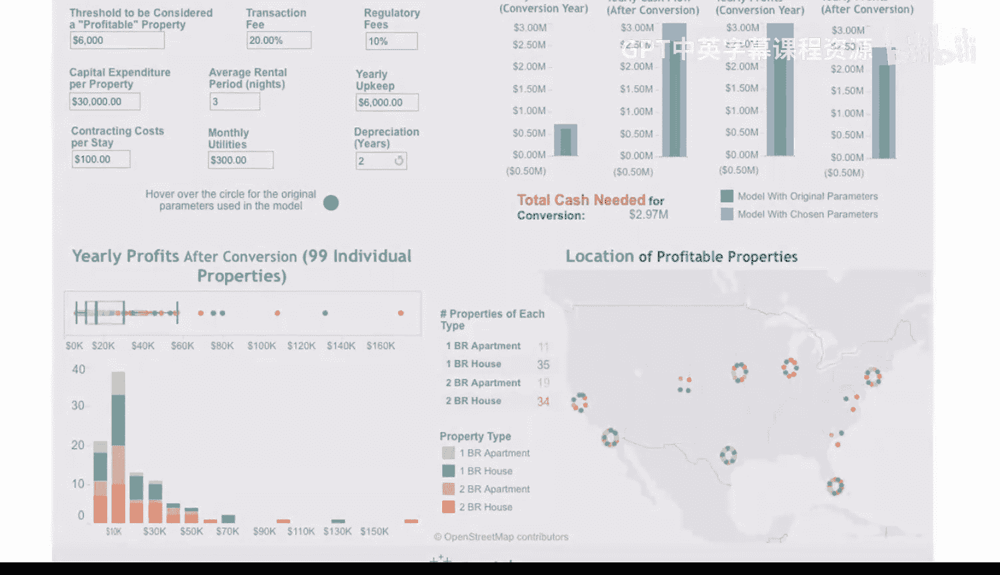

# 杜克大学《Excel 到 MySQL：商业分析（5课全）｜Excel to MySQL： Analytic Techniques for Business》中英 p172 16_05_02_分析师专用仪表板.zh_en -BV1mS421X7yw_p172-

Hi guys， in this video， I'm going to show you some examples of dashboards that would be useful to you in order to test the financial assumptions of your watershed model。

 Now， I want you to know we do not want you to duplicate these dashboards。 In fact。

 it's important to us that you don't。 You will be tested on whether or not you can make some of these graphs and whether the graphs you are showing display the correct information。

 but you are not going to be tested on whether they look exactly like what I'm showing you here or whether they're in the exact same place。

 That's going to be all up to you and your creativity and what you think is best。

 Just make sure you keep that in mind。 what I'm showing you here is just for inspiration and to show you some types of graphs that I haven't shown you before。

😊，The next thing I want to warn you is that I have purposely set up the model I am displaying these dashboards so that they are incorrect I did that because we really want you to come up with the model and the answers to the model on your own so I didn't want to give you away the answers so don't make your dashboards give the exact same answers as my dashboards if you do you'll have the incorrect answer。

The other two things I wanted to tell you before we jump into the dashboard themselves is that first of all。

 dashboards are different than presentations， or at least the way we're using it in this case。

 it's very different the dashboards here are meant to show you all the information you need to make a decision in one place quickly and efficiently That means you're gonna to see a lot of information there and it's going to be pretty busy so you would never use this format in a presentation you would never put all of this all of a dashboard in one slide for example。

 because your audience would be looking all over the place and you wouldn't be able to control where they're looking。

You would only use a dashboard of this kind for study when you're trying to study the results of what you're seeing。

 and that could be for you to study it or for someone else to study it。

And I'll use that as a segue to say the last thing I want to tell you。

 which is that there are two reasons you might want to make a dashboard like this One is so that you can convince yourself of the reliability of your model。

 The other is so that you can convince somebody else of the reliability of your model I say that because you should feel free to make whatever visualizations you need in your first dashboard。

 but then before you show that dashboard to someone else or to another audience。

 you should always find out whether your audience likes getting that information in a different type of way or whether they're used to seeing that information in a different type of way。

In my case I ended up having to make two dashboards too。

 I made the first one for myself and then when I showed it to other people they said they really wanted the other the information they were seeing in a different format。

 so I did that for them as well so I will show you both of those versions and you should think about that yourself when you were going through the rest of this project。

With that， let's jump in and take a look at these dashboards。

So here is the dashboard I made for myself。Let me orient you to the different types of information I wanted to see。

First of all， over here in this part of the screen are all of my parameters are all of my assumptions。

 so I made a different parameter for each financial assumption in my model and I can change those in each one of these boxes。

Over here are the basic metrics that I think are most important for making my decision about whether watershed should convert their properties to short term rentals or not。

I have actually eight different metrics here in this bar graph and I'm going to start with dividing them into four groups and you'll see why there are actually eight groups here so in this bar graph I'm showing the yearly cash flow for all of the properties that are considered profitable based on this cutoff a cutoff we learned about during solicititation that was $6000 so if any property brings in at least a profit of $6000 they are considered profitable and I total all of those the profits from those profitable properties together and I show them here in this bar graph。

This bar graph shows that cash flow from those profitable properties during the conversion year。

 and this bar graph shows the cash flow for those profitable properties all the years after that first conversion year。

In this bar graph， I'm showing the profits rather than cash flow for the conversion year。

 and in this bar graph I'm showing the profits rather than cash flow for all the years after the conversion year。

Now within each one of these bar graphs are actually two different bars that represent two different types of information。

The dark blue bars on the inside here。Represent the totals of all the profitable properties when I define profitable properties based on the original assumptions in my model。

 So these are all the ones that we got during elicitation。The light blue bars， on the outside。

 on the other hand， represent the profits and cash flow as calculated if you change the financial assumptions based on all of the bars put in over here。

So what you'll see if I change any of these parameters is that the dark blue bar。Will stay the same。

 but the light blue bars will change。So if I make depreciation years，3， for example。

The light U bars changed， but the dark blue bars all stayed the same。

One other thing that I have in this part of my screen is the total cash needed if I was going to convert all of the profitable properties based on the parameters as they are defined over here so everything other than these dark blue bars in my dashboard are based on the parameters that I'm entering here rather than the original parameters。

These dark blue bars are the only part that I'm showing that can give you an idea of how changing the parameters relates to the original parameters themselves。

This part of the screen shows me all of the aggregated data from the profitable properties。

Everything down here on the bottom half of the screen shows me all the data from the unaggregated profitable properties。

 so it's showing me all the data for each individual or profitable property。

Here top part of this the graph I'm showing over here is a box plot and you guys know how to make that and have seen those before。

 so each one of these dots shows the profits that you could expect from that specific property if you converted it to a shortter rental。

Taking into account the conversion year， so these are the profits after the conversion year。

 you can see that if you hover over one of the data points。

 it gives you all the data about that specific property。

I'm showing the same data in a different way down here in this graph。

 this graph is what's called a histogram and I will show you how to make these in a later video。

 but basically what they are is they take all of the numbers here on this X axis they break them into bins so in my case I've broken them up into $10。

000 bins and then it counts how many of these points are in each one of those bins so for example you see that there's only one point here that's over $160。

000 or has profits increased profits of over $160，000 so I have only one data point here in the $160。

000 bin。Down here though you can see that there is one property that's 61。

000 and or has profits of $61，000 and another property that has $68，000 in profits， so there are two。

 this one has over $70 so there's only two data points that are in the bin from $60，000 to $70。

000 those two data points are represented here。So this is just a different way of giving you an idea of the distribution of the individual profits for within the properties。

 the profitable properties， and lets you know that in general。

 most of your properties are going to have profits that are in the according to the fake model I'm showing here。

 5，000，10，00，15，000 or $10，000，$20，00030，000 range。

 you don't have too many that are outliers up here but you do have some important outliers and so these are ones you would definitely want to consider converting。

And over in this part of the screen， I'm showing you where each of these individual properties are located。

So this is actually a pretty neat type of graph I did not make up this type of of map this is using what's called a jittering technique which I will show you using other materials later on in the course how to make but since we have a unique issue with our data in our data we have many data points that are in the same geographic location so if you try to map them it can be very tricky especially if you want to be able to show things like what type of property type is in each data point if you use a normal map or use normal mapping techniques those data points will just get put on top of each other so what the jittering does is it takes all the data points from the same geographic location and it puts them in a circle around that geographic location so all of these data points are from Miami Florida for example。

So I'll show you how to do this later。There are a couple other features of this dashboard that I thought were useful or at least were useful for to me every time you click on a data point in the map。

 it will highlight that data point in both of these charts over here。

 likewise if you click a data point on either the box plot or。The histogram。

 it will highlight the corresponding part on the map and the box plot so that makes it easy to be able to visualize and of course when you hover over any of these data points it also gives you the actual numerical values for them so you can either visualize the properties of these data points these individual or you can。

Or you can actually see the raw data There are a couple other quick things I wanted to point out to you。

 first of all， if if you don't remember the way to unhighlight a data point is to just click on it again。

And you can do that in any of these visualizations。

 so if I click on this this bar and then click on again， it will unhighlight。

The other thing I wanted to show you is that it's not just the。

Either the bars or the graphs or this number that are changing when I change the parameters I also made it so that my title changes so I wanted to be able to tell myself easily how many profitable properties are there when I make the assumptions that I've indicated in these boxes so you can see that if I change。

These parameters。This number of total properties will change， as well。S it again。

So that's based on a calculation and I will show you how to do that。

So that gives you an idea of the dashboard I made for myself in the next video。

 you'll see the dashboard I modified for a different audience。

