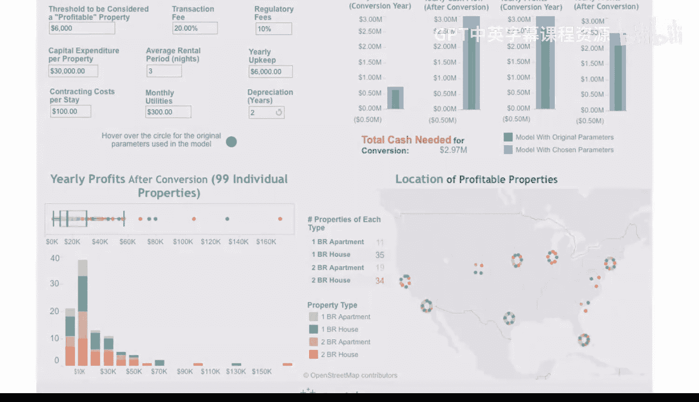

# Excel 到 MySQL：商业分析：5：分析师专用仪表板 📊


在本节课中，我们将学习如何构建一个用于测试财务模型假设的分析师专用仪表板。我们将探讨仪表板的设计目的、核心组件、可视化技巧，并理解它与演示文稿的区别。

---

## 仪表板概述与核心原则

首先，需要明确仪表板的核心用途。仪表板旨在将所有必要信息集中展示，以便快速、高效地做出决策。这意味着仪表板上会包含大量信息，布局可能较为紧凑。

**仪表板与演示文稿有本质区别**。你绝不会在演示文稿的一页幻灯片上放置整个仪表板，因为观众会无所适从，你无法控制他们的视线焦点。此类仪表板仅用于**分析研究**，无论是供自己分析，还是供他人审查模型结果。

构建仪表板通常有两个目的：一是说服自己模型的可靠性，二是说服他人模型的可靠性。因此，在向他人展示前，务必了解对方偏好的信息呈现方式。

---

## 仪表板结构解析

以下是专为分析师自己设计的仪表板布局，我们将逐一解析其各个部分。

### 参数与假设区域

在屏幕的这一区域，集中了模型的所有财务假设参数。每个假设都有一个独立的参数输入框，可以在此进行调整。

**公式/代码表示参数**：
`参数值 = 用户输入(例如：折旧年限=3)`

### 核心决策指标

接下来是用于决策的核心指标。这里使用条形图展示了八项关键指标，这些指标分为四组，每组包含两个条形。

以下是这四组指标：
1.  **盈利房产的年现金流（转换年）**：此条形图展示所有被认为盈利的房产（基于设定的盈利阈值，例如$6000）在转换年份产生的总现金流。
2.  **盈利房产的年现金流（转换年后）**：此条形图展示所有盈利房产在首个转换年份之后所有年份的总现金流。
3.  **盈利房产的利润（转换年）**：此条形图展示盈利房产在转换年份的总利润。
4.  **盈利房产的利润（转换年后）**：此条形图展示盈利房产在转换年份之后的总利润。

在每个条形图中，都包含两种条形：
*   **深蓝色条形（内侧）**：代表基于模型**原始假设**计算出的盈利房产总利润或现金流。
*   **浅蓝色条形（外侧）**：代表根据屏幕左侧**当前输入的参数**计算出的利润或现金流。

**关键交互**：当更改任何参数时，深蓝色条形保持不变，而浅蓝色条形会相应变化。这直观地展示了参数变动相对于原始基准的影响。

此外，该区域还显示了基于当前参数，转换所有盈利房产所需的**总现金**。仪表板中除深蓝色条形外的所有部分，都基于当前输入的参数进行计算。

---

## 数据详情的可视化

上一节我们介绍了聚合数据的展示方式，本节中我们来看看个体层面的数据是如何呈现的。

屏幕下半部分展示了未聚合的个体盈利房产数据。

### 箱线图与直方图

屏幕左上方的图表是一个**箱线图**，每个点代表一处房产在转换为短期租赁后（考虑转换年）可预期的利润。将鼠标悬停在数据点上，可以查看该房产的详细数据。

下方的图表是一个**直方图**。直方图将X轴上的所有数值划分到不同的区间（例如，每$10,000为一个区间），然后统计每个区间内数据点的数量。

**公式/代码表示直方图区间**：
`区间 = [下限, 上限)，例如：[60000, 70000)`
`计数 = 满足 下限 ≤ 利润值 < 上限 的数据点数量`

例如，根据示例模型，大多数房产的利润集中在$10,000到$30,000的范围内，同时存在少数高利润的异常值，这些是需要重点考虑转换的房产。

### 地理位置分布图

屏幕右侧的地图展示了每处个体房产的地理位置。这里使用了一种称为**“抖动”**的技术。由于数据集中许多数据点地理位置相同，若使用普通地图，它们会完全重叠。“抖动”技术将这些来自同一地理位置的数据点，均匀地分布在该位置周围的一个圆形区域内。

**代码逻辑表示抖动**：
```python
# 伪代码：为每个相同坐标的点添加微小随机偏移
for each group of points with identical coordinates:
    for each point in the group:
        point.x += random(-offset, +offset)
        point.y += random(-offset, +offset)
```

### 交互式高亮功能

此仪表板的一个实用功能是**交互式高亮**：
*   点击地图上的一个数据点，它会同时在箱线图和直方图中被高亮显示。
*   同样，点击箱线图或直方图上的数据点，也会在地图和另一个图表中高亮对应部分。
*   要取消高亮，只需再次点击该数据点即可。
*   将鼠标悬停在任何数据点上，都可以看到其具体的数值。

---

## 动态更新与总结



最后，仪表板实现了全局联动更新。当更改参数时，不仅图表数据会变，连仪表板的标题也会动态更新，例如显示当前参数下的“盈利房产总数”。


本节课中我们一起学习了如何构建一个功能全面的分析师仪表板。我们明确了其用于分析的核心定位，剖析了包含参数区、核心指标、个体数据可视化（箱线图、直方图、地图）的结构布局，并体验了交互式高亮和动态更新等关键功能。记住，仪表板的设计应服务于分析和验证模型本身，你可以根据自身需求灵活调整其视觉呈现。在接下来的课程中，你将看到为不同受众修改后的仪表板版本。