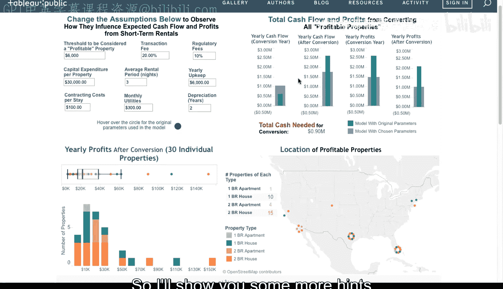

# 杜克大学《Excel 到 MySQL：商业分析（5课全）｜Excel to MySQL： Analytic Techniques for Business》中英 p173 17_05_03_面向财务受众的仪表板调整.zh_en -BV1mS421X7yw_p173-

Hi guys， in the last video I showed you the dashboard I made for myself to investigate whether or not the parameters in my watershed model would affect the outcome of my decision about whether or not watershed should change their properties into short term rental properties In this video。

 I'm going to show you how I slightly modified that dashboard according to the preferences of my audience。

 So let's go ahead and bring it up。So this is the dashboard I made for myself。

Everything is going to say mostly the same in the dashboard I made for a different audience。

 except these graphs are going to change。I was told by by some people I asked for advice from that they were not used to looking at histograms and they were not used to looking at scatter plots or box plots and that happens often actually especially when people spend a all lot of time in the finance world。

 they're really used to looking at spreadsheets and lists and they have a hard time pulling information out of visualizations they're not used to looking at。

 So they asked to have that information in the form of basically an Excel spreadsheet which I've put here as a list So instead of having the scatter plot and the histogram to show the information about each individual profitable property I've now put that information in a table that can be scrolled through and that will change depending on the parameters in these。

In these boxes here， so I've shown the property ID， the state， the city， the type。

 the number of bedrooms and the cash flow and the year of conversion that you would get from that property。

😊，And the profits after the conversion year from that property in case you wanted to order the properties and。

Buy those value separately， although they will give you the same ordering。

 So this might be more comfortable to certain types of audience members。

I do want to take one second to say that even if your audience is more comfortable looking at spreadsheets or lists like this。

Don't ever or at least hardly ever put a list like this or a spreadsheet like this in an actual presentation or in a slide。

 they will almost definitely not be able to read this information and it's too much to put in one place it won't actually walk them through a story so if they insist on having a list。

 you can put it in a dashboard like this or you can put it in a white paper or they send it to them in an email but don't put it in a presentation just want to make sure you remember that。

I did want to show you one more feature of actually both dashboards that I didn't point out in the last video and that's this little feature here。

 this is a little trick that can be helpful sometimes so what if you're like me and you're forgetful and forget what values are supposed to go in these boxes or values you used in your original assumptions for your original model。

I made this little cheat sheet here that allows you to hover over this dot and get all of the original assumptions that you made in your model and this is a trick that's actually very easy to do I will show you how to do it you basically make a mark on a worksheet and then you just edit the tooltip to have the information you want so some people use this to actually give audience members a directions they'll make something like this in a corner and they'll say click or hover over the dot for directions and so instead of having this information here that would actually have a big text page that shows them gives directions for how to use the dashboard。

I'm going to show you how to or I'm going to give you instructions。

 either written instructions or videos about how to do this， how to make these bar and bar graphs。

 how to how to make these jittered maps I'm going to remind you how to make these tables because they are kind of counterintuitive and tableableau Tableau is not originally designed for them and I will also give you either a video or written instructions about how to make these histograms you'll find they're all relatively easy to make except for the jittered map which does get a little tricky。

So hopefully that gives you some inspiration for what you might want to put in your own dashboard。

 but it's nice and easy to show you all these things you can click on。

 but I'm sure you're wondering how on earth do I get started？

I'd like to give you some advice about that。First of all。

 stare at this a little bit and just try to imagine， okay。

 what would you need in Tableau in order to create each one of these plots individually？As you stare。

 you'll start to realize a couple of different things。First。

 each one of these bars or data points has to come from some type of variable。

 so that means there has to be some type of either measure or dimension in tableableau that has each one of these measures。

 That means you should be thinking about making。A column in your Tableau file in your Tableau workbook that has the yearly cash flow just for the conversion year。

The yearly cash flow， just for the years after conversion， the yearly profits。

 just for the conversion year and just the yearly profits for after the conversion year。

 but you also will have to make those columns using two different sets of parameters because the fact that these bars stay put means that they must be using different inputs than these so you're going to have to make two sets of parameters。

 one for the fixed bars for the original parameters and one that allows you to make the parameters dynamic so that they change so just to say that again。

 you're going to need to make a measure or dimension for every single one of these bars separately and you're going to have to define whether that measure dimension which will most likely be a calculated field uses fixed parameter set or whether it uses a dynamic parameter set So that means you will also have。

You have to make two parameter sets， one for your fixed values and one for your dynamic values。

One last hint I want to give you is that the fact that you're showing two different aggregated values in one graph and that each aggregated value actually aggregates a different number of properties because it's based on a different cutoff。

Means that you're not going to be able to define these aggregations based on a filter alone。

Because if you just said if you had a calculated feel， it just said profitable properties。

It would have to use either the fixed parameters or the variable parameters。

 it wouldn't be able to use them both。Or you could do it。

 but it would be an even more complicated calculation you would have to think about how you do it。

 so the easiest way to do this would be to make a calculated field。

Instead of a filter that says exactly which properties to aggregate in order to make these fixed bars and these variable bars。

 so I'll show you some more hints about exactly how to do that as well。

With those hints in mind， here's how I suggest you proceed。

I suggest you choose one of the blue bar charts and see if you can recreate it。

In yourself in Tableau， what you want to do is you want to see if you can get your blue bar to give you the same result as you got from your Excel spreadsheet。

 so when you add together all of the profits or the cash flow depending on which metric you choose in Tableau。

 do you get the same result is when you had all the profits or cash flow from the profitable properties in your Excel spreadsheet？

To do that， you're going to want to import data from Excel。

 and I suggest that you take the most raw data that you can。

Because what you should do is you should import that data and then make a calculated field for every column you made in your Excel spreadsheet。

If you do it that way， you should be able to end up with the same result and then once you get there。

 you'll be able to see how easy it is to make all these or all the rest of your visualizations。

So give that a shot and once you've got your final answer in your shorts， right？

Take a look at the next videos， good luck。