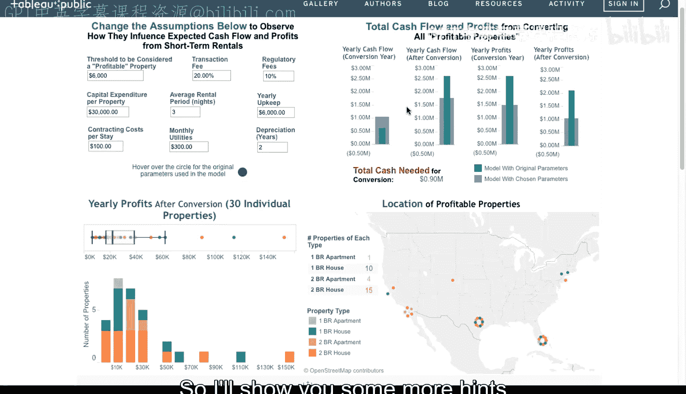

# Excel 到 MySQL：商业分析：5.3：面向财务受众的仪表板调整 📊

在本节课中，我们将学习如何根据特定受众（尤其是财务背景的受众）的偏好，调整和优化仪表板的设计与呈现方式。

---

在上一节视频中，我展示了为自己制作的仪表板，用于分析流域模型中的参数是否会影响关于是否应将物业转为短期租赁的决策。本节中，我们将看看如何根据受众的偏好，对该仪表板进行微调。

现在，我们来打开这个仪表板。这是我为自己制作的版本。

在为不同受众制作的仪表板中，大部分内容将保持不变，但部分图表会进行调整。我咨询的一些人告诉我，他们不习惯查看直方图、散点图或箱线图。这种情况实际上很常见，尤其是在金融领域工作的人，他们非常习惯于查看电子表格和列表，对于不熟悉的可视化图表，他们很难从中提取信息。

因此，他们要求以类似Excel电子表格的形式呈现这些信息，我已将其以列表形式放在这里。所以，我没有使用散点图和直方图来展示每个盈利物业的信息，而是将这些信息放入一个表格中。该表格可以滚动查看，并且会根据以下这些框中的参数变化而更新。

以下是表格中包含的信息列：
*   物业ID
*   州
*   城市
*   类型
*   卧室数量
*   现金流
*   转换年份
*   转换年份后的利润（如果你想单独对这些值进行排序，尽管排序结果会相同）

对于某些类型的受众成员来说，这种形式可能更舒适。

我想花一点时间说明，即使你的受众更习惯于查看这样的电子表格或列表，也永远不要（或至少几乎不要）在实际的演示文稿或幻灯片中放入这样的列表或电子表格。他们几乎肯定无法阅读这些信息，而且内容太多，无法有效地引导他们理解整个故事。如果他们坚持要列表，你可以将其放在这样的仪表板中，或者放在白皮书里，通过电子邮件发送给他们，但不要放在演示文稿中。请务必记住这一点。

我还想向你展示两个仪表板中都有的另一个功能，我在上一个视频中没有指出，就是这里的这个小功能。这是一个有时会很有用的小技巧。如果你像我一样健忘，忘记了这些框中应该输入什么值，或者忘记了原始模型中使用的原始假设值，该怎么办？

我在这里制作了这个小备忘单，允许你将鼠标悬停在这个圆点上，以获取你在模型中做出的所有原始假设。这实际上是一个非常容易实现的技巧，我会向你展示如何操作。你基本上是在工作表上做一个标记，然后编辑其工具提示，填入你想要的信息。有些人会用它来给受众提供指示，他们会在角落制作类似这样的东西，并写上“点击或悬停圆点查看说明”。这样，就不必在这里放置大段文字来说明如何使用仪表板。

我将向你提供说明，无论是书面说明还是视频，教你如何制作这些条形图、抖动地图。我也会提醒你如何制作这些表格，因为它们的制作方式有些反直觉，Tableau 最初并非为此设计。我还会提供关于如何制作这些直方图的视频或书面说明。你会发现，除了抖动地图有点棘手外，其他都相对容易制作。

希望这能给你一些灵感，思考你想在自己的仪表板中放入什么内容。这些可点击的内容展示起来既美观又简单，但我相信你一定在想：我到底该如何开始？

我想给你一些建议。首先，盯着这个仪表板看一会儿，试着想象一下：要在 Tableau 中单独创建这些图表中的每一个，你需要些什么？当你仔细观察时，你会开始意识到几件事。

第一，这些条形或数据点中的每一个都必须来自某种变量。这意味着在 Tableau 中，必须有某种度量或维度来对应这些度量值。这意味着你应该考虑在你的 Tableau 工作簿中创建列。

以下是需要创建的列：
*   仅针对转换年份的年度现金流
*   仅针对转换后年份的年度现金流
*   仅针对转换年份的年度利润
*   仅针对转换后年份的年度利润

但是，你还必须使用两组不同的参数来创建这些列，因为这些固定不动的条形意味着它们使用的输入参数与这些可变的条形不同。所以，你需要创建两组参数。

以下是需要创建的参数组：
*   一组用于固定条形（原始参数）
*   一组用于实现参数动态变化

再强调一次，你需要为每一个条形单独创建一个度量或维度，并且必须定义该度量或维度（很可能是计算字段）是使用固定的参数集还是动态的参数集。这意味着你还必须制作两个参数集，一个用于固定值，一个用于动态值。

我想给你的最后一个提示是：你在一个图表中展示了两个不同的聚合值，而每个聚合值实际上聚合了不同数量的物业（因为基于不同的阈值），这意味着你将无法仅基于筛选器来定义这些聚合。

因为如果你只有一个计算字段，它只会使用固定参数或可变参数中的一种，而无法同时使用两者。或者你也可以做到，但那将是一个更复杂的计算，你必须思考如何实现。所以，最简单的方法是创建一个计算字段（而不是筛选器），来精确指定哪些物业应该被聚合以生成这些固定条形和可变条形。我也会给你更多关于具体如何操作的提示。

---

考虑到这些提示，以下是我建议你进行的步骤。

我建议你选择一个蓝色条形图，看看能否在 Tableau 中重新创建它。你要做的是，看看能否让你的蓝色条形图得到与 Excel 电子表格相同的结果。当你在 Tableau 中将所有利润或现金流（取决于你选择的指标）相加时，得到的结果是否与 Excel 电子表格中所有盈利物业的利润或现金流总和相同？

要做到这一点，你需要从 Excel 导入数据。我建议你使用最原始的数据。因为你应该做的是导入数据，然后为你在 Excel 电子表格中创建的每一列都制作一个计算字段。如果这样做，你应该能得到相同的结果。一旦达到这一步，你就能看到制作所有其他可视化图表是多么容易。

所以，尝试一下吧。当你得到最终答案后，请看下一个视频。祝你好运。

---

本节课中，我们一起学习了如何根据财务受众的习惯调整仪表板，将图表信息转换为更易读的列表形式，并了解了在演示中合理呈现数据的重要性。我们还探讨了在 Tableau 中重建此类分析仪表板的核心思路，包括创建必要的计算字段、参数集，以及从原始数据开始逐步构建可视化组件的方法。