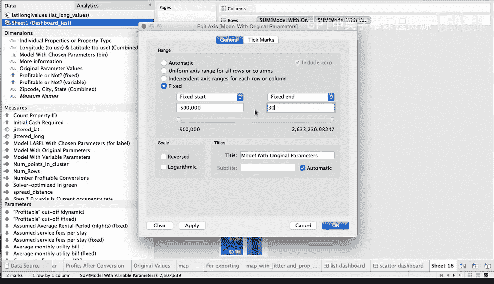

# 杜克大学《Excel 到 MySQL：商业分析（5课全）｜Excel to MySQL： Analytic Techniques for Business》中英 p174 18_05_02_Tableau中的柱中柱图表.zh_en -BV1mS421X7yw_p174-

Hi guys， if you're watching this video， that means that you have been able to replicate the results you got in Excel in Tableau。

 that's a great accomplishment you should be very proud of yourself and you're gonna to be glad you did it because there's gonna to be a lot of fun stuff you can do in Tableau now that you've been able to get your basic model into a format that Tableau can read and that you can use。

😊，In this video I'm going to show you how to make those bar and bar charts I showed you in the dashboard examples we saw in previous videos in order to do this。

 you're going to need to make sure that you have one set of parameters for your fixed values and one set of parameters for your variable values when I say fixed I mean the original assumptions you made in your model when I say dynamic or variable I mean the parameters or the assumptions that you're going to change in order to see how they influence the outputs of your model。

So make sure again that you have one set of parameters for your fixed values and one set of parameters for your variable values and then also make sure that you have one set of measures that refer to the fixed parameters and a different set of measures that refer to the variable parameters once you have that you'll be ready to make your barn part chart so let's go ahead and see how we do that。

So if we bring up Tau， I want to point out before we start your worksheet is going to look totally different than mine。

 you are not going to replicate exactly what I have here。

 so all of your variable names are going to be called something different and all of your parameter names are going to be called something different use this video and all the videos you see in this capstone project from now on as an example of the concepts of how you would make a graph but don't try to copy it exactly because you're going to have set up your worksheets a little differently So one more time just use this for the concepts of how to make these graphs rather than how to do it exactly in your worksheet。

So the first thing I need to show you is how to make the calculated fields that will let you aggregate only the properties that are profitable based on the original assumptions in your model。

 and then make a separate filter or separate calculation that aggregates only the properties that are profitable based on the new assumptions or new parameters you've entered into your model。

To do that， you're going to need to make different sets of parameters and calculations so you're going to start by making。

One parameter that has a cutoff for your dynamic model and one parameter that has a cutoff for your fixed model when I say dynamic in all these cases。

 by the way， or let's start with fixed， when I say fixed that means this is the model that's going to use the original assumptions。

 financial assumptions you made and that you got from solicitlicitation when it's say dynamic or sometimes I'll say variable model that means it's the model that is using the new assumptions that you've entered via your parameters。

Okay， so that's going to use that terminology from now on。So make sure you have these two parameters。

 Then you're going to make a set of calculated fields that are going to make a binary output。

 You're going to make one for fixed model and one for the variable model， the fixed one。

Is going to say， I should say the goal of this is just to make a binary output that says， yes。

 this is a profitable property based on my assumptions or not。And in this case， we want to say yes。

 it's a profitable property based on my original assumptions。

 So we're going to say if the profits after conversion。

Using my fixed parameters are greater than the cutoff I've set for my fixed model。Then。

 output put a one。Else outputs at zero。The variable calculation will do something similar。

 except that this calculated field。I going to be for the dynamic version。

 so this calculation uses the dynamic parameters that are all set down here that's going to say if that calculation is greater than my dynamic profitable cutoff。

Then one。Okay。Then you're going to need to make one more calculation in order to aggregate the fixed profitable properties separately from the variable profitable properties。

You're going to make。Need to make another calculation that says， if。

It's profitable based on this calculation， then I just give me the value。If not。

 then give me a null value， take it out Okay， so what this this calculation does is it's going to only output。

The calculation only output the profit。From this calculation。

If it's profitable based on this calculation and based on the profitable parameters。

The variable one will be similar。Except it's going to have in the profitable or not variable version。

And it's going to calculate profits based on the dynamic parameters。So by doing this， now。

 when you put these two measures onto your workspace。

 this measure will only show the properties that surpass the cutoff。Based on the fixed model。

 fixed parameters， and this one will only show properties。

 and only aggregate properties that have profits that surpass the variable cut off and that use the variable or dynamic parameters。

Okay， so that's how you would filter these two different measures separately without using the filter shelf。

That's the most complicated part of this visualization， everything else is going to be much simpler。

So how do you make the bar and bar graph， I'm going to double click。One of my variables。

 I'm going to bring the other one out next to it on the row shelf。As you would expect。

 it's putting each one of these measures on a separate row。

What we want to do is we want to put the two measures on the same row and we want to actually put it in the same graph。

 The way to do that is you go to the pill that's all the way to the right。

 someone that's farthest to the right， click on the drop down and then click dual axis。

What it's doing is it's automatically putting both of these measures in this visualization and it's putting this mark。

 which is actually associated with the variable parameters。Using this axis。

 and there's one underneath that that you can't see right now that's using this axis。

So I do want to let me I'll show you how to change these in a second， I'll explain this more。

 but let me make these into bar graphs just to make it a little easier to see and I'm going in order to show you the bar behind it。

 Im going to say move marks to the front。So now let me explain what I just did。

This mark represents the aggregated sum of the profits based on the model that used the original parameters。

 I can change that mark individually I using the marks card。

 So this you can see that you could either click on all。

Or you can click on a panel that has just this measure or on a panel that has just this measure I want to use my variable one first and now I can change either the type of market is I can make it a circle if I didn't want to have a bar we want it to be a bar。

And I can change the size。 Since this is my fixed parameter。 I want this one to be smaller， I said。

 so I can change the size。 And now when I click out here。

 you'll see that this bar is now smaller than the outside bar。

 If I wanted to change the color or the size of this one， which is my variable parameters。

 I would click on this panel and then I could change the size here so I could either make it bigger。

Or smaller。Okay。Now there's an important thing you need to do now that you can see both of your marks。

 you can see that this data point is shown on a different axis than this one This one goes from zero to 200。

2。2 million and this one goes to 0 to 2。6 million。 you really need these to be on the same axises to do that。

 you right click on either axis and you click on synchronize axis。Now， forevermore。

 whenever either one of these marks are shown， they're going to be shown on the same axis。

 the axis will have the same minimum and maximum value。

If you want to clean this up so that you don't have to actually see the axes on both sides。

 you can go to the pill。Go to either pill。 this pill is the one on the right and you'll see that show header has a check mark next to it if you unclick that。

All of that will go away。 You can do the same thing in this one。 You can also。

Oops you can also just right click on the axis and say show header if you want to get it back。

 you would go to the pill， click on the drop down and say show header。

There are a couple other things that'd be useful to show you here if you want to change the formatting of these numbers。

 you can format them， so I right clicked and then I clicked on format。

Here under scale this numbers option is where you would change that so on my dashboard I have this in terms of millions instead of thousands so you can click on this dropdown。

 you can go into currency custom and you can change how many decimal points you want to see whether it has a prefix。

 whether it has a dollar mark in front of it and what type of units so if we want to change it to millions。

 you would change that here and you can make it one decimal point or two。

And that will change the number formatting。 you can also change the size， of course， of your text。

And the format and the font and all that kinds of good stuff too。If you want to change the title。

You can double click on the access and you can either erase the title here or change it here。

Now an important thing to point out right now is that it's automatically tableableau is automatically determining the minimum and maximum value of the axis if we want to change that we would have to choose fixed and we are going to want to change that because of an important thing。

嗯。So let me say cancel for a second。The reason why is because in our original dashboard。

 this is my dashboard here， we have four of these graphs， each one of these shows a different metric。

 so this again is the cash flow for the conversion year， cash flow for after conversion， profits。

 for the conversion year， profits for after conversion and so on。

There is really no easy way to make all four of these visualizations in the same worksheet。

 so what I suggest you do， although there are other hard ways to do this。

 but what I suggest you do is make each one of these bar and bar graphs in its own worksheet and then you should insert them into your dashboard as a floating object so these here are all floating objects and I can move them around separately。

In order to do that， you might want to do one more thing with formatting though。

You can see these lines here in this graph we just made。

 if you want to get rid of those so that they don't show in your dashboard。

 you can see they don't show in my dashboard here。Then you can once again format your graph。

 I'll show you a different way this time， go up to the format menu and click on borders。

 you can also do that by pretty much clicking in any part of your graph and clicking format what you want to do is you want to go to this icon here that has the little square and you'll see that these options down here have lines in them right now you want to make those be none in order to get rid of the lines。

And now， if you brought that into your dashboard， there wouldn't be any lines。

The reason I mentioned axes before is because if you are going to put them all together on your dashboard。

 you want to make sure they all have the same ax， so you're going to want to go in by hand and say what the axes should be。

 I made mine minus 0。5 million up to 3 million。So in order to do that。

 you could double click on the axis。And I would start with。us 500，000。

 and I would make it go up to 3 million。

And that's how you make your bar and bar graph， great job， have fun with it。

