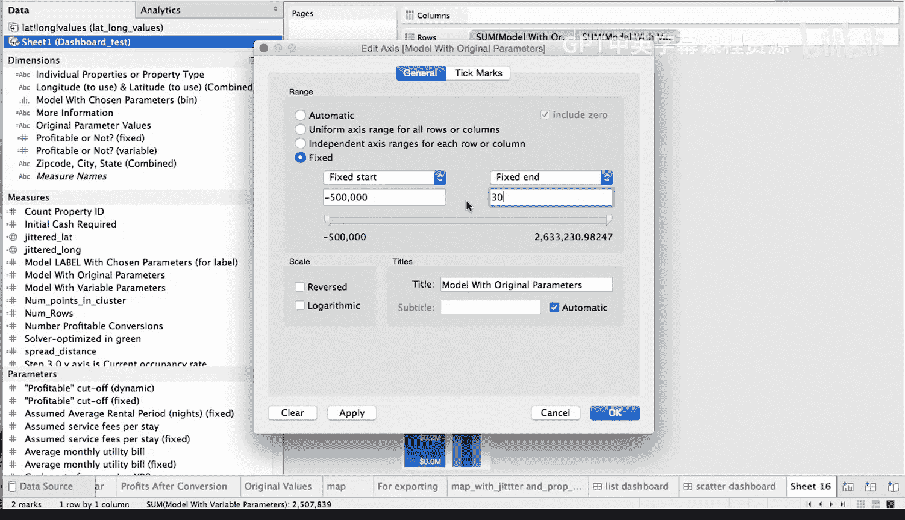

# Tableau 商业分析：第 18 章：在 Tableau 中创建柱中柱图表 📊


在本节中，我们将学习如何在 Tableau 中创建柱中柱图表。这种图表常用于在同一个图形中对比基于不同参数集（例如原始假设与动态假设）的计算结果。

上一节我们成功将 Excel 模型导入 Tableau。本节中，我们来看看如何利用这些数据创建直观的对比图表。

## 准备工作

在开始制作图表前，需要确保数据已正确设置。

以下是创建柱中柱图表所需的数据结构：
*   **固定值参数集**：代表模型中原始的、不变的假设。
*   **变量值参数集**：代表用户可以通过参数面板动态调整的假设。
*   **引用固定参数的度量集**：基于固定参数计算出的指标（如利润）。
*   **引用变量参数的度量集**：基于变量参数计算出的指标。

## 创建核心计算字段

创建图表的第一步是构建用于筛选和聚合数据的计算字段。

### 1. 创建阈值参数

首先，需要创建两个参数，分别作为判断“盈利”的阈值。
*   **固定模型盈利阈值**：用于基于原始假设的模型。
*   **变量模型盈利阈值**：用于基于新假设的动态模型。

### 2. 创建二元判断字段

接下来，创建两个计算字段，用于判断每个房产在对应模型下是否盈利。它们将输出 1（盈利）或 0（不盈利）。

**固定模型盈利判断** 公式逻辑如下：
```
IF [基于固定参数的利润] > [固定模型盈利阈值] THEN 1 ELSE 0 END
```

**变量模型盈利判断** 公式逻辑类似，但引用变量参数和阈值：
```
IF [基于变量参数的利润] > [变量模型盈利阈值] THEN 1 ELSE 0 END
```

### 3. 创建条件聚合字段

最后，创建两个用于图表展示的度量。它们只聚合那些被判断为盈利的房产的利润值。

**固定模型利润（仅盈利）** 公式逻辑如下：
```
IF [固定模型盈利判断] = 1 THEN [基于固定参数的利润] END
```
此字段仅当房产在固定模型下盈利时，才输出利润值，否则为 `NULL`。

**变量模型利润（仅盈利）** 公式逻辑如下：
```
IF [变量模型盈利判断] = 1 THEN [基于变量参数的利润] END
```
此字段仅当房产在变量模型下盈利时，才输出利润值。

通过以上步骤，我们得到了两个独立的度量，它们分别汇总了在不同参数假设下达到盈利阈值的房产总利润。这是实现柱中柱对比可视化的核心。

## 构建柱中柱图表

现在，我们开始将计算出的度量转化为柱中柱图表。

### 组合两个度量

1.  将 **固定模型利润（仅盈利）** 度量拖入行功能区。
2.  将 **变量模型利润（仅盈利）** 度量也拖入行功能区，放在第一个度量的右侧。此时，两个度量会显示为上下排列的两个独立条形图。
3.  点击最右侧度量胶囊的下拉菜单，选择 **双轴**。Tableau 会将两个度量合并到同一个图形区域，并使用两个独立的 Y 轴。

### 调整标记类型与样式

1.  在“标记”卡中，确保视图类型为 **条形图**。
2.  点击“标记”卡顶部的下拉列表，可以选择 **全部**、**固定模型利润** 或 **变量模型利润** 来分别设置每个度量的样式。
3.  选择 **变量模型利润** 面板。可以调整其颜色和大小。通常，我们希望外层的柱子（变量模型）更大或颜色更突出。
4.  选择 **固定模型利润** 面板。调整其大小，使其略小于外层柱子。还可以点击“标记”卡上的 **前景** 按钮，确保内层柱子显示在前端。

### 同步坐标轴与清理视图

1.  右键单击任意一个 Y 轴，选择 **同步轴**。这确保两个度量使用相同刻度的 Y 轴，使对比更准确。
2.  若要隐藏多余的轴标题以简化视图，可以右键单击轴并取消勾选 **显示标题**，或者点击对应度量胶囊的下拉菜单取消勾选 **显示标题**。

## 高级格式设置

为了使图表更专业并适应仪表板布局，可以进行以下格式调整。

### 调整数字格式

右键单击 Y 轴，选择 **格式**。在格式窗格的 **刻度** > **数字** 区域，可以设置数字显示为货币、添加千分位分隔符、调整小数位数，甚至将单位设置为“千（K）”或“百万（M）”。

### 自定义坐标轴范围

在包含多个类似图表的仪表板中，保持所有图表的 Y 轴范围一致非常重要。
1.  双击 Y 轴。
2.  在弹出窗口中，选择 **固定** 范围。
3.  手动输入 **最小值** 和 **最大值**（例如，-500，000 到 3，000，000）。

### 移除网格线和边框

1.  点击菜单栏的 **格式** > **边框**。
2.  在格式窗格中，点击代表 **行** 或 **列分隔符** 的图标（通常是一个小网格图案）。
3.  将 **行分隔符** 和 **列分隔符** 的线条设置为 **无**。这将移除图表内部的网格线，使仪表板看起来更简洁。

## 在仪表板中整合多个图表

通常，一个仪表板会包含多个展示不同指标（如转换年现金流、转换后利润等）的柱中柱图表。

以下是整合建议：
*   为每个指标（如现金流、利润）**单独创建一个工作表**，并按照上述步骤制作柱中柱图。
*   在新建的 **仪表板** 中，将这些工作表作为 **浮动对象** 添加进来。这样可以自由地移动和排列每个图表，确保布局整齐美观。
*   确保所有图表的 Y 轴范围已按前述步骤设置为相同的固定值。

---



本节课中我们一起学习了在 Tableau 中创建柱中柱图表的完整流程。我们从准备数据和创建核心计算字段开始，逐步构建出对比图表，并学习了如何调整样式、同步坐标轴以及进行高级格式设置，最后探讨了在仪表板中整合多个此类图表的最佳实践。掌握这些技巧后，你将能有效地在 Tableau 中可视化并对比基于不同商业假设的分析结果。