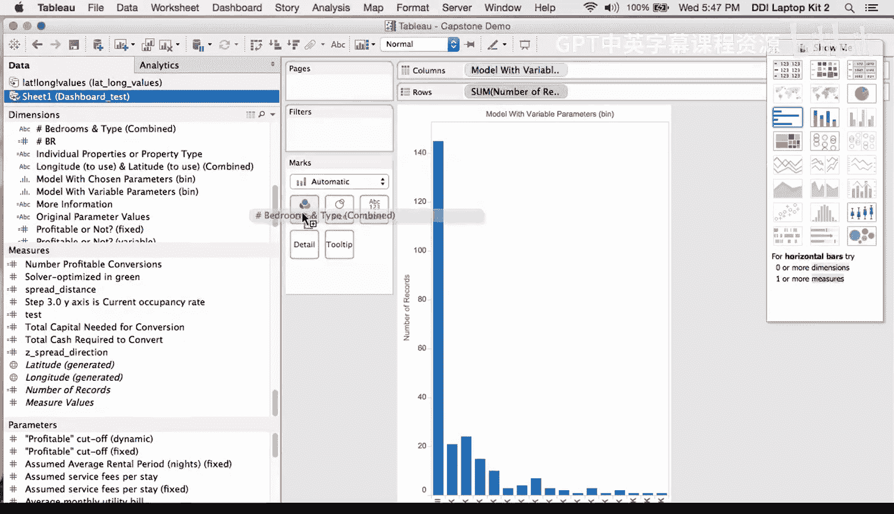

# 杜克大学《Excel 到 MySQL：商业分析（5课全）｜Excel to MySQL： Analytic Techniques for Business》中英 p175 19_05_03_Tableau中的直方图.zh_en -BV1mS421X7yw_p175-

In this video， I'm going to show you how to make histograms in Tau。

 Remember that this video is just going to show you the concepts of how to make histograms。

 Your worksheets are going to look different than mine and are going to have different variable and parameter names。

To get started， I want to make sure I go over again exactly what a histogram is。

A histogram is a type of bar graph that lets you see easily the distribution of values you have in a column of data。

Here is how they work。First， you divide up the possible values the data can hold into bins。

 usually of the same width。So if your minimum value in your data was 3 and the maximum value was 96。

 you might want to break your data up into 10 bins that are each 10 units in width so that your X axis includes possible values of 1 to 100。

You can certainly break your data up into even more bins or make the bins represent values much less than the minimum value or much more than the maximum value the main idea is just to make sure you set up your bins so that all your data can be represented somewhere in your histogram。

Next， you count up how many of your data points of values that are within the span of each bin。

So if you had three data points that were 13， 16 and 18， they would all go in the 11 to 20 bin。

 if you had two data points that were 42 and 47， they would go in the 41 to 50 bin。

After you place all your data in the appropriate bin。

 a histogram then puts the bins on the x axis on the number of data points in each bin on the Y axis。

In the end， you get something like this。You can see from this histogram that most of the data in the data set is down here in the 21 to 30 bin。

You can also see that visualizing your data as a histogram makes it really easy to pick out extreme values Extreme values will always be at the outside edges of the histogram away from the rest of the data。

The one thing that can be tricky about histograms is that you do have to pay attention to what the labels mean because there is no agreed upon convention。

Sometimes thell labels are explicit and give you the full range of values in each bin。

 but that takes up a lot of space， so it's not very common。More often。

 you will see programs label each bin with the median or middle value of that bin。

Labeling your histograms that way looks like this。Occasionally。

 programs will have yet undiffer naming system。 For example。

 Tableau labels its spins with a lower limit of the range of the numbers assigned to each bin。

 and that number is inclusive。 So this histogram would be labeled like this in Tableau and the label 20 would mean that bin includes numbers greater than or equal to 20。

 but less than 30。I make histograms all the time， and I find them extremely useful for summarizing raw data。

 You should be aware that many people in business are not used to looking at them， though。

 So you would probably want to get an idea of what type of audience you are going to have before you would consider using them in a presentation。

 If you do want to use them， Tableau makes them very easy。Now that we know what histograms are。

 let's make some histograms in Tableau。It's usually very。

 very simple one way to do it is simply to take a model or a measure you're interested in。

 bring it into the row shelf。Coops。And then click this histogram on the show me cardt。

And you can see that it will make all of your bins down here。

 and it will automatically count how many of those values are in that bin。

Now I chose this variable to give you a hint for when you do your own calculations。

 this measure that I made is a calculated field that only reports out property properties that meet the profitable cutoff so there are a lot of properties that are turned into nulls and that's shown here in this bin。

 you can get rid of that in your histogram by right clicking and then clicking on excludec。

So that would be your final histogram if you then want to label each of the each of the properties that go in these bins。

 you can use the color shelf and I made a variable that combines bedrooms and type as a reminder of how to do that you can click。

To。Varis。So make sure they're selected at the same time。

And then go to create and you can do a combined field so we learned how to do that in the tabau course and you can do that again here if you want to just to make your labeling easier so if you do make that combined field。

 then you can just take that variable， drop it on color。

And now you will get the histogram re got before。I do want to show you one thing that might be useful to you。

The way tableableau makes these histograms is that it takes your measure and it automatically breaks them up into bins。

 like I said， but it'll actually save out a variable that tells you what those bins are。

 So the variable that is being used to label this axis is actually now here on the dimensions pane。

 So if you click on that you can edit it and you can change the size of the bins。 So if we wanted to。

 we can make this 5000 instead of 10，000。 and now you're going to see twice the number of bins here。

So you can play with that as you like for your own histogram。If for some reason。

 you don't want to use the showmi card， the other thing you can do。It's clear sheet。

Is you can click on one of your measures。Click on the drop down。

Go to create and then go to bins and then it will make this variable for you and then you can just put。

Put one of these in your columns。And then you can put。Number of records。

And row and get your histogram again。Again， of course， you could put this one color again。

Nice work， I hope you'll find this useful for your dashboard。

