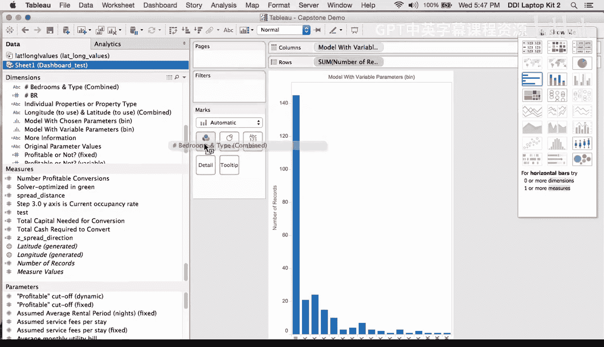

# Tableau 数据可视化：第 19 章：Tableau 中的直方图 📊

在本节课中，我们将要学习如何在 Tableau 中创建直方图。直方图是一种强大的数据可视化工具，它能帮助我们直观地理解数据集中数值的分布情况。我们将从直方图的基本概念开始，逐步演示在 Tableau 中创建和自定义直方图的步骤。

## 什么是直方图？

上一节我们介绍了课程目标，本节中我们来看看直方图的核心定义。直方图是一种特殊的条形图，它能让你轻松地查看数据列中数值的分布情况。

以下是其工作原理：
1.  **划分区间**：首先，将数据可能取值的范围划分为若干个“区间”。这些区间通常宽度相同。例如，如果你的数据最小值为3，最大值为96，你可能希望将数据划分为10个区间，每个区间宽度为10个单位，这样X轴就涵盖了1到100的可能值。
2.  **计数**：接着，统计每个区间内包含的数据点数量。例如，如果有三个数据点分别是13、16和18，它们都将归入“11到20”这个区间。如果有两个数据点分别是42和47，它们将归入“41到50”这个区间。
3.  **绘图**：在将所有数据点放入对应的区间后，直方图将区间放在X轴上，将每个区间内的数据点数量放在Y轴上。

最终，你会得到类似这样的图表。从这张直方图中，你可以看到数据集中的大部分数据都集中在下方的“21到30”这个区间内。

将数据可视化为直方图还能让你轻松识别极端值。极端值总是位于直方图远离其他数据的外侧边缘。

关于直方图，有一点需要注意：你必须留意坐标轴标签的含义，因为业界对此没有统一的约定。
*   有时标签是明确的，会给出每个区间的完整数值范围，但这会占用大量空间，因此并不常见。
*   更常见的是，程序会用每个区间的中值或中间值来标记区间。这样标记的直方图看起来是这样的。
*   偶尔，程序会有不同的命名系统。例如，Tableau 使用每个区间数值范围的下限来标记其区间，并且这个数字是包含在内的。因此，这个直方图在 Tableau 中会像这样标记，标签“20”意味着该区间包含**大于或等于20但小于30**的数字。

我经常制作直方图，发现它们对于总结原始数据极其有用。但你应该意识到，商业领域的许多人并不习惯看直方图。因此，在考虑在演示中使用它们之前，你可能需要先了解你的受众类型。如果你确实想使用它们，Tableau 让这一切变得非常简单。

## 在 Tableau 中创建直方图

现在我们已经了解了直方图是什么，让我们在 Tableau 中制作一些直方图。这通常非常简单。

一种方法是，只需将你感兴趣的度量值拖到“行”功能区，然后在“智能显示”卡片上点击**直方图**图标。

你可以看到，它会在下方创建好所有的区间，并自动计算每个区间内有多少个数值。

我选择这个变量是为了给你一个提示：当你进行自己的计算时，我创建的这个度量值是一个计算字段，它只报告达到盈利阈值的属性，因此有很多属性被转换成了空值，这显示在这个区间里。你可以通过右键单击该区间，然后点击“排除”来在直方图中移除它。

这样你就得到了最终的直方图。如果你还想标记进入这些区间的每个属性，你可以使用“颜色”功能区。我创建了一个结合了“卧室数”和“类型”的变量。作为如何操作的提醒，你可以同时选中这两个字段，然后转到“创建”菜单，选择“组合字段”。我们在 Tableau 课程中学过如何操作，如果你想让标签更简单，可以在这里再做一次。如果你创建了这个组合字段，那么只需将该变量拖到“颜色”功能区上。

现在你将得到之前看到的直方图。我想向你展示一个可能对你有用的功能。

Tableau 制作这些直方图的方式是：它会获取你的度量值，并自动将其划分为区间，但**它实际上会保存一个告诉你这些区间是什么的变量**。因此，用于标记这个坐标轴的变量现在实际上位于“维度”窗格中。如果你点击它，可以对其进行编辑，并更改区间的大小。例如，如果我们愿意，可以将其从 10，000 改为 5，000，现在你将看到这里的区间数量增加了一倍。你可以根据自己的直方图需求随意调整。

如果出于某种原因，你不想使用“智能显示”卡片，另一种方法是：先清空工作表，然后点击你的一个度量值，点击下拉菜单，转到“创建”，然后选择“数据桶”。它会为你创建这个变量，然后你只需将这个变量拖到“列”功能区，将“记录数”拖到“行”功能区，就能再次得到你的直方图。当然，你也可以再次将这个变量拖到“颜色”功能区上。

做得好！我希望你会发现这对你的仪表板制作很有用。

## 总结

本节课中我们一起学习了直方图的核心概念及其在 Tableau 中的创建方法。我们了解到直方图通过将数据划分区间并计数来展示分布，是识别数据模式和极端值的有效工具。在 Tableau 中，我们可以通过“智能显示”卡片快速生成直方图，也可以通过“创建数据桶”功能手动构建，并能灵活地调整区间大小、添加颜色编码以丰富信息层次。掌握这些技巧将帮助你更直观地分析和呈现数据。