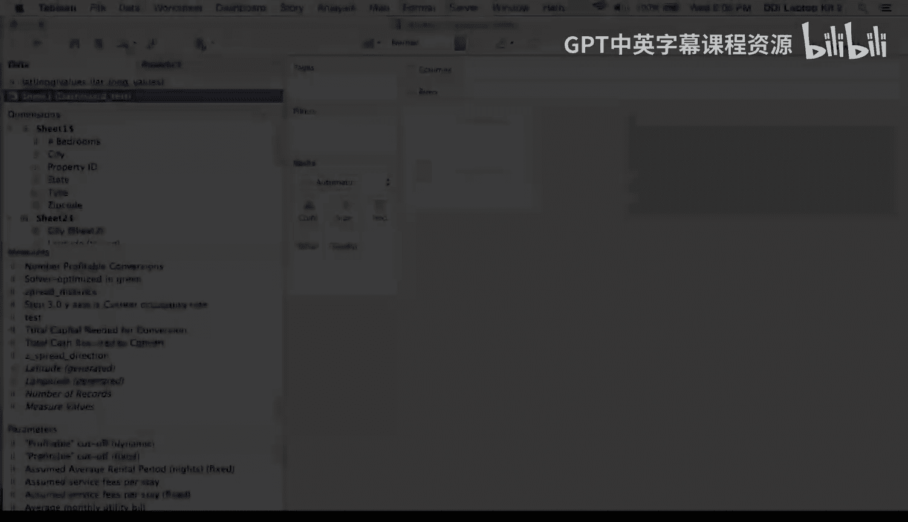
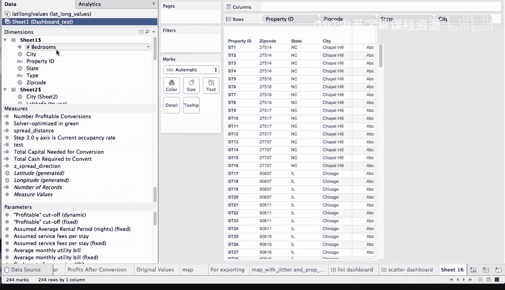
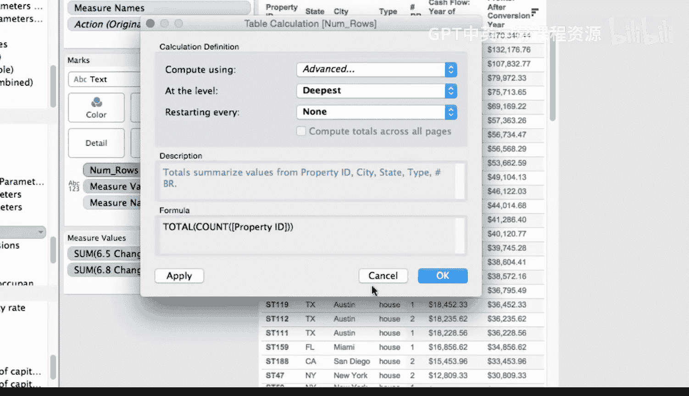

# 杜克大学《Excel 到 MySQL：商业分析（5课全）｜Excel to MySQL： Analytic Techniques for Business》中英 p176 20_05_04_Tableau中的表格.zh_en -BV1mS421X7yw_p176-

Hey there。We've gone over how to make barn bar charts and histograms。

 And this video we'll go over how to make tables。 You should have some idea how to make the tables based on all you learned in the Tableau course。

 But I will say that Tableau is not designed to make tables。 It was designed to make visualizations。

 You can now make tables because the business world just loves their tables and can't live without them。

 But because that isn't what Tableau is designed for， the interface is not intuitive。

If you don't know the tricks， you can drive yourself crazy trying to make tables if you do know the tricks。

 it will literally take you about two seconds to get what you want so I want to make sure it takes you two seconds and that you don't go crazy so let's see how we can do that。

And again， remember that all of my variable names and parameter names will look different than yours。

 so this is to show you just the basic concept so imagine we want to make a table like we saw in my dashboard where we have property ID。

 then state， then city type， number of bedrooms and then two measures。

So what we would do is all we're going to do is we're going to double click on all of the dimensions and measures we want。

 so I think the first thing I said was in that table is property ID so double click it。

 it's going to automatically go where we want it to go then we'll click zip code state city。

AndWe could click number of bedrooms and we could click type if we wanted to as well。

We're going to skip those for right now So now if we wanted some of our measures in these columns。

 all you would do is double click the measures so let's try some that I think might be useful。

And let's put in another one we can do。This one， How about。

And you can do that for as many measures as you want so you can see it's very easy to do since that was so quick to do I'll go ahead and show you a couple of formatting options that you might like if you want to get rid of these names for some reason you can always right click them and go to show header and unclick this option and they will go away if you do that by the way to get them back you have to go up to measure names up here in the column。

Show header now if you just want to change the name of the header that's shown there， you can。

Right click again。OopsAnd go to editit alias。This will let you change the name to whatever you want it to be so we can change it to cash flow。

Year of conversion。And youll see that the name changes， and you could do the same for this one。

If you want to change the formatting， you do it the same as anything else if you want to。

If you want to change the the way it's written， you would click on right or right click and then do format and this will let you。

Change the font。Here， or you can get rid of the borders in between each row。

 so this is the same as before， so these are now showing lines， if you want to get rid of them。

 you can click on none instead， you can also change the way you can see that these alternate or sometimes they will alternate some rows will be gray and some will be white。

 make it easier to look at， you can get rid of that by changing the row banding here if you want。

If you want to actually change the way the numbers are written。

 then you need to go to the measure values themselves so you can do format。And then go to numbers。

And remember how we did this before， you can go to currency， you can change the decimal places。

 you can change the units so you can make it thousands。

And you can use whatever decimal places you want。Now。

 if for some reason you forget to make the table this way。

 you'll find it gets very frustrating very quickly。

I'll show you one other way you can do it in case for some reason you find it easier。

I would not suggest that you do it by adding things directly to the text property on the marks card。

 which is what you would probably try to do and what seems intuitive instead what you need to do is you need to use the measured values。

And the measure names， variables that Tableau automatically makes for you。This is going to be weird。

 which is why I suggest you just use the double click strategy。

 but just in case this is useful to you， what you need to do is you need to bring the measure names variable onto the filter shelf。

If you don't bring it onto the filter shelf and you use measure names in the workspace。

 it's just going to include every single measure you have here and you don't want that。

 so I would unclick them by clicking none and then I would go and click the ones you're interested in。

We could choose something like。Like this one， for example。

And now you should include all of the dimensions that you're interested in， so property ID again。

 we wanted zip code。State。City。And now you would bring measure names。Onto the column shelf。

And then you would bring measure values onto the detail shelf。And you would click it down。

Go to the right the so there'll be a white space hover over that。

 go to this drop down and click on text。And that will give you what you had before and you can change the filters so that you can include different measures。

 the reason why I don't have values for all of these rows here is because that particular calculation I made will give no values when that property is not considered profitable。

 but that's the general strategy。That should give you the tables you're looking for。

While we're talking about tables， I thought we could go to one more thing one more feature I put in my dashboard that you might want to be able to use yourself so in my dashboard I had the title of the list dynamically show how many items how many profitable properties were in the list in order to do that you have to make a calculation and then you have to reference that calculation in your title so let's talk about the calculation first the calculation I made is called nu row and。

If I show you what's in the calculation。This is what the formula is the important thing is that the calculation is going to be based on what's in your workspace right then。

 so it needs to be a table calculation， it needs to reference okay how many things are in my table right now。

 the table that I'm looking at right now as it's getting filtered dynamically。

So because it needs to look at what's there right now as opposed to what's in each row。

 you need to make sure it's a table calculation， that's what total is。If we go。

 let me show you what it。What total actually does， It says returns the total for the given expression for all the database rows that contribute to the partition。

 So if you just did count， that would show you what's there for each row When do total。

 it gives you what's there for that partition。 And remember， partition refers to table calculations。

 So make sure that you use this formula。And then when you make your calculation。

 you're going to have to make sure you。Tell Tableau how it should be computing， so for me。

It should be summarizing values from。From all of these， all of these different fields。

When you hover over it。It tells you that's summarizing， but it's telling you how it's summarizing it。

 so whether it's partitioning or not， and what it's addressing。Once you make that。

 then you can include it in your title。 so if I double click on the title。

 it brings me up to this edit title workspace and all you have to do is。

Go to insert and you can insert anything you want， but you can insert anything in the workspace as well。

 so these are the parameters， but here are my all of my variables in my workspace。

 including the N rowse calculation， so if I click that。It will just insert it here whenever。

Has these these little symbols outside of the name of the parameter， the name of the calculation。

 that means it'll be dynamic， so that's how I made。The dynamic title。 and you could do so， too。

Nice work。 You almost know how to make everything on your dashboard。 Just a couple left。

