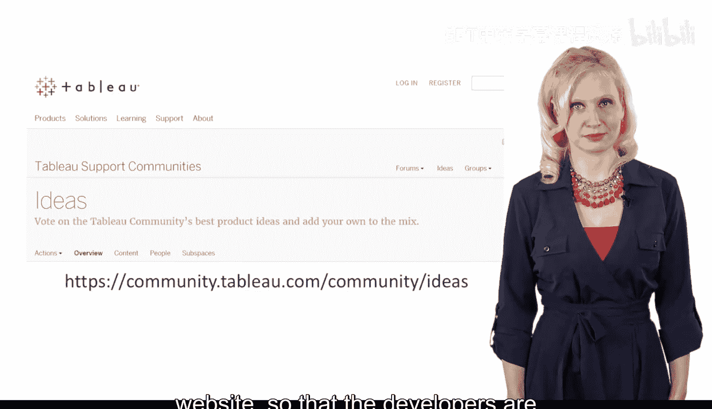

# 杜克大学《Excel 到 MySQL：商业分析（5课全）｜Excel to MySQL： Analytic Techniques for Business》中英 p177 21_06_01_为决策者准备仪表板.zh_en -BV1mS421X7yw_p177-

。Congratulations on doing your first sensitivity analysis in Tableau。By now。

 you should have replicated the results of your Excel watershed model in your Tableau dashboard using parameters and calculations。

In doing so， you might have noticed that it certainly would have been possible to develop the entire predictive and financial model in Tableau and skip using Excel altogether。

When you take on new projects in your own companies。

 you should decide for yourself when developing models in Excel or Tau would be most useful to you。

On that note， I wanted to make sure you knew that although Tableau doesn't have the equivalent of Excel's solver function built into its own software。

 Tableau can achieve the same capability through its integration with the statistical software R。

Tableau is set up so that anything you can do in R， you can visualize in Tableau。

So you could run your own custom state of the art， statistical models or optimization functions in R and pass parts of your equations into Tableau to make a dashboard that would help you visualize the effects of changing each part of those equations。

We aren't going to go over our integration with Tableau in this specialization。

 but have included some links in the course resources that will help you explore possibilities on your own。

For now， it's just useful to know that due to its R integration。

 Tlow actually is much more sophisticated prediction in data science capabilities than Excel。

The analyses are just a little bit more of a pain to set up the first time。This week。

 we want you to finish using your dashboard to assess the reliability of your model and then spend the rest of the week focusing on designing and formatting your dashboard so that it is ready to share with Watershed executives。

You will start off by making one more visualization， theitted map I demonstrated for you last week。

Then if you haven't done so already， make a first draft of a dashboard that will allow you to investigate the effects of changing your assumptions on the output of your model。

Change your assumptions systematically and try to figure out which assumptions change the results you your model the most。

How much do your model results change as you modify your assumptions and do they change in a way that would influence your recommendation？

Use your dashboard to figure out your final recommendation for watershed executives so they enter the short term rental market or not。

And if so， with what properties。Once you know what your recommendation is。

 spend the rest of the week designing and formatting a dashboard that will show watershed executives how your model supports your recommendation and how changes in your assumptions would influence your recommendation。

I'll warn you， going through the trouble to format a dashboard for an external audience will give you firsthand experience with two limitations in the current data visualization field。

The first limitation is that despite their popularity。

 dashboards are often very poor media for communicating the meaning of data。

They tend to pack in too much information in a very small space。

 so they are difficult to design in a way that will guide your audience's eyes and a clear path。

Until we find more creative ways to show large amounts of detailed information efficiently。

 you often have to compromise storytel ability in order to accommodate the amount of information that needs to be included in dashboards。

 That's not a big deal when you are making the dashboard for yourself。

 Since you know it to pay attention to， but it has more significant consequences when you are trying to use dashboards to convey information to an audience。

 That's part of the reason Tableau came up with the idea of story points， by the way。

Tableau stories are an effort to overcome the limitations of crowded individual dashboards。

The second limitation you will appreciate this week is that although Tableau is exceptional at allowing you to create graphs quickly and efficiently。

 it still sometimes struggles with allowing you to format those graphs in exactly the way you want。

There are a handful of functionalities that you don't discover are missing from the software until you try to make a dashboard with limited space。

These functionalities include things like being able to resize titles or column headers the way you want to。

Although there are often workarounds available for these issues that you can find on the Tableau community website。

 the workarounds can be cumbersome， which is hard not to notice when the rest of Tableau is so intuitive。

So you will see a lot of areas Tableau has room to grow this week。

When you find a missing capability that you really wish Tableau would implement。

 I suggest you post it in the ideas section of the Tableau Community website so that the developers are aware of the need for that capability。

Of course， even if you find some aspects of making dashboards to be not ideal。

 by the end of this week， you will also appreciate how useful dashboards can be for helping both analysts and businesses make decisions。

 Nothing beats being able to see all the important results of your analysis in one place。😊。

The ability to make a dashboard is a great skill to have as an analyst no matter what field you're in。

 so enjoy this last phase of your dashboard making and remember to check out the videos and links we've included with the course materials to help you out along the way。

😊。

