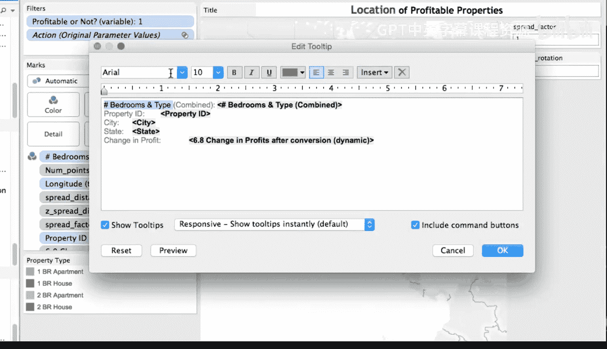

# 杜克大学《Excel 到 MySQL：商业分析（5课全）｜Excel to MySQL： Analytic Techniques for Business》中英 p178 22_06_03_Tableau中的抖动地图.zh_en -BV1mS421X7yw_p178-

Again。In this video， we're going to talk about the jittered map I showed you in my dashboard。

 I've included some written instructions about how to make the map with the course materials。

 So we're not going to go over every single detail here。

 but I did want to show you a couple of things that I think it would be useful for you to see visually。

 And I did want to point out one place in particular that I think if you're going to get tripped up。

 that's where you'll get tripped up。 So let's go ahead and take a look at how you make this thing。

So this is my version of the Jittered map and let me just talk you through what it's doing in general again。

 so the reason we're using this jittered map is that it would be useful to be able to see all of the properties within a given location that are profitable and also to see for each property。

 whether it's a one or two bedroom house or apartment。In order to do that。

 you have to be able to separate the points and there is no good way built into Tableau to do that。

If you tried to make a map like that， you would either end up with something like。

This where you have a different size depending on how many how much profit you have or how many properties。

 profitable properties you have， or you would end up with something like this where you just have one single data point when you'd have to hover over it say to find out how many profitable properties we in each location so that's not very informative that doesn't tell you exactly what you want by eye so the jittering technique says。

Take all the data that you're interested in。Look at it and say， okay。

 if there are any data points that are in the same geographic location， put them in a cluster。

Then we're going to distribute that cluster into a circle。

 the center of that circle is going to be on that shared common location。

What the instructions allow you to do and show you how to do is change how wide the circle is relative to the center point。

 the center shared location， and change how the circle。Turns around。

 so I just wanted to show you what that looks like。

And again this is all going be in the instructions this is just to show you what it looks like so there are two parameters the instructions tell you to make one is spread factor and spread rotation let's go ahead and open those and take a look at them and this is a good reminder about how to bring up a parameter control in your worksheet so I'm clicking on the dropdown and I'm bringing up show parameter control so the spread factor is going to it's basically defined the radius of the circle and I should also say that all the calculations you'll see are based on just the the geometry or the equations of how to make a circle so let me zoom in actually make this a little bit clearer it's go end Texas Texas is a good state has a lot of properties and this part of the visualization。

so each one of these is a mark， you can change the colors， of course， or the size。

 let's make the size a little bit bigger since we've zoomed in。

So what the spread factor will do is it will change how wide the circle is。 so right now it's one。

 if I change it to two， the circle is going to get wider。If I change it to 0。5。

The circle is going to get smaller than it was before， and the smaller it gets。

 the more the points are going to overlap so you will want to change the size accordingly。

Let's make it back to one again。The rotation spread rotation is just。

 it basically turns the circle around， so it's interesting I don't find it that useful。

 but watch what happens to say this green dot if I change the spread rotation from 40 to 80。

You can see it just turned around and you can。Do that in a bunch of different ways。

So that's what the basic。The basic parameters is to do now the part that I want you。

 there are two things actually where you might get tripped up。

Let's make this look a little prettier again。The first thing you need to know is that if you look at my visualization here。

 you see that I have a longitude and a latitude。Value up here now the thing is is that we have to make a calculated field that uses that longitude and latitude because we have to adjust longuditude latitude from its original point to go to the circle。

The annoying thing is that Tableau doesn't allow you to use its automatically generated latitude and longitude values here。

 which is what it uses to make the map in calculated fields。

 so you have to do this workaround what you have to do is you have to make a map like this where you display all of the geographic locations you're interested in then you're going to have to export this data and again all these instructions are written down。

But you can right click view the data and what's going to happen is now these are real values so when you export the data you're going to be able to use these values。

 which are the same as those that are automatically generated。

 but you're going to actually be able to use them because they're not going to be traded in the same way as these automatically generated ones so you'll export them and then you are going to blend the data back into your current workspace and your current work source so that you can use the latitude and longitude values in calculated fields which is what you have here so make sure you pay attention to that step in the instructions。

The other place where you might get tripped up。Let's go over here。

Is that you have a lot of calculations in this visualization。

And what I said before when I was describing what the general approach of the visualization is。

should give you a hint about where you might get tripped up because I said that it looks at， okay。

 within everything that's displayed here， put all of the data points that are in the same geographic location in one group。

What that means is it's only looking at the stuff that's in the workspace。

 that means it's going to use table calculations remember row calculations make a different calculation for every single row in the data source table calculations do different types of calculations based on what's in your workspace and what you're actually seeing right now now that you've taken the SQL course I can tell you that table calculations basically act like a subqueries or multiple subqueries。

They let you make derived tables and work with derived tables and they let you make nested subqueries。

 that's why they are dependent on what you're actually seeing in your visualization at the time。

So you're going to have a lot of table calculations that go into this visualization and remember every time you make a table calculation you have to tell Tableau how to compute it and what to do with the other variables that are in your workspace。

 you can think of this again like SQL。You have to be able to tell the database what to do with those other variables every time you're going to aggregate it in a different way。

So the reason why that can be tricky is I'm going to go up to these as examples。

Remember you can go you have to when you're going to tell Tableau how to make the table calculation。

 you do the dropdown， you're click on the dropdown， and you click on editit table calculation。

The trick is that you have to remember to tell it what to do using again， I told you。

 I always suggest you use the advanced option。But you're going to have to do it for every calculated field within that calculated field。

 so there are actually three different calculated fields。

In this one pill and you have to make sure that you check。

The correct partitioning and addressing options for every single one of them。

 so if you get confused or if you have a hard time and things aren't working most likely it's because you forgot you forgot to tell Tableau what to do with every single field that's in each one of these table calculations the one other thing I should mention about table calculations is if every time you add another measure dimension to your workspace you will likely have to redo all of your table calculations because again you'll have to tell Tableau every single time what it should do with that new variable you just put in think of it again in SQL terms and it will help you remember why that's important。

The one last thing I'll take this opportunity to show you is you've been seeing in these visualizations that every time you hover over a data point。

 usually there's some useful information there。Tableau does automatically put stuff in that tooltip。

 but you can edit what's in that tooltip and you can actually do very pretty things in the tooltip if you have the energy and want to the way you edit that is you go to the toolt button。

 click on the tooltip button and anything that doesn't have。

These symbols around it and the artt and gray will be written verbatim。But you can insert variables。

 each one of these are variables， you can insert them so that they are dynamic and represent things specific to the data point by going to insert and then it'll give you all the options that'll let you put in anything in your workspace or any of your parameters。

And you can change the formatting and all of these so you can make parts of it green。

If you want to do。By changing the color here or changing the font or the size。

So hopefully that helps give you an idea of how the jittering technique works。

I know that this map will probably take you a little bit longer than some of the other visualizations you'll be making in this dashboard。

 but the time will be worth it。 first of all， it really helps you understand many aspects of how Tableau works。

 including blending and reminds you about table calculations。

 but it's also a really great tool to have in your back pocket for the future It's also a great visualization to be able to show potential employers so that you can show how good you are at Tableau andly you know how to do so good luck with it and I hope you have fun。

