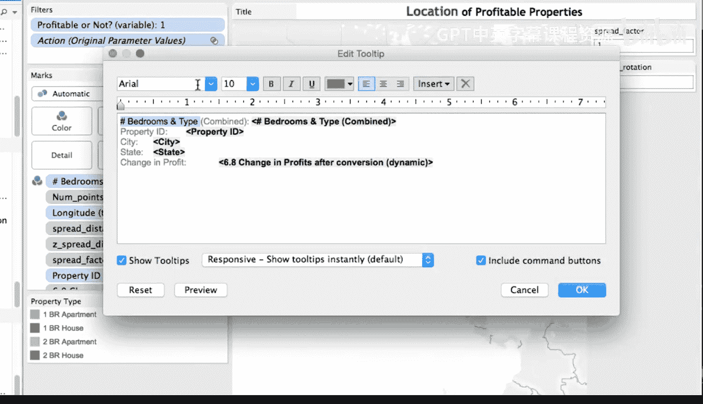

# Excel 到 MySQL：商业分析：5.3：Tableau 中的抖动地图 🗺️

在本节中，我们将学习如何在 Tableau 中创建“抖动地图”。这种地图技术用于解决地理数据点重叠的问题，通过将位于同一地理位置的数据点分散在一个圆形区域内，从而清晰展示每个数据点的详细信息。

## 概述

上一节我们介绍了地图可视化的基础。本节中，我们将深入探讨一种高级技巧——抖动地图。当多个数据点共享完全相同的地理坐标时，标准地图会将它们重叠显示为一个点，这限制了信息的可读性。抖动地图通过算法将这些重叠的点分散开来，同时保持它们与原始地理位置的关联，从而解决这个问题。

## 抖动地图的原理与参数

抖动地图的核心思想是：识别所有具有相同经纬度的数据点，将它们视为一个“簇”，然后将这个簇中的点均匀地分布在一个以原始坐标为中心的圆形区域内。这通过两个关键参数来控制。

以下是控制抖动效果的两个主要参数：

1.  **扩散因子**：此参数定义了圆形区域的半径。公式可以理解为：`新坐标 = 原始坐标 + 随机偏移量`。其中，随机偏移量的最大幅度由扩散因子控制。
    *   **值增大**：圆形区域变大，点更分散。
    *   **值减小**：圆形区域变小，点更密集。

2.  **扩散旋转**：此参数控制圆形区域内点的起始分布角度。改变它会使整个点簇围绕中心旋转，但通常对解读数据影响较小。

## 关键步骤与常见难点

理解了基本原理后，我们来看看创建过程中的两个关键步骤，这也是初学者最容易遇到问题的地方。

### 难点一：在计算字段中使用经纬度

Tableau 自动生成用于地图的经纬度字段无法直接在计算字段中被引用。为了解决这个问题，你需要一个“变通方案”。

**操作步骤如下：**
1.  首先，创建一个显示所有所需地理点的标准地图。
2.  在该地图上右键点击，选择“查看数据”。
3.  将显示的数据导出。此时，你获得的是实际的、可用的经纬度数值。
4.  将这些导出的数据作为新数据源，通过数据混合的方式与主数据源连接。这样，你就能在计算字段中使用这些“真实”的经纬度值来创建抖动偏移计算。

### 难点二：理解与设置表计算

抖动地图的实现依赖于大量的**表计算**。表计算的特点在于，它的运算结果取决于当前视图（工作表）中具体有哪些数据，而不是整个数据源。这类似于 SQL 中的子查询。

**关键注意事项：**
*   每个包含表计算的计算字段，都需要通过下拉菜单选择“编辑表计算”来明确指定计算方式。
*   在“编辑表计算”对话框中，你需要为计算字段内的**每一个**组成部分正确设置“分区”和“寻址”选项。建议使用“高级”选项进行更精确的控制。
*   一个常见的错误是只设置了最外层计算，而忽略了内嵌的计算。如果地图显示异常，很可能是这里的设置出了问题。
*   请记住，每当你向视图中添加新的维度或度量时，都可能需要重新检查和调整所有表计算的设置，因为新的字段改变了视图的上下文。

## 美化工具提示

除了地图本身，你还可以优化用户交互体验。当鼠标悬停在数据点上时显示的“工具提示”是可以高度自定义的。

**自定义工具提示的方法：**
1.  点击“标记”卡中的“工具提示”编辑按钮。
2.  在编辑器中，直接输入的文本会静态显示。
3.  通过点击“插入”按钮，你可以添加字段、参数等动态内容，这些内容会随着数据点的不同而变化。
4.  你还可以使用 HTML 标签（如 `<b>` 加粗、`<i>` 斜体）和样式来改变字体、颜色和大小，从而创建更美观、信息更丰富的提示框。

## 总结

本节课中，我们一起学习了 Tableau 中抖动地图的创建方法。我们首先了解了其解决数据点重叠问题的原理，并认识了控制抖动的两个参数：扩散因子和扩散旋转。接着，我们重点剖析了实现过程中的两个关键难点：如何通过数据混合获取可在计算中使用的经纬度，以及如何正确设置复杂的表计算。最后，我们还介绍了如何自定义工具提示以提升可视化效果。虽然构建抖动地图需要一些耐心，但它不仅能产出极具表现力的图表，更能深化你对 Tableau 数据混合、表计算等核心功能的理解，是一项非常值得掌握的高级技能。