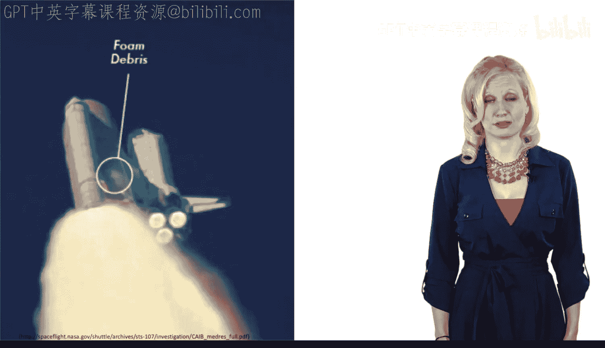

# 杜克大学《Excel 到 MySQL：商业分析（5课全）｜Excel to MySQL： Analytic Techniques for Business》中英 p179 23_07_01_说服决策者采纳建议.zh_en -BV1mS421X7yw_p179-

。Great work so far， you are on the home stretch of your watershed project。This week。

 you are finally going to prepare your presentation for Watershed executives。 As some inspiration。

 I wanted to tell you a story that illustrates some of the critical points about business presentations I want you to remember from the data visualization and communication with Tau course。

😊，The US Space Shuttle Columbia launched from Kennedy Space Center in Florida on January 16， 2003。

Unlike other space missions of the time that were focused on building the International Space Station。

 this mission titled STS 107， was dedicated to science。

Over 80 experiments in life sciences and physics were completed during the 16 days the crew was in space。

Unfortunately， while the crew was advancing cancer research and learning about microgravity。

 unknown to the crew， the rest of NASA was busy doing something else。

They were busy discussing a piece of foam that fell from the shuttle during launch。

They had to make a decision。Did the lost foam or the damage it caused pose a threat to the crew？

Countless PowerPoint presentations were made about this topic while the crew was in orbit。

The final decision makers decided that no， the foam did not pose a threat。

 so Columbia should return to earth as planned on February 1 after the shuttle was in orbit for about 16 days。

 And so that's what the Columbia crew did。Unfortunately， the decision makers were wrong， very wrong。

The damage caused by the foam was lethal。

It caused a hole in the thermal protection system on the left wing。

 that it allow superheated air to penetrate the wing during reentry into the Earth's atmosphere。

The superheated air led to the space shuttle disintegrating over Texas and Louisiana。

 taking the lives of all the astronauts who participated in the mission。

The Columbia mission was a terrible tragedy that Americans will never forget。

In addition to the toll this space shuttle Columbia disaster took on human life。

 it also took a huge toll on the American government's finances。

The government commissioned a review board to determine how so much human life and money could possibly be lost。

The Columbia Accccident Investigation Board， or CA AI B， as it was later known。

 eventually released a multi volumeum report and how the shuttle was destroyed and what led to it。

The CIB said in their report that they believed all the information that was needed to prevent the Columbia disaster was available to NASA at the right times。

 but somehow the information didn't reach top NASA officials in a way that they were able to evaluate it correctly。

In essence， they said that lack of data communication was the cause of the Columbia disaster。

During their investigation， the C AIB discovered that almost all technical information relevant to the Columbia mission was communicated to the various parts of NASA via PowerPoint presentations rather than written reports。

They hired Edward Tuft， the data visualization pioneer who coined the term data In ratio we learned about earlier in the specialization to consult on the efficacy of these PowerPoints。

Toughft wrote a scathing review of the slides made by NASA pioneers。 In particular。

 he wrote about this slide， which he argued had a critical detail buried in the bullet points that could have saved the mission。

Believe it or not， this bullet point here tells NASA audience members that the piece of foam that broke off was 640 times larger than any of the NASA models that said reentry should be safe。

 assumed。In other words， the damage was severe and decision makers should be very concerned。

As the CAIB noted， the way this slide is written， senior management probably didn't even know that it contained information about a life threatening situation。

 let alone what that life saving information was。The board concluded in their written report。

The board views the endemic use of PowerPoint briefing slides instead of technical papers as an illustration of the problematic methods of technical communication at NASA。

In other words， the CAIB believed that if the critical engineering detail had been described in a White paper rather than a crowded slide presentation。

 it might have been noticed by NASA decision makers who could have prevented the Columbia disaster。

Clearly， the Columbia mission was much more significant and complicated than any project you or I are likely to be presenting on in a business setting。

But that doesn't mean we can't learn from it。As we discussed in week four of data visualization and communication with Tableau。

 slide presentations for telling your data stories and persuading your audience。

Written white papers are for documenting technical details that your audience might be interested in if you succeed in pulling them into your story during your presentation。

That's why this week， you are going to prepare a slide presentation to convince the watershed executives to follow your recommendations。

 and you are going to prepare a separate written document that documents the details of your analytical model。

To kick off the week， start by storyboarding your presentation。

What are the key points you want to make， what are the key data analyses that support those points。

 and what are the visualizations that best illustrate the implications of those analyses？

How are you going to frame your story and engage your audience？

Make sure you stress test your story and put all the concepts you learned about data communication to good use。

 I highly encourage you to ask for feedback from each other or from your own friends and coworkers as you put together your presentation。

😊，I want to emphasize again that you are designing this presentation to persuade your audience not to document all the hard work you've done over these many past weeks。

😊，You might be very tempted to show pictures of your spreadsheets or to show pictures of your linear aions。

 Reist those temptations。 Those types of details may be part of the background to your story。

 and you should be very proud of them， but they won't help you tell the story。

 and they certainly won't help you tell the story efficiently。 In fact。

 as the Columbia Acdent Invest board found， Those types of details will be lost。

 they are put in your presentation。 and they will also frustrate the watershed executives who simply want to know what you think they should do。

😊，So put all the details of your model and analysis in your white Pa so that interested audience members can study the details in their own time。

 but do not put them in your visual presentation。As you finalize your slides。

 make sure you think about the design concepts we talked about in the data visualization and communication Mo Tableau course。

 maximize your data ink ratio， use color and contrast to call attention to things that are important。

 and choose graphs that are easy for your audience to interpret correctly。

Remember that where people look or don't look on your slides will determine what they decide。

Then make sure you practice your presentation many times， pay attention to your opening。

 your conclusion and your transitions。 Do you have emotional hooks， are they heartfelt。

 are they time efficient。When you are confident you have practiced your presentation enough to make it as engaging and persuasive as it can possibly be。

 You've put the finishing touches on your dashboard， and you have completed your white paperper。

 You will be ready to present to the watershed executives next week。😊。

Danelle and I know that we are going to be very proud of what you come up with。

Enjoy this last week and we can't wait to see your presentations。

