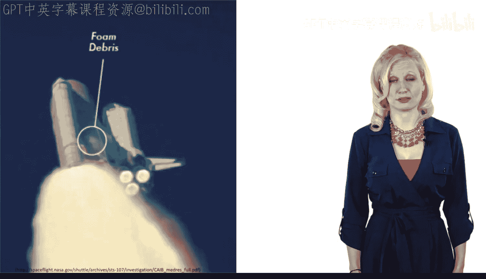

# 商业分析：第5课：说服决策者采纳建议

## 概述
在本节课中，我们将学习如何准备一份有效的商业演示，以说服决策者采纳你的分析建议。我们将通过一个真实的历史案例，理解清晰沟通的重要性，并掌握将复杂分析转化为有说服力故事的关键技巧。

---

## 从哥伦比亚号航天飞机事故中学习
上一节我们完成了数据分析的核心工作，本节中我们来看看如何有效地沟通这些发现。一个关于沟通失败的著名案例是美国哥伦比亚号航天飞机事故。

哥伦比亚号于2003年1月16日从佛罗里达州肯尼迪航天中心发射升空。这次代号为STS-107的任务专注于科学研究，机组人员在16天的太空飞行中完成了80多项实验。

然而，当机组人员在太空进行癌症研究和微重力实验时，美国国家航空航天局（NASA）的工程师们正在讨论发射过程中从航天飞机上脱落的一块泡沫。他们需要判断这块泡沫造成的损坏是否会对机组人员构成威胁。

在哥伦比亚号轨道运行期间，工程师们制作了无数份关于此问题的PowerPoint演示文稿。最终决策者认定泡沫不构成威胁，哥伦比亚号按计划于2月1日返航。

不幸的是，决策者错了。泡沫造成的损坏是致命的。它在左翼的隔热系统上造成了一个洞，导致航天飞机重返地球大气层时，超高温气体侵入机翼，最终使航天飞机在得克萨斯州和路易斯安那州上空解体，所有宇航员遇难。

## 沟通失败是灾难的根源
哥伦比亚号事故调查委员会（CAIB）发布了一份多卷报告，分析了事故原因。报告指出，防止哥伦比亚号灾难所需的所有信息在正确的时间都已提供给NASA，但这些信息未能以决策者能够正确评估的方式传达给他们。

**核心结论是：数据沟通的缺失是导致哥伦比亚号灾难的原因。**

调查发现，几乎所有与哥伦比亚号任务相关的技术信息都是通过PowerPoint演示文稿，而非书面报告，传达给NASA各部门的。委员会聘请了数据可视化先驱爱德华·塔夫特来评估这些PPT的效果。塔夫特严厉批评了NASA工程师制作的幻灯片。

他特别提到了其中一张幻灯片，认为一个可能拯救任务的关键细节被埋没在项目符号列表中。那个细节指出，脱落的泡沫尺寸是NASA所有预测安全返航模型所假设尺寸的**640倍**。这意味着损坏非常严重，决策者本应高度关注。

但正如CAIB所指出的，由于这张幻灯片的呈现方式，高级管理层很可能根本没有意识到其中包含了关乎生死的信息。委员会在报告中总结道：

> “委员会将普遍使用PowerPoint简报幻灯片而非技术论文的现象，视为NASA技术沟通方法存在问题的例证。”

换言之，CAIB认为，如果这个关键的工程细节被写在一份**白皮书**中，而不是拥挤的幻灯片里，它或许会被NASA决策者注意到，从而可能避免这场灾难。

## 商业演示的核心原则
显然，哥伦比亚号任务比我们在商业环境中可能遇到的任何项目都更为重大和复杂。但这并不意味着我们不能从中学习。正如我们在Tableau数据可视化与沟通课程第四周所讨论的：

*   **幻灯片演示**用于讲述你的数据故事并说服你的听众。
*   **书面白皮书**用于记录技术细节，当你在演示中成功吸引听众后，他们可能会对这些细节感兴趣。

因此，本周你的任务是准备一份幻灯片演示来说服Watershed高管采纳你的建议，同时准备一份独立的书面文档来记录你分析模型的细节。

## 如何准备你的演示
以下是准备有效演示的几个关键步骤。

首先，为你的演示制作故事板。确定你想要表达的关键观点、支持这些观点的关键数据分析，以及最能说明这些分析含义的可视化图表。思考如何构建你的故事并吸引听众。

确保对你的故事进行压力测试，并充分利用你学到的所有数据沟通概念。在整合演示文稿时，强烈建议你向同伴、朋友或同事寻求反馈。

## 区分演示与文档
需要再次强调，你设计这份演示的目的是为了**说服**听众，而不是记录你在过去几周所做的所有艰苦工作。

你可能会非常想展示你的电子表格截图或线性回归方程。**请抵制这种诱惑**。这些类型的细节可能是你故事的背景，你应当为之自豪，但它们无助于你讲述故事，更无法帮助你高效地讲述故事。

事实上，正如哥伦比亚号事故调查委员会所发现的，这类细节如果放在演示中，不仅会被忽略，还会让只想了解你建议的Watershed高管感到沮丧。

所以，请将你模型和分析的所有细节都放入你的**白皮书**中，以便感兴趣的听众可以自行研究。但不要把它们放在你的可视化演示里。

## 优化幻灯片设计
在最终确定幻灯片时，请确保运用我们在Tableau数据可视化与沟通课程中讨论的设计概念：
*   **最大化数据墨水比**。
*   使用**颜色和对比**来吸引人们对重要内容的注意。
*   选择易于听众正确解读的**图表**。

请记住，听众在幻灯片上看什么或不看什么，将决定他们的决策。

## 练习与交付
然后，确保你多次练习你的演示。注意你的开场、结论和过渡。你是否设置了情感钩子？它们是否真诚？是否高效？

当你自信已经充分练习，使演示尽可能吸引人和有说服力时，当你为仪表板做了最后的润色，并完成了白皮书时，你就准备好在下周向Watershed高管进行演示了。

## 总结
本节课中，我们一起学习了如何准备一份有说服力的商业演示。我们通过哥伦比亚号航天飞机的悲剧案例，理解了清晰、有效沟通的极端重要性。关键要点在于：使用幻灯片讲述一个引人入胜、以行动为导向的故事；将支持性的技术细节放入单独的白皮书中；运用优秀的数据可视化原则来设计幻灯片；并通过充分练习来完善你的交付。我们期待看到你的精彩演示。