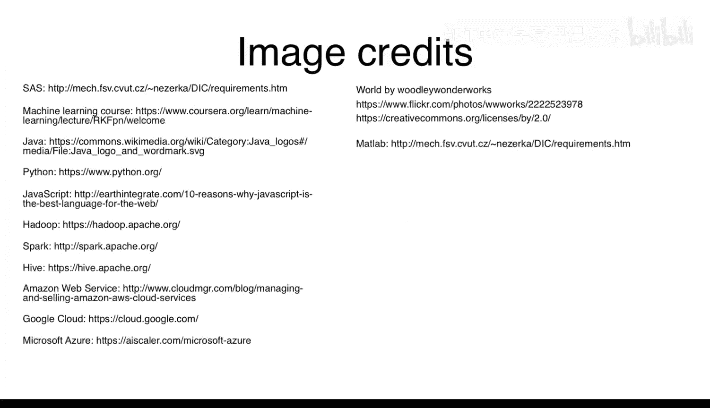

# 杜克大学《Excel 到 MySQL：商业分析（5课全）｜Excel to MySQL： Analytic Techniques for Business》中英 p19 19_03_01_数据科学家.zh_en -BV1mS421X7yw_p19-

Data scientist is a newly emerging leadership role。

Interdisciplinary and with constantly evolving scope。

Which is nevertheless increasingly seen as vitally important。

A position where at present demand for skilled individuals greatly exceeds supply。

In the past 10 years， it's become difficult to imagine any competitive enterprise aiming for scale。

 surviving， nevermin growing and winning in its market。

Without a coordinated effort to join together the following three elements。Moodeling。

 machine learning and forecasting。An environment in which key business process data is continually captured and stored。

 analyzed， updated， shared throughout the organization。And finally。

 that the data is received by decision makers on a real time or just in time basis。In many cases。

 the decision maker is itself a computer algorithm that decides how to interact with a customer in real time and without human input。

 like the Amazon Pre engines we talked about earlier。

This requires major influence over the user experience design process and an Edenman larger commitment of software engineering resources。

In other cases。Having information on a customers' most recent transactions available to sales or support people so that when they're in contact with the customer。

 they know everything that's happened so far。The just in time standard is good enough。

 but that too requires a major effort to architect。

 build and maintain a company's data storage and retrieval systems。 In either case。

 data scientists are the people who grasp what is possible from big data in terms of dramatically improved business processes and can translate a company's business aims and needs into database architecture and software engineering terms and can translate the needs and concerns of engineers into terms the company's non-technical management can understand。

Requirements for becoming a data scientist begin with the same skills required of a business data analyst。

But data scientists are expected to be familiar with a large number of additional technologies and concepts as well。

Data scientists are expected to be masters of the big picture。

Understanding how different tools and technologies can be integrated to form a coherent whole。

We've identified eight skill areas that data scientists are expected to have that go beyond the nine already expected of a business data analyst。

First， more advanced modeling tools。Intermediate to advanced knowledge of at least one of R。

 Matlab or SaS。Second， advanced statistical methods。

 Most data scientists have taken at least one calculus level probability and statistical inference course。

 either at university or online。Course2 in this specialization touches upon most of the advanced topics you would encounter in that type of course。

 but in an introductory way， so you can decide for yourself if learning more about those topics interests you。

Third。Baesian learning and probabilistic models， machine learning algorithms for predictive analytics。

 The way machines learn from data is captured well by Bayesian assumptions and Bayesian methods。

Almost all real time decision systems rely on machine learning to ensure that decisions reflect the latest data inputs。

 Again， course2 will briefly introduce these topics。Fourth。Additional relational database skills。

 including at a minimum， how to populate， that means to put data into and optimize making pulling data out fast SQL databases。

Fifth， intermediate knowledge of the most important technologies used to communicate between the customer layer。

 typically the web browser or mobile app， and the database layer。The tools are Python， Java。

 and JavaScript。Sixth， experience managing distributed and unstructured data。

 including tools like Hadoop， mappRuce， Hve， P and Spark， seventh。

 basic knowledge of tools and methods for natural language processing for applications such as sentiment analysis。

8th。Experience with massively scalable cloud based data hosting and processing。

 either with Amazon Web Services， AWS or with one of its nearest competitors such as Microsoft Azure or the Google Compute Laer。

