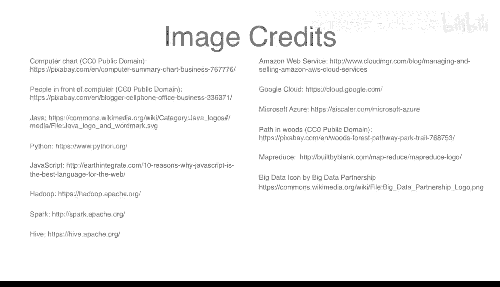

# 杜克大学《Excel 到 MySQL：商业分析（5课全）｜Excel to MySQL： Analytic Techniques for Business》中英 p21 21_03_03_高级软件工程师.zh_en -BV1mS421X7yw_p21-

As they move to embrace big data culture。Along with business data analysts and data scientists。

 companies require skilled software engineers and experienced technical product managers to design and build。

 optimize user experiences and all of the layers beneath that make up a company's real time and just in time。

Data storage， processing and retrieval systems。None of the nine skills that we discussed earlier as being required by all business data analysts are part of the regular skill set of software engineers。

A data scientist's knowledge of modeling tools， statistical methods and machine learning is also unnecessary。

On the other hand， software engineers do share with data scientists knowledge of。

Languages for scripting such as Python， Java and JavaScript， as well as tools like Hadoop， Mapreduce。

 hive， Pig and Spark for handling and retrieving unstructured data。

Some experience with natural language processing tools and with cloud based services such as AWS are also shared in common。

Software engineers leading the systems engineering and product management for big data projects will also typically have skills in the following five additional areas。

 First of all， experience with lower level languages such as C++。Second。

 knowledge of highly scalable， low latency commercial relational databases such as Oracle and Terraadata。

Third， experience leading software development teams。Fourth， experience with project management。

 including scheduling and budgeting for software development。

And fifth experience working with real time and third party data feeds。

We think it's important to point out。That while the career paths for business analyst。

 business data analyst and data scientists all start with the same basic skills。

 and overlap to a great extent as people move up in the organization。

 software engineers and technical product managers have very different and to a large extent。

 non overlapping expectations for skills and experience。

 we want to make sure that you get on the right path for you。

