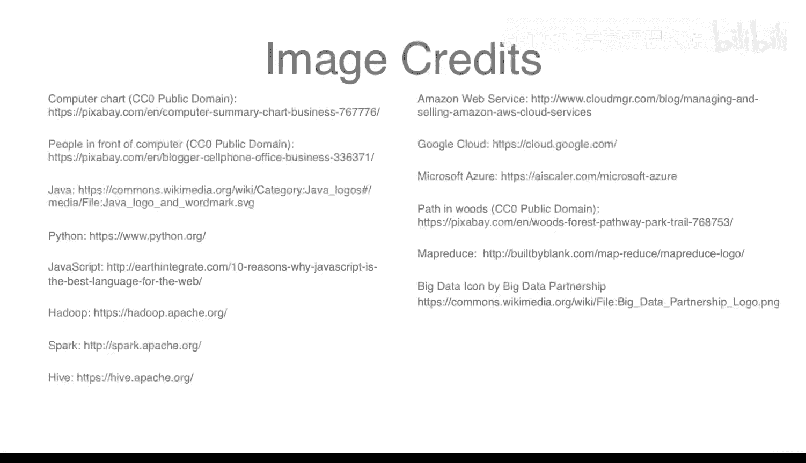

**商业分析职业路径：5：高级软件工程师与技术产品经理 👨‍💻**

在本节课中，我们将探讨大数据生态中至关重要的两个角色：高级软件工程师和技术产品经理。他们的职责与之前讨论的商业数据分析师和数据科学家有显著不同。

随着企业拥抱大数据文化，除了商业数据分析师和数据科学家，公司还需要熟练的软件工程师和经验丰富的技术产品经理。他们的核心任务是**设计和构建**、**优化用户体验**以及构成公司实时与即时系统的所有底层架构。

---

### **核心技能差异**

上一节我们介绍了商业数据分析师的通用技能，本节中我们来看看软件工程师的技能构成。之前讨论的九项商业数据分析师必备技能，通常**不属于**软件工程师的常规技能集。同样，数据科学家所掌握的建模工具、统计方法和机器学习知识，对软件工程师而言也**并非必需**。

---

### **共享的技能领域**

然而，软件工程师与数据科学家在部分技术领域存在交集。以下是他们共同掌握的知识：

*   **脚本语言**：例如 `Python`、`Java` 和 `JavaScript`。
*   **大数据处理工具**：用于处理和检索非结构化数据的工具，如 `Hadoop`、`MapReduce`、`Hive`、`Pig` 和 `Spark`。
*   **其他技术**：自然语言处理工具的经验，以及基于云的服务（如 AWS）的使用经验。

---

### **软件工程师的专属技能**

主导大数据项目系统工程和产品管理的软件工程师，通常还具备以下五项额外的专业技能：

1.  **底层语言经验**：例如 `C++` 的使用经验。
2.  **高性能数据库知识**：对高可扩展、低延迟的商业关系型数据库（如 `Oracle` 和 `Teradata`）的了解。
3.  **团队领导经验**：领导软件开发团队的经验。
4.  **项目管理经验**：包括软件开发的进度安排和预算制定。
5.  **实时数据处理经验**：与实时及第三方数据源协作的经验。

---

### **职业路径的区分**

我们认为有必要明确指出：虽然商业分析师、商业数据分析师和数据科学家的职业路径始于相同的基本技能，并且随着在组织内晋升，其技能重叠度很高，但**软件工程师和技术产品经理**在技能和经验要求上则**非常不同**，并且在很大程度上**没有重叠**。

我们希望你确保自己选择了正确的职业发展路径。

---

**总结**

本节课中，我们一起学习了大数据领域高级软件工程师与技术产品经理的角色定位。我们明确了他们与数据分析师的核心技能差异，介绍了他们与数据科学家共享的技术栈，并详细列出了软件工程师独有的五项关键技能。最后，我们强调了这些技术类职业路径与数据分析类路径的本质不同，帮助你更清晰地规划职业方向。