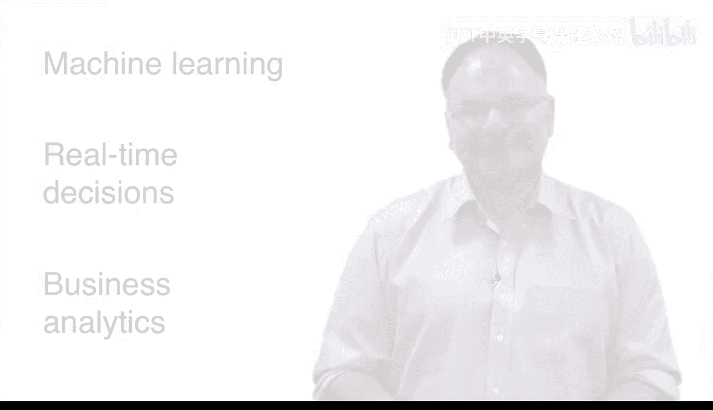

# 商业分析：1.3：五类大数据相关企业概述 🏢

在本节中，我们将对美国市场中塑造大数据文化的领先公司进行分类概述。我们已经了解了如何从大数据中提取指标以改进业务流程，也探讨了不同关键岗位的人员如何与数据协作。作为大数据生态系统概览的最后一部分，我们将识别并梳理这些公司。

为了便于理解，我们将所有美国公司划分为五个类别。这五个类别按照其业务优势对专有软件和知识产权的依赖程度，从低到高进行排序。换句话说，这个排序也大致反映了它们招聘初级商业分析师（而非更技术性的软件开发人员）的可能性高低。详细的排序说明可参考课程配套图示。

以下是这五个类别的具体介绍：

**第一类：传统战略商业咨询公司**
这类公司的商业模式是提供建议并收取费用。它们通常专注于改进业务流程、增加收入、最大化盈利能力和降低风险的方法。

**第二类：传统实体企业（规模最大）**
这是迄今为止规模最大的群体，涵盖了所有市场领域的传统企业，常被称为“实体公司”。它们与在同一市场竞争但拥有完全不同商业模式（通常成本结构低得多）的数字化公司形成对比。实体运营成本高昂，零售、大型商店、银行与支付处理、金融顾问、出租车、酒店等许多传统经济领域正面临来自数字化公司的激烈竞争。我们将识别哪些公司正在有效反击，哪些则显得落后。

**第三类：兼具软件实施能力的战略咨询公司**
这是一小部分同样建议业务流程变革的咨询公司，但它们专门负责构建或安装定制软件系统来实施其建议。由于《财富》500强公司倾向于遵循它们的建议，这些公司对数据分析市场有着超乎寻常的影响力。

**第四类：硬件与软件公司**
这些是关键公司，它们共同提供了收集、存储、管理、搜索、处理、分析、可视化和报告全球数据所需的产品与服务。我们将深入探讨大数据信息技术领域的各个子行业。

**第五类：数字化公司**
这类公司主要与传统市场中的老牌企业竞争，例如提供出租车服务、夜间租房、商业和消费贷款、零售购物、电影、通讯及社交机会等。但与它们的实体竞争对手不同，数字化公司没有高昂的固定成本。它们也创造了互联网时代之前不存在的全新市场领域，如谷歌之于搜索，eBay之于在线拍卖。所有数字化公司都依赖于海量数据处理，通常通过机器学习系统增强，以进行实时决策——其价值主张的核心正是商业分析。

在本节中，我们一起学习了美国大数据生态系统中五类主要公司的特点、商业模式及其对数据分析的依赖程度。理解这些类别有助于我们看清商业分析在不同类型组织中的应用和职业机会。