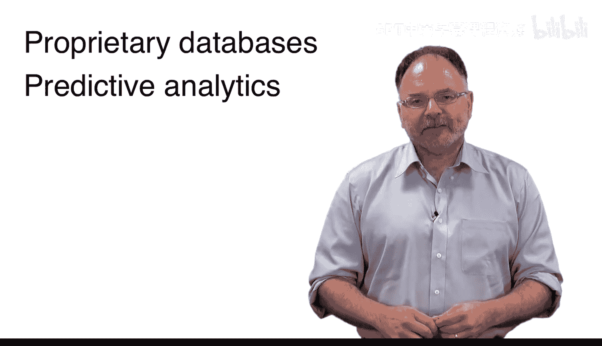
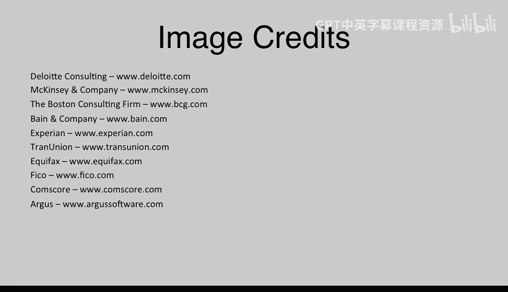

# 杜克大学《Excel 到 MySQL：商业分析（5课全）｜Excel to MySQL： Analytic Techniques for Business》中英 p23 23_03_02_传统战略商业咨询.zh_en -BV1mS421X7yw_p23-

Strategic business consulting firms provide expert advice about best practices to companies that want to stay competitive in the constantly changing conditions of the global digital economy。

Much of a strategic consulting company's work。Is based on collecting and analyzing data。

And using that data to recommend business process changes to their clients for this。

 they need business analysts in large numbers。The largest firms of this type are Deloitte Consulting。

 McKinsey， Boston Consulting Group and Bain。With annual consulting revenues over 6 billion，5 billion。

 3 billion， and 2 billion respectively。Mostly， the data that the business analysts work with belongs to a client。

Technical staff at either the consulting firm or at the client extract data that the client already has stored in various databases but is not using dynamically。

 They provide it to the business analyst， typicallyp in the form of an Excel spreadsheet。

The business analyst studies it。And applies various models to discover opportunities for business process improvement。

A variation on this situation。Are the specialized group of consulting firms？

That have developed their own proprietary databases and related predictive models about a particular industry or market sector。

These consulting firms tend to need more business data analysts and some data scientists as well。

Examples of this type of consulting firm are credit bureaus。

 which collect information about people's debts and payment history and sell that information to banks and others offering credit to help them decide whether they should risk a loan with that person。

The three leading credit bureaus are Equifax， Transunion and Experian。A fourth company called FiIco。

 formerly called Fair Isaac， uses the data originally gathered by the credit bureaus to generate a single number。

 The FiIco score that predicts credit worthiness。 FiIco scores range from 300。

 which is terrible to 850， which is outstanding credit。

FICO is one of the original data driven predictive analytics companies。

And its numbers are used to make over 24 million lending decisions in the United States each day。

 that's 90% of all US lending decisions。Two other examples of strategic business consulting companies that built thriving consulting practices around proprietary data。

Our comm score and Argus information and Advisory services。

Tracking web and mobile click streams with user permission。

 Com scoreore observes how much traffic goes where and is a kind of Nielsen ratings for the web。

Comm score quoteMasures what people do when they navigate the digital world。

It had 339 million in revenues last year。ArrgIS combines credit card transactions， balances。

 and payments across most of the credit cards in the industry。

So it has transaction level purchasing information that the credit bureaus don't have。

 Credit bureaus only know how much you owe on a card and whether you've been late making payments。

Not what you bought and when。Arrgus combines credit card transactions， balances。

 and payments across most of the credit cards in the industry。

It has transaction level purchasing information that the credit bureaus don't have。

Credit bureaus know only how much you owe on a particular card and whether you've been late making payments。

Not what you buy and when。Arrgs builds models about consumer behavior。

 segmenting potential customers， and helping banks with marketing promotions for new credit cards。

 as well as with managing credit risk。Arrgus revenues are not broken out separately。

 but it is part of Verris analytics with 1。8 billion in annual revenues。

