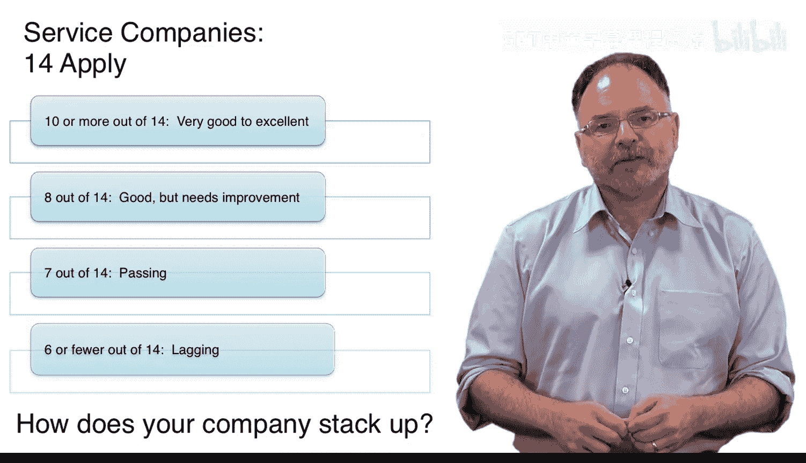

# 杜克大学《Excel 到 MySQL：商业分析（5课全）｜Excel to MySQL： Analytic Techniques for Business》中英 p24 24_03_03_实体企业.zh_en -BV1mS421X7yw_p24-

In spite of the explosion of digital technology， most of the world's economy still consists of making physical stuff。

Transporting it to where it is wanted or offering goods for sale to the public from a store。

We can't discuss every type of business， obviously， so in this course。

 we'll focus on certain sectors of the traditional bricks and mortar economy。

That are presently under serious threat from digital companies。

These sectors have the most to gain by adopting best practices for business analytics and the most to lose from failing to move。

Threatened sectors include， but are not limited to all forms of consumer retail purchases。

 including books， movies， music， fashion， electronics， groceries， household supplies。

 financial services， including。Issuing credit cards。

 making other types of unsecured loans to individuals and small businesses， payment processing。

 and managing other people's money as an investment advisor。Real estate， in particular。

 short term lodging， such as hotel rooms。Logistics and transportation， in particular。

 local taxi industries around the world。All bricks and mortar companies of any size need some business analysts。

 but they also need both business， data analysts and data scientists。

 they typically outsource a good part of their IT infrastructure development to consultants and vendors。

 but they still need some individuals with extensive technical IT project management experience。

The process of moving toward big data culture is well advanced at some companies。

 and these have major data science and software development efforts underway。

Others are still trying to figure out what they should do。

Here is a checklist you can use to evaluate how far along a company is in embracing big data culture。

This checklist has a total of 20 items，19 items are relevant to product companies and 14 to service companies。

Over time this checklist will no doubt evolve， it represents the state of the industry in 2015 into 2016。

1。Offer a mobile version of its website tested for rapid loading times in all world markets。

Does it use edge caching， content delivery networks such as AkaMmai？

Can you buy products and services directly from mobile apps for Android and iOS as well as the web？2。

Track your visitors's full click stream， the exact path through the website with time spent at each point。

 rather than just count unique visitors or page views。th3。

To findine conversion of new website visitors in two steps， first。

 individuals register and provide name and email， and second they become revenue generating customers。

4。😡，Do ongoing AB testing of site features to optimize rates of conversion to revenue。F。

 know how to achieve and maintain a high Google ad rank。No。

 the maximum price per click through for web advertising that is profitable。

 This requires knowing both。The conversion rate to revenues per click through and the average lifetime value of a new customer。

seven。Give customers a meaningful and effective incentive to interact with the company online between store visits。

Ideally， make real time online promotional officers to individuals based on a preference analysis of their specific history。

E， and this is for product companies only allow companies to see what is on the shelf in their local store while online。

Nine， again for product companies， allow customers to order ahead of a time and pick up at the store。

10。Really， what you want to do is collaborate with third party shopping and delivery services to enable same day or less deliveries from the nearest store for product companies。

The equivalent for service companies number 11 is to make sure that whatever service you provide。

 you're doing it and completing the service delivery as fast as your online competitors。

 So for example， if you're making loans。Does the person borrowing receive the money as fast as they do from your online competition？

12， track all interactions with a customer， sales， complaints。

 web interactions located under a single customer record ID in a database and have that information available on a quote。

 "Just in time basis when interacting with a customer。13。

Identify opportunities for recurring revenue through value added membership and loyalty programs like Costco membership or Amazon Prime。

14。Have point of sale customization， for example， custom coupons for additional products or services aimed at a particular customer's。

Past purchase interest that are available to them when they check out。5。

Develop customer incentives to reward and cultivate your highest spending Reat customers。

 what they call in Las Vegas， the Wales。Or air travelers with executive platinum。

16 continually track churn rates and follow up with special incentives to lure back customers who have gone quiet for a set period。

17 for product companies only。Track all SkuUs at the store level to prevent excessive days inventory。

18 product companies track all zero inventory items to eliminate empty shelves。

 do research to identify products customers wanted that are not carried。19 for product companies。

V inventory levels for individual items by store， region， season， even day of the week to balance。

Minimizing dayss inventory and wastage against not running out20。

Offer effective price reduction in last minute promotion programs to sell any wasting inventory。

 whether products or services like hotel rooms or airline tickets。

So here's how you can score your company。For product companies。

16 or more out of 19 is very good to excellent， 14 out of 19 is good， but needs improvement。

11 out of 19 is passing， and fewer than that， your company is lagging and needs to consider changing its business culture or simply withdrawing from markets that face digital competition。

For service companies， we have 14 that apply， 10 or more out of 14 is very good to excellent。Ai。

I'd say eight to 10 is good， but needs improvement。Seven， passing and six or fewer。

 the company again is lagging and needs to change its business culture or consider withdrawing from the digital markets where it is competing。

