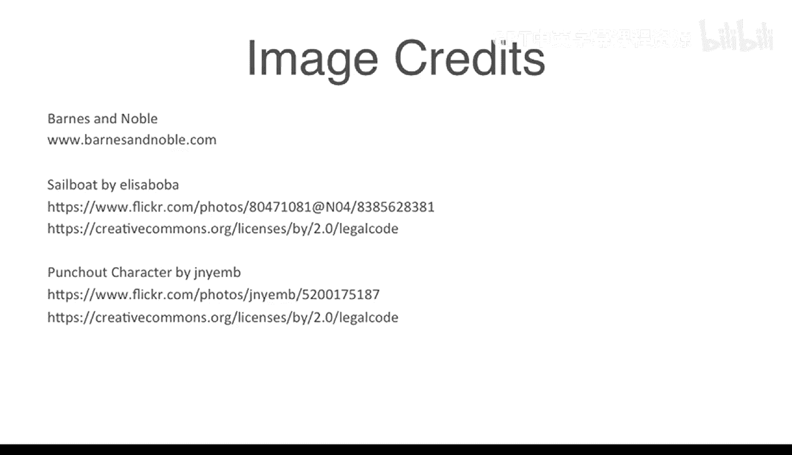

# 杜克大学《Excel 到 MySQL：商业分析（5课全）｜Excel to MySQL： Analytic Techniques for Business》中英 p25 25_03_04_巴诺书店案例研究.zh_en -BV1mS421X7yw_p25-

In some cases， it is apparent that faced with competition from a digital company。

A bricks and mortar competitor is at sea。Barnes and Noble is a very nice chain of US bricks and mortar bookstores。

James Riggio purchased Barnes and Noble in 1971 when it had a single store in New York City。

 And over his first 25 years， his owner built it into a thriving Fortune 500 company with hundreds of stores and billions of dollars in revenue。

 But Barnes and Noble has struggled for 20 years to find an effective response to Amazon dot com。

 ever since the Amazon website went live in 1995。 By my count， even now。

 Barnes and Noble meets only nine of the 19 criteria for a bricks and mortar product company to compete effectively in business analytics。

Barnnes& Noble stock price was $37 in 1995。It was still $37，10 years later in 2005。

10 years after that， in 2015， its stock price is now $27， a decline of 28 per cent。By comparison。

 during those 20 years， the S&P 500 index is up more than 8% per year， continually compounded。

Over the past 20 years， Amazon dot com has slowly crushed the life and joy out of Barnes and Noble。

Over the 17 years since Amazon co went public， its stock price is up 350 fold。

 an annualized return of more than 32%。News item April 2014。

 Barnes and Noble Chairman Leonard Riggio disclosed his second stock sale in five months。

 reducing his interest to 20% from 30% last year。Barnes and Noble shares dropped 12% on the news of Mr。

 Riggio's sale， which he said he made for estate planning purposes。Maxim group analyst John Kinker。

 who has been bullish on Barnes and Noble in recent months。

 described the sale as quoteob negative unquote。Aens and Noble has tried its own E reader to compete with Amazon's Kindle。

The nook。And its own website， Bn。com。But both efforts seem underwhelming。Understandably。

 as the company does not want to turn itself into a pure online competitor to Amazon。

A market where it has no competitive advantage。The Nook and BN efforts do not enhance any competitive differentiation between Barnes and Noble and Amazon。

 They erode it。To me。Arange and Noble's basic value proposition is as a place to gather with other people。

 maybe sit and study or have a cup of coffee while surrounded by books。

There is the pleasure of people watching and the chance that you might meet somebody over a book。

Something you'll never get on Amazon。Perhaps the only way to survive long term while selling this kind of intangible would be to persuade people to pay a cover charge at the door。

 just like a bar that offers a live band。Barneston Noble is， in fact， a kind of old fashioned club。

Essentially， people are paying to be with other people who like or love books。

While being surrounded by tons of very expensive physical inventory。Right now。

 a $25 Barnes and Noble membership offers a 10% discount and it's not mandatory。

Maybe a higher and mandatory membership fee would take Barnes and Noble all the way to exclusive club status。

What do you think Barnes and Noble could do to survive and hopefully thrive again someday？

I'm interested in your thoughts and comments。

Hello， everyone。10 years ago， when I first presented Barnes and Nobles。

 a case study of what not to do。The company appeared to be in an irreversible decline。

This is an update as of June 2025， when the company has been getting lots of positive publicity and is presenting itself as having turned things around。

By 2019， although it still had over $3 billion in annual revenue。

 the company was barely breaking even with earnings of only about $3。8 million。

 and the stock price was below $5 a share。That year， the shareholders cashed out。

 They sold 100% of the company。To a private equity firm called Elliot Investment Management。

They sold the company for $683 million， but $200 million of that。

 or maybe a little more was not paid to the shareholders。

 It was to cover the existing debts of the company。 So in reality。

 we had a company that had $3 billion in revenues， sell for under $500 million。

And that is not a good outcome for shareholders， that's just plain terrible。So the question arises。

 is it a bargain for Elliot investment management？Once a company is taken private。

 its shares are no longer publicly traded on the US stock exchange。

 So the Se no longer requires it to file annual and quarterly reports of its financial status， right。

 so we don't actually have detailed and reliable numbers。

Backing up the idea that there has been a financial turnaround。

We do have a rough performance metric in the number of operating stores。

 which Elliott has made public。The company had 627 stores in 2019。Down from a high of 726 in 2005。

 all closed down during Covid， and some never reopened。 The company does not announce store closings。

 but since 2022， they are announcing new store openings，16 new stores in 2022，30 in 2023，58 in 2024。

 and it has plans to open 60 stores in 2025。It had 604 stores in 2024。 So this year。

 it should finally reach and exceed the number of stores it had the year it was sold。

There have been many stories in the press about the greatly improved attractiveness and effectiveness of the company's bricks and mortar stores。

 since Eliliot took over。 the stores seemed to be attracting more walk in customers。

Online reviews are uniformly positive about changes in the stores。

Here's a recent glowing example that I found on Reddit。

 which hits all the company's key talking points。We have a new Barnes and noble， and it is fantastic。

 The layout is completely changed with very engaging displays， places to sit， Starbucks。

 activity nights。 We go there whenever we want a new book。 Usually at night。

 It is great to just browse the sections and find the one that is right for the moment。

 It's an excellent third space。😊，Now， this may have been written by Elliot Management's PR firm。

But let's assume that it's genuine。So what's changed？In 2019， Elliott brought in James Dwt as CEO。

Dunant started out as an owner manager of small independent bookstore。

 He opened Daunt books in 1990 as a specialty bookstore in London focused on travel books。

Daunt Books is still in business with six locations in London and Oxford。

It sounds like a fun place instead of traditional categories like biography， history， cookbooks。

 tourist guides， and so on， all the books are organized by country。It's browser friendly。In 2011。

 Dat took over as CEO of Waterstones， a UK bookseller， which was also acquired by Elliott in 2018。

 and which had overcome market changes with some success。When he began as CEO in 2019。

 Daunt assessed the state of Barnes and Noble stores and said that they were quote。

Crucucifyingly boring。He used the period in 2020 when stores were forced to close for Covid to refurbish their interior spaces。

 He started allowing more individual variation and store layouts and decor。

 as well as leasing smaller， more intimate and probably less expensive retail spaces。

 Daunt made several critical changes to the Barnes and Noble business model。 first。

The company stopped accepting promotional payments。What are promotional payments you might ask， Well。

 the company had long taken payments directly from publishers。

Under what are known as co op agreements in return for prominently displaying their bestsellers or the books that they were trying to turn into bestsellers。

All stores nationally were required to give large amounts of floor space to these sponsored books。

 whether the books ultimately sold well or not， and often in a particular location， they did not。

This dependence on Paola contributed to the impersonal sameness and dness of the Barnes and Noble stores。

Dat also stopped selling miscellaneous non media items， According to the economist magazine， toys。

 backpacks and bottled water are out。Most fundamentally。

Daun gave individual store managers more authority to choose for themselves what books to order and in what quantity。

He effectively told managers to use their own judgment and to try to match their inventory and store displays to the local interests of their specific customers。

 He allowed his managers to act as if they were owner operators of independent bookstore。

Assuming that they know the readers they meet face to face better than headquarters can and can identify and order books that their customers will enjoy and buy。

😊，Employees now also post notes on the shelves about their favorite or newly recommended books。

 something long common and independently on bookstores， but unusual for big national chain。

This localization can be very specific。 One article I read gave the example of how the Barns and noble locations in Manhattan's Upper East S and Upper West S stock and sell very different books。

Another example jumped out at me when they started allowing local managers to respond to local demand。

 their national sales of manga and graphic novels increased by 500%。

This example is especially revealing because it suggests that not only was former management out of touch with local interests。

 but also with national trends。Dunant is heavily emphasizing and telling the press he is emphasizing customer experience。

The company is dedicating space in each store to host frequent community events organized around reading and encouraging employees to be relaxed about customers browsing and reading in the store。

The goal is to make the stores in Dan's own words， places in which you discover books with an enjoyment with a pleasure with a serendipity that is simply impossible to replicate on。

😊，So do smaller， more community oriented stores with more autonomous managers lead to improved profitability？

After all， this is the metric that matters。We won't know for sure until Eliliott decides to take the company public again。

 at which time it will need to disclose five years of prior financial results。

But it is clearly correct that trying to compete on price and scope of inventory。

 where Amazon will always have the edge will never work。

The best hope for Barnes and noble is to fully embrace the customer' experience of discovery of new and interesting books。

😊，Which is best done in person。Thank you。😊。