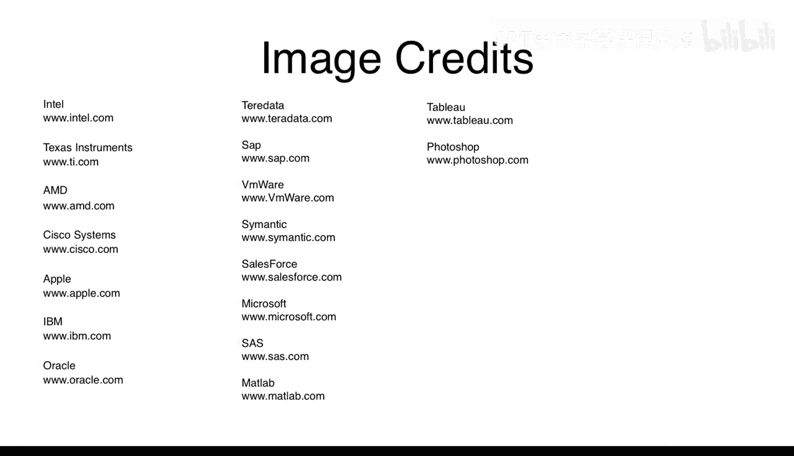

# 杜克大学《Excel 到 MySQL：商业分析（5课全）｜Excel to MySQL： Analytic Techniques for Business》中英 p27 27_03_02_硬件与软件公司.zh_en -BV1mS421X7yw_p27-

Hardware and software companies have used for a few business data analysts and data scientists。

But their primary need is for skilled software engineers and technical project managers。

Their company's value depends upon the efficient development and delivery of proprietary technology。

Hardware and software have unusual price dynamics。Technology has high fixed costs to develop。

And variable costs that are often close to zero。The first saleable copy of a complex enterprise software application might cost $5 million to develop。

But the second copy and every additional copy might cost a penny， essentially。

A new semiconductor chip may be produced in a fabrication plant that costs $5 billion to build。

But the variable cost of a single chip off of that assembly line。

Is only the cost of the raw material may be a few cents worth of clean sand。

Big data culture is possible only because of today's extremely low cost for storing and processing electronic information。

Today's absurdly low computing costs are the result of 50 years of ferocious price wars in commercial hardware and software markets。

Mars marketss that are driven by the unusual dynamic of high fixed costs and very low variable costs。

Price wars tend to drive any commodity product or service down to prices close to variable cost。

 In other words， most market participants lose money。Feww survive。Personally。

 I've seen a million fold decrease in data storage costs in my career。In 199 year 3。

 the year I launched my first software company， I was invited to visit what was then the largest commercial database in the world。

Owned by Mead， Data Central and Dayton， Ohio。They offered remote access by dialup modem to one terabyte of text stored on an acre of mainframed computers running Unix。

The hardware and software to store that one terabyte of text was worth over $100 million。Now。

 for $64， I can store one terabyte of data on my portable drive on my desk。

To survive hardware and software companies， I either need to figure out how to be the absolute lowest cost provider of a commodity good or service。

 or they need to dominate a value added branded niche so effectively that when a lower cost alternative inevitably appears the perceived cost of switching away from the dominant brand outweigh the benefits。

We'll briefly cover the largest survivors of this Darwinian struggle。

Organized by what layer of the information technology stack they primarily focus on。

These are the 20 or so companies that provide most of the core technologies for big data。

Information technology infrastructure is often described in terms of a stack。

 Our very simplified I stack has only three layers at the base， hardware。

 computers and routers in the middle， databases and enterprise software。 and at the top。

 desktop commercial software。At the base of the stack is hardware。

 chips and other components assembled into machines， servers and routers。 At this level。

 are semiconductor chip companies LED by Intel with revenues of 55 billion。

 and also including Texas Is， with revenues of 13 billion and AM D with revenues of 4。6 billion。

Cisco， the leading provider of Internet routers， has revenues of 49 billion。

A very unusual hardware company is Apple， with revenues of 224 billion。

 the largest I T company in the world。 In fact， by market capitalization。

 Apple is twice as big as the world's next largest company， Exxon Mole。

Apple is famous for its successful control of the entire stack from chips and monitors through the operating system。

 applications， look and feel， mobile devices， and all the way to proprietary value added services like iTunes and its own cloud storage。

In the middle layer of the stack are enterprise， scalable operating systems， web server software。

 big relational and distributed databases， and of course， big enterprise software applications。

This is software only professionals interact with。User friendly interfaces tend to be nonexistent。

 and little if any thought is given to making the products intuitive or easy to use。

The primary goal at this layer is scalability and， of course， security。

Leaders at the enterprise software level are IBM， with revenues of $86 billion。

Primarily focused on building enterprise systems for companies， then Oracle。

 with revenues of 38 billion。For large databases that can handle high simultaneous traffic and for enterprise software in the human resources。

 customer relationship management， finance and supply chain segments。Next， SAP。

 which has 21 billion in revenues for supply chain and finance systems。

A smaller player and one of Oracle's last surviving competitors in commercial databases is Terraadata with 2。

7 billion in revenues。Semantex， which makes enterprise security software， had 6。

7 billion in revenues。The Mware， which makes enterprise software that allows multiple operating systems and concurrent users on a single machine's hardware。

 had 6 billion in revenues。An interesting hybrid company。

Offering very complex enterprise level software to manage all aspects of customer relationship management and the sale process。

 but offering their software exclusively as a hosted service is Salesforce com with 4。

1 billion in revenues。Then comes the third layer， user friendly commercial desktop software applications that allow knowledge workers to access and work with company data。

This level is currently dominated by Microsoft with revenues of 86 billion for Microsoft Word， Excel。

 PowerPoint， and the rest。Slightly more technical statistics and modeling packages include SaS with revenues of approximately 4 billion。

And MatTlab， which is privately held owned by Mathworks with approximately 750 million in revenues。

Also， data visualization tools like Tableau with revenues of 468 million。

And digital imaging process tools like Adobe Photoshop with revenues of 4。35 million。

All these hardware and software companies have big data strategies。

 Microsoft is moving into the hosted software as a service space that is currently dominated by Amazon Web services。

IBM and Oracle both have cloud offerings， IBM even hosts SAP enterprise applications in the cloud。

All of these companies are trying to remake themselves as offering just in time and real time data for human or computer driven decision making。

Most have extensive machine learning and predictive analytics initiatives。 For example， IBM's Watson。

And Microsoft's Azure projects。

