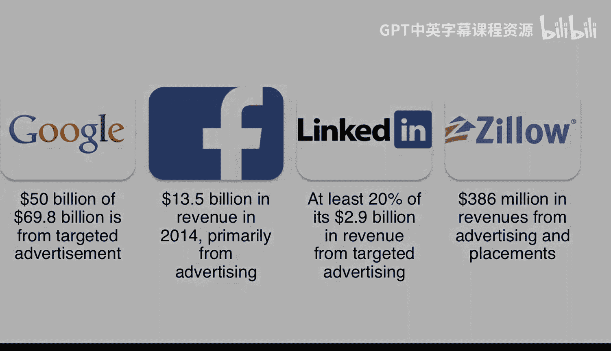

# 杜克大学《Excel 到 MySQL：商业分析（5课全）｜Excel to MySQL： Analytic Techniques for Business》中英 p28 28_03_03_数字化企业.zh_en -BV1mS421X7yw_p28-

The companies that we've chosen to identify as digital companies。

Are some of the leaders at using new business models to disrupt traditional markets or forge entirely new markets。

These companies are driven by developing new information technology。

Both software and business analytics for their own internal use。Mostly。

 the products or services they sell can be offered better， faster。

 cheaper than their competitors because of their superior grasp of real time data processing and machine learning。

Because they are architecting entirely new systems。

These companies need software engineers and to a lesser extent， data scientists。

 they have relatively less need for business analysts and business data analysts。

Amazon has completely transformed multiple retail industries， starting with books。

 moving on to electronics and other goods。But recently。

 its biggest impact has been in the hosted storage and processing business known as Amazon Web Services or AWS。

More than 6 billion of Amazon's 69。6 billion in revenues came from the giant server farms that it offers on a variable cost rent just as much as you need basis to global 2000 companies。

 medium sized business and many of the best known startups， including both Airbnb and Uber。

Amazon dot com surpassed Walmart in the summer of 2015。

 becoming the largest retailer in the world by market capitalization。

We have elsewhere discussed Amazon's outstanding real time user experience customization for revenue optimization。

Amazon also pursues a recurring revenue loyalty program model with its prime membership。

And competes as the low cost provider of data and processing hosting services worldwide。

Perhaps most extraordinary is Amazon's early dominance of the cloud computing sector。

 Amazon is rumored to have built over 500000 customized Linux servers to date。😊。

And its revenue from cloud computing。Are estimated to exceed that of its three closest rivals in the space。

 IBM， Google and Microsoft combined。Many Internet companies offer information and services for free and make their money by selling targeted advertising。

Or better positioning within search results。These companies use analytics both to make their services as useful and attractive as possible。

And also， to identify users toward whom to target specific advertising campaigns。

Leaders in the ad supported free to users category are， of course， first Google。

 where over $50 billion of their $69。8 billion in revenue is from targeted advertising。Second。

 Facebook with $13。5 billion in 2014 revenue， primarily from advertising， third。

 LinkedIn with multiple revenue streams， but at least 20% of its 2。

9 billion in revenue from targeted advertising。A fourth digital information company dominating the residential real estate rental and sales listings。

 real estate information and metric sector is zeroillow with 386 million in revenues。

 largely from advertising and placements。

Two companies that have generated tremendous attention for their innovative sharing economy business models。

And are equally impressive for their use of data analytics， are Uber and Airbnb。

Uber competes against traditional taxi companies。 Uber digitally links drivers with people needing rides。

 allowing each to see reviews of the other and allowing passengers to see a map of how far away the nearest Uber car is。

 and how long the soonest available will take to arrive。

 as well as getting a committed fixed price from Uber for a journey to a specified address before they set out。

Uber also charges more when demand for cars exceeds supply。

 a variable pricing method to optimize clearing of inventory of available cars。

Uber drivers own their own cars and work as independent contractors。

 so Uber has minimal capital expenditure。Uber takes a 20% commission for matching drivers and passengers。

 Uber's commission revenue is expected to exceed $2 billion in 2015 on 10 billion in gross spending by passengers。

Airbn B competes with traditional hotels。 Airbn B， which matches property owners who wish to rent out a vacant apartment or even a room with travelers who are looking for a more personal travel experience。

😊，Also provides mutual reviews of owners and renters。

 provides detailed mapping functionality to identify what is available in a given region and provides owners with predictive analytics tools to optimize their revenue based on location。

 day of the week， time of the year， et cetera。Airbnb collects a commission that averages 11% on room rentals。

 so about 420 million in revenues。On about 4 billion in bookings in 2014。

