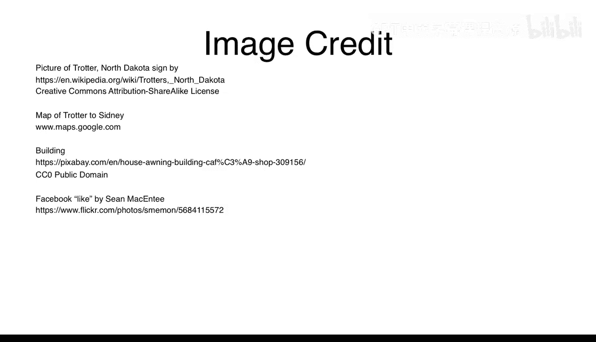

# 网络营销分析：1：网络营销指标概述

在本节课中，我们将要学习网络营销指标的核心概念。这些指标是衡量网络营销活动效果、并直接与增加销售收入相关的关键工具。

## 什么是网络营销指标？📊

网络营销指标是营收指标。与它们相关的分析可以直接带来销售额的增长。

这些指标是动态的。即使你对网站主页文本或为搜索结果中的赞助链接购买的关键词做出微小改动，也可能导致这些指标发生快速且显著的变化。

## 网络营销概述

为了给网络指标提供一个背景，我们首先快速概述一下网络营销。

就我们的目的而言，营销被定义为一种**有意的、可衡量的过程**。这个过程首先是为特定的品牌、产品或服务在目标人群中创造积极的认知和兴趣，然后持续地增加这种认知和兴趣。

## 理解目标人群

所谓目标人群，是指具有共同特征的一群人。例如，年龄都在18到35岁之间，来自同一个国家或地理区域等。

由于营销需要有效利用有限的资源，营销人员会努力将精力集中在那些成员比普通人更有可能了解产品或服务、购买它并最终成为高价值回头客的群体上。

## 案例分析：从本地到全球的营销挑战

假设你在北达科他州的特罗特斯开了一家披萨店，并在橱窗上挂了一个招牌。你几乎可以确定，任何想要吃披萨的特罗特斯居民都会从你这里购买。你最近的竞争对手在51英里外的蒙大拿州悉尼。在这里，你的目标人群就是住在特罗特斯的人。特罗特斯只有770名居民，在这样一个小镇上，几乎可以肯定每个人都会在几天内知道新开了一家餐馆。你的新顾客的转换成本——即去别处买披萨所需的时间和麻烦——在这种情况下，开车往返悉尼需要两个小时，这个成本非常高。因此，如果你的披萨做得还算不错，你很可能会培养出一批忠实的回头客。

现在，想象一下你在一个拥有60亿人口的城市开了一家新的披萨店。这听起来不错，有很多潜在客户。但坏消息是，当你开业时，你所在的街区已经有7万家其他披萨店开业，还有数百万家其他餐馆和商店在争夺注意力。这就是网络营销的世界。

## 如何定义网络营销中的目标人群？🎯

你应该尝试在这60亿人中识别出一个更小的群体，即你的目标人群。这个群体应该更有可能想要披萨，更重要的是，更有可能想要**你的**披萨。他们是一群比普通人更有可能对你独特的信息——即你与其他7万家披萨店有何不同——做出积极回应的人。

你传达差异的信息就是你的**市场差异化**。其核心思想是将你的市场差异化与一个目标人群相匹配。

## 案例分析：定义差异化与目标市场

假设你的差异化优势在于：你提供**严格的素食披萨**，并且你开发了一种特殊的冷冻工艺、运输箱和国际特许经营网络，使你能够将冷冻披萨运送到地球上的任何地方，并在两天内送达。

那么，你理想的目标市场可能是：已知喜爱披萨的人；出于健康、文化或宗教原因对严格素食有强烈偏好或需求的人；目前居住地附近没有素食披萨供应的人；能够负担得起包含运费在内的奢侈品的人；以及正在为未来计划特殊餐食，而不是现在立刻想吃披萨的人。

当然，人们并不会已经按照你所有理想的目标特征被整齐地分类好。你通常需要与他人预先定义的类别合作，这些就是所谓的**人口统计类别**。

## 利用人口统计数据定位

利用现有的类别，你可以找到尽可能接近你理想目标客户的目标人群。在这个案例中，你可以定义一个目标人群：收入高到足以负担奢侈品的人，以及居住在远离披萨店的偏远地理区域的人。

有时可以获得更具体的人口统计筛选条件。例如，你当然可以向Facebook上喜欢素食社区的724，000人做广告。从其他来源，你可能可以购买到那些因其工作职责而经常为他人购买奢侈餐食的人的姓名和电子邮件地址，例如办公室经理、企业销售代表、派对策划师等。

## 思考与拓展

你认为还有哪些其他职位可能与订购两天内送达的奢侈披萨有关？你还能想到哪些创造性的方法，可以利用人口统计数据来识别你理想目标市场的成员？

## 总结

本节课中，我们一起学习了网络营销指标的基础知识。我们了解到这些指标是动态且与收入直接相关的。我们探讨了营销的定义、目标人群的重要性，并通过一个披萨店的案例，从本地市场过渡到全球性的网络市场，深入理解了如何根据市场差异化来定义和寻找目标人群。最后，我们讨论了如何利用现有的人口统计类别和创造性思维来精准定位潜在客户。掌握这些概念是进行有效网络营销分析的第一步。