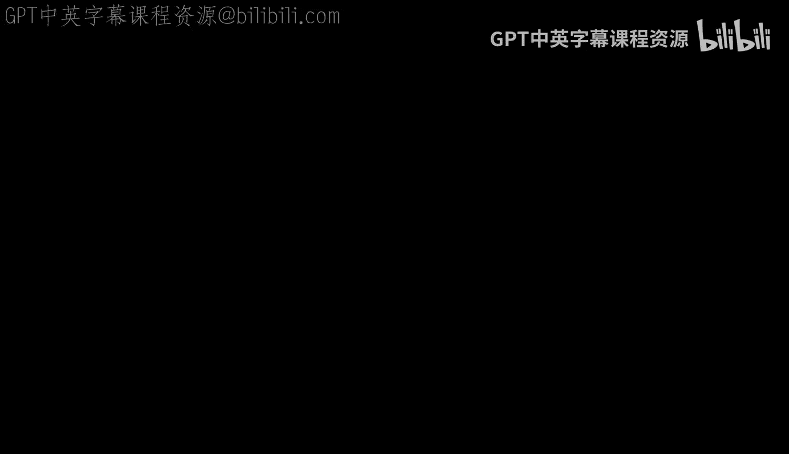
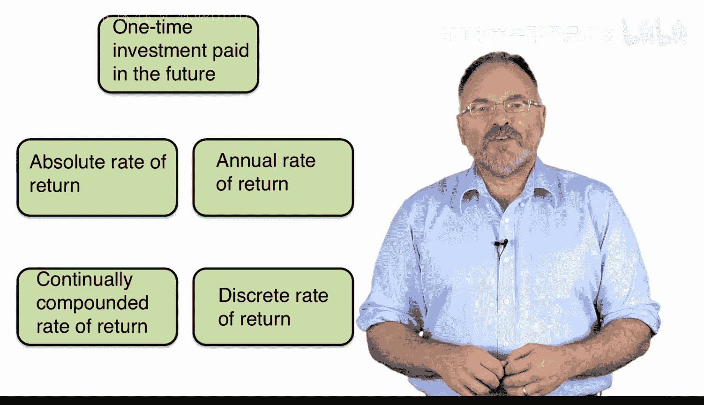
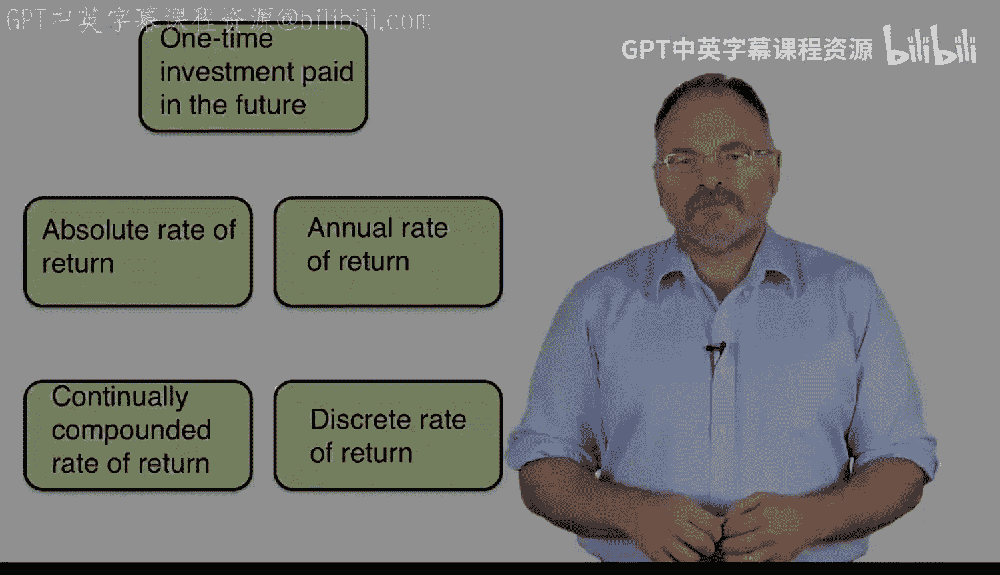
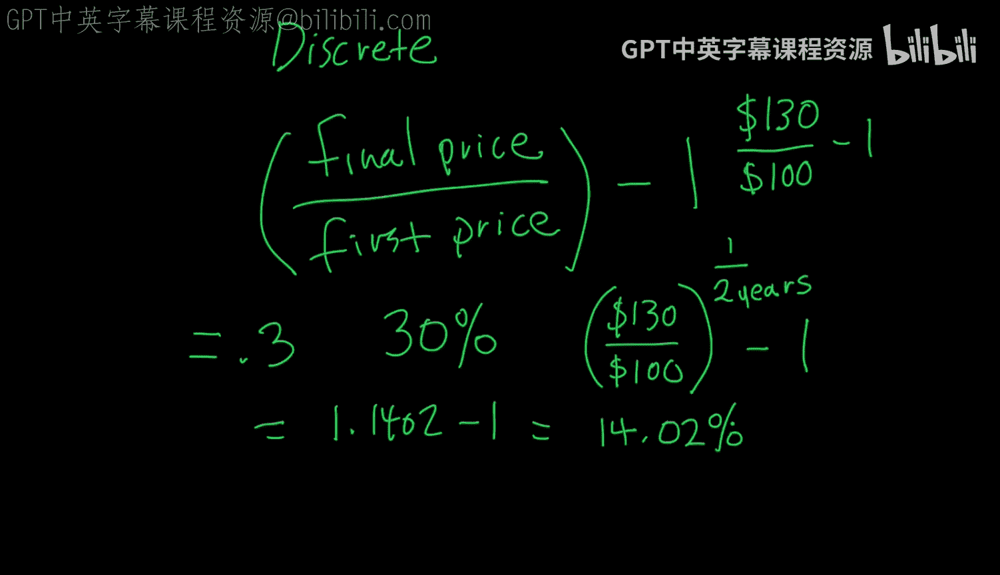
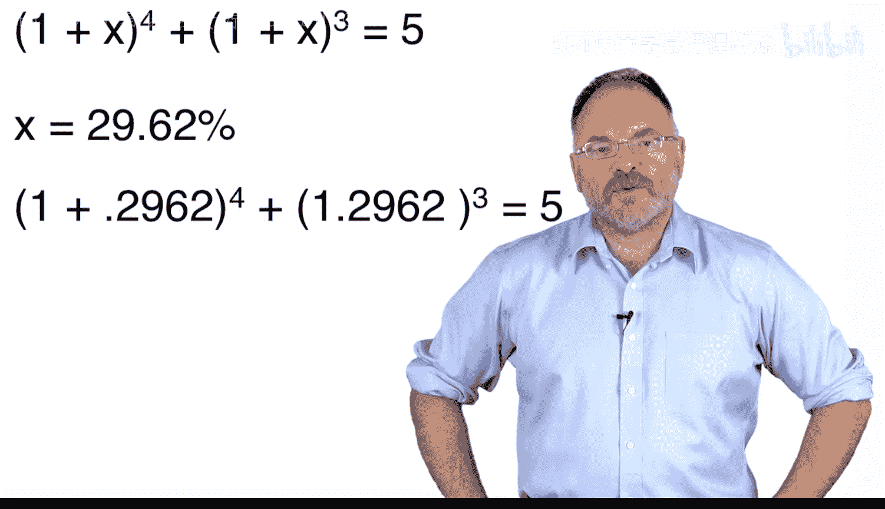
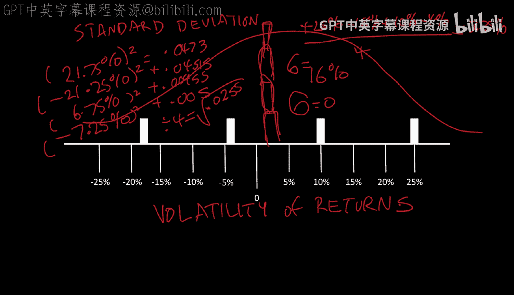
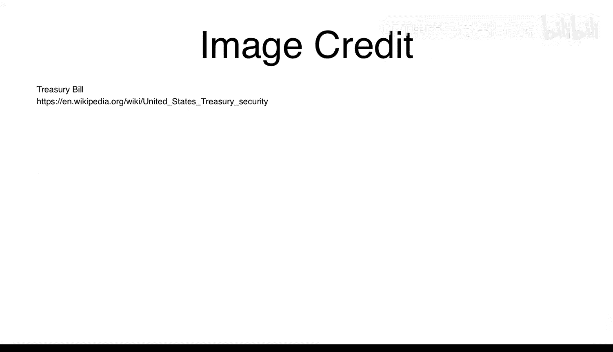

# 杜克大学《Excel 到 MySQL：商业分析（5课全）｜Excel to MySQL： Analytic Techniques for Business》中英 p32 32_04_01_金融服务指标：资金管理与投资.zh_en -BV1mS421X7yw_p32-

Money managers are professional investors who are paid to generate a return on other people's money。

The money management industry has its own specialized metrics for investment returns in general and for managers performance in particular。

We will now discuss returns and volatility of returns。

Asset returns are calculated in three main ways。For a onetime investment that pays off in the future。

The absolute and annual rates of return can be calculated either as a continually compounded or as a discrete rate of return。

Both continuously compounded and discrete are acceptable metrics。

 but because the two metrics will not give the same result。

In order to get a meaningful apples to apple's comparison。

 always use the same method when comparing two or more returns。

The first method， which calculates the continuously compounded return。

Involves taking the log to the base E。Usually written as a natural log LN。

Of the ratio of the final price。Divided by the first price。

And this will give us a value for the absolute return。So if we started with。$100。

 And we ended up with。$130。Its natural log。Of 1。3。This gives us point。2，6，2，4。Or。26。2。4 percent。

For the absolute return over the two year period。Then if we want to calculate the one year or annual return。

We simply divided this value by the number of years， to years。Get a value of 13。12%。Per year。

The second or discrete method。Involves taking the ratio of。The final price。Divded by the first price。

us one。So the way you would do this is youd simply say。130。Divided by 100。

Minus1 would be equal to 03， which is equal to 30%。notee that the exact same return of $130。

It givesives us 26。24% using the continuously compounded method and 30% using the discrete method。

Now if we wish to calculate the discrete annualized return。We will need to take the。Geiametric。Min。

Of our ratio of final price over first price。And then subtract one from that。 So in other words。

 we're going to take our ratio 130。Proided by 100。And we're going to take it to the。

Power that reflects how many time intervals we want to have。

 So if we want to have two time intervals。For a few years， we're going to take this to the one half。

Min-1。Its equal to。1。1402 minus1。Which is equal to 14。02。Percent。So again。

 notice that we get a different value for the geometric mean or discrete annualized return of 14。

2% versus the annualized continuously compounded return of 13。12%。

When an investment is not made all at once。But cash is invested at several different times。

 the metric used to evaluate the overall return。Is to identify a single fixed。

 discrete annual rate of return to apply to each of the payments that if summed would result in the final payout。

 this value is called the internal rate of return， or I R R。For example。

 assume an investment of $1 million at year0 and an additional $1 million at year1 to develop a property that is sold for $5 million a year4。

 we set up the problem as an algebra problem where we solve for x1 plus x to the fourth plus 1 plus x to the third equals 5。

Most pocket calculators have an IRR function， which will find that x equals 29。62%。In other words。1。

2962 to the fourth plus 1。2962 to the third equals 5。

Next we're going to look at calculating the。Beeiometric mean of a series of annual returns。

So let's suppose that I have four annual returns。Plus， 25%， minus 18%。Plus，10 percent。And minus 4%。

What I want to know is if I have$1 at the beginning of the four year period。

 how many dollars will I have at the end of four year period？

The way that I can calculate this is by looking at each year at a time and then taking the product。

 so I can say。For year one， $1 would be $1。25。For year two。$1 would be。没 sense。And excuse me。

 it presentents。For year three， $1 would be 110。And number4，$1 would be $96 cents。

If I multiply all these together， I'll find that I have 1。0824 or $1。

8 and a little bit of extra for an absolute return over the four year period of a little over 8%。

And if I want to convert this to an annualized return。

 I'm going to take the geometric mean over four time intervals of the value 1。0824。

And the way that I do that is I take 1。0824。One fourth power， four， because I have four years。Minus1。

And this gives me a geometric mean return。Of 2%。So as we've just seen。

 the geometric mean return of our four different annual returns。Is just about 2%。Though。

 we could have had。An investment that returned exactly 2%。Here for four years。

And it would have achieved the same outcome。As are much more scattered returns ranging from plus 25%。

 all the way down to minus 18%。But something that we very much want to know。

Is how scattered are our returns？It's a basic assumption of finance that all else being equal。

If two investment opportunities have the same long term return。

 we would prefer the one that doesn't have the huge range。Or scatter。

Of returns and is much more consistent。So the。Metric that we use to calculate how clustered together or spread out our returns are。

Is called the standard deviation。The way that we calculate standard deviation。As we take。First。

 take the arithmetic mean of our。Four values。Then we're going to subtract that mean from each individual value that gives us the distance from the mean of each value。

So for our values here。First step is to calculate the mean。It gives us 3。25%。

Now we're going to calculate for each of these values。We're going to subtract3。25% from it。

So this is going to give us。21。75%。-21。25%。6。75%。-7。25。First。Next， we take each of these。

Distances or differences from the mean。And we square them。And this is going to give us。可。4， seven，3。

04，51，5。00，4，5，5。0，05。And then we are going to add these together and take their average。So。

 this plus this。Plus this。 plus this。5 it by 4。That is going to give us 00255。

then we take the square root。Of that result。And that is going to give us 16%。

What we're actually saying here is if we have。A very tightly clustered group of outcomes。

So for example， all the outcomes are the same， then the standard deviation。

 which we traditionally represent by the Greek letter sigma， would be equal to0。

But if we have a much more spread out set of events。

Here we have a standard deviation that's equal to 16%。And deviation of returns is known in finance。

 as。Vololaatility of returns。And it is a standard measure of risk。Because as I said before。

 all else being equal。The greater the volatility of returns， the riskier an investment is。

An investment with a fixed payout。Like a bond。That also has effectively zero chance of loss is known as a risk free investment。

It has zero volatility of returns。The annual interest rate paid by financially strong national governments when they borrow in their own currency。

Is known as the risk free rate of return。Typically。

 the US government three month Treasury bill rate is used， this rate is currently 0。08%。

 far lower than its long term historical average of 4。55%。

The risk free rate is the rate for lending without risk。

 but large companies and financial institutions can also borrow at rates quite close to this rate。

 so it's often used for simplification of our problems。

