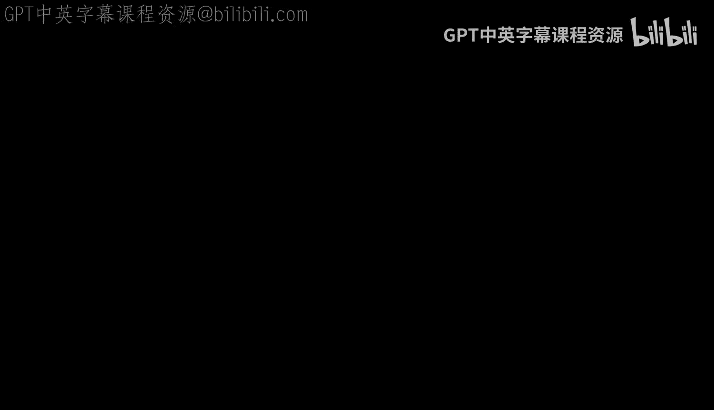
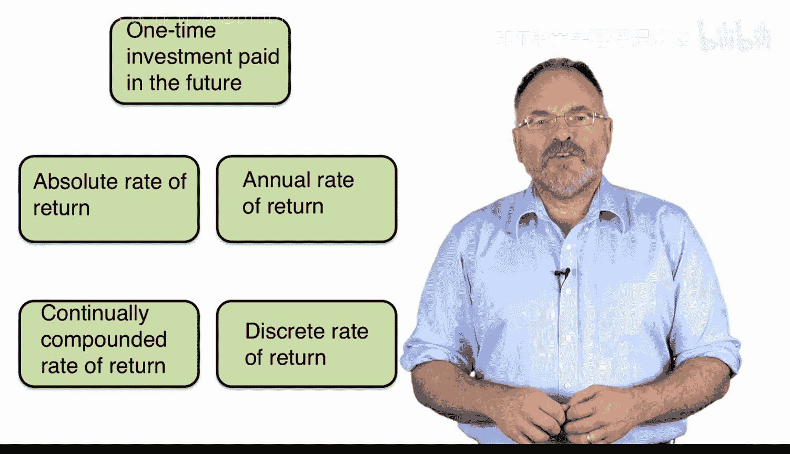
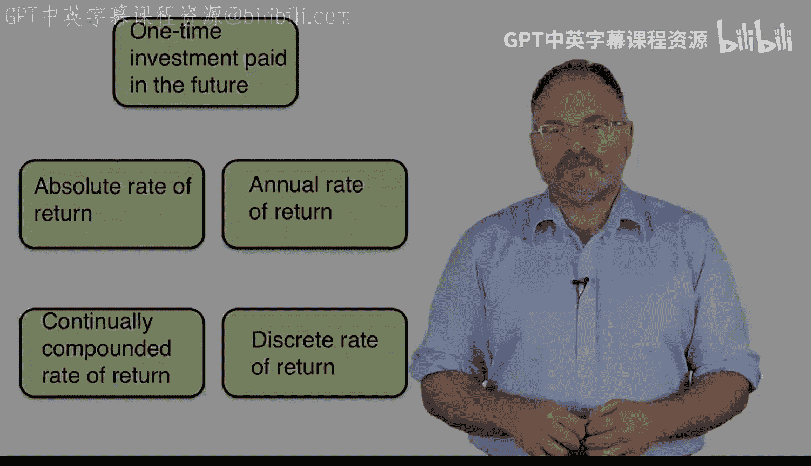
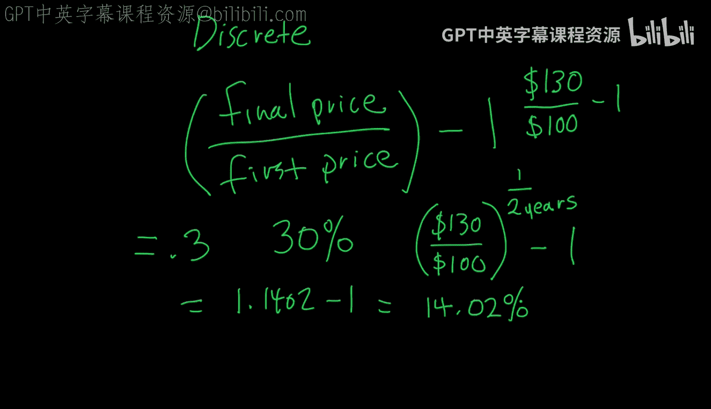
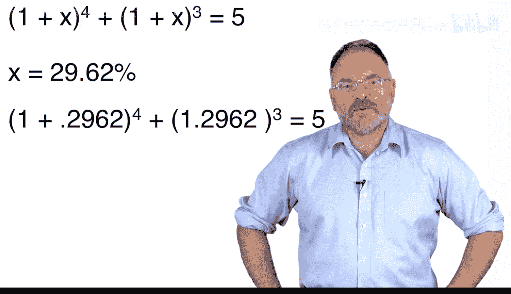
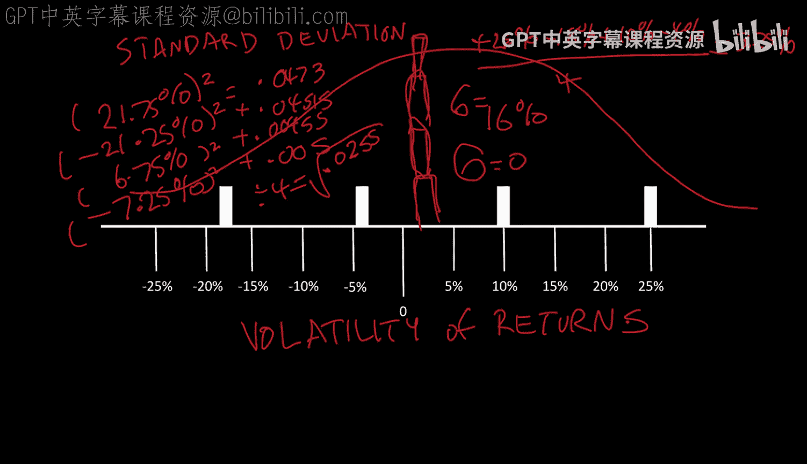
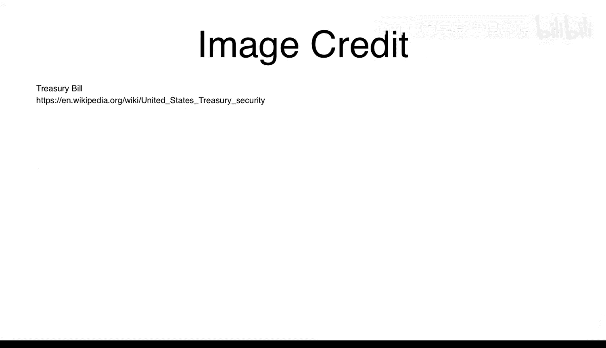

# 杜克大学《Excel 到 MySQL：商业分析》：第32课：金融服务指标：资金管理与投资

在本节课中，我们将学习金融服务领域的关键指标，特别是资金管理与投资回报的计算方法。我们将探讨如何计算不同类型的投资回报，理解回报的波动性（风险），并介绍风险与无风险利率的概念。

## 资金经理与投资回报

资金经理是专业的投资者，他们的职责是管理他人的资金以获取回报。资金管理行业有自己专门的指标来衡量投资回报，尤其是经理的业绩表现。接下来，我们将讨论回报及其波动性。

## 资产回报的计算方法

资产回报主要有三种计算方式。对于一次性投资并在未来获得回报的情况，可以计算绝对回报率和年化回报率。这些回报率既可以计算为**连续复利回报率**，也可以计算为**离散回报率**。

虽然连续复利和离散回报率都是可接受的指标，但两种方法得出的结果不同。为了进行有意义的、公平的比较，在比较两个或多个回报率时，应始终使用同一种方法。

### 连续复利回报率

第一种方法是计算连续复利回报率。它涉及计算最终价格除以初始价格比值的自然对数（以e为底，通常写作 `LN`）。这将给出绝对回报值。

**公式**：
`绝对回报 = LN(最终价格 / 初始价格)`

**示例**：
假设初始投资为 `$100`，最终价值为 `$130`。计算过程如下：
`LN(130 / 100) = LN(1.3) ≈ 0.2624`，即 `26.24%` 的两年期绝对回报。

要计算年化回报，只需将此值除以年数（2年）：
`年化回报 = 0.2624 / 2 = 0.1312`，即 `13.12%` 每年。

### 离散回报率

第二种方法是离散回报率。它涉及计算最终价格除以初始价格的比值，然后减去1。

**公式**：
`绝对回报 = (最终价格 / 初始价格) - 1`

**示例**：
使用相同数据：
`(130 / 100) - 1 = 0.3`，即 `30%` 的两年期绝对回报。

注意，相同的 `$130` 回报，使用连续复利法得出 `26.24%`，而使用离散法得出 `30%`。

要计算离散年化回报率，我们需要计算最终价格与初始价格比值的几何平均数，然后减去1。

**公式**：
`年化回报 = (最终价格 / 初始价格)^(1/年数) - 1`

**示例**：
`(130 / 100)^(1/2) - 1 = 1.1402 - 1 = 0.1402`，即 `14.02%` 每年。

再次注意，我们得到了不同的值：几何平均（离散年化）回报率为 `14.02%`，而连续复利年化回报率为 `13.12%`。

## 内部收益率（IRR）

当投资不是一次性投入，而是在不同时间点分批投入现金时，用于评估整体回报的指标是**内部收益率**。IRR 是一个单一的、固定的离散年化回报率，如果将其应用于每一笔投入的现金，其未来值的总和将等于最终的总回报。

**示例**：
假设第0年投资 `$100万`，第1年追加投资 `$100万`，用于开发一处房产，该房产在第4年以 `$500万` 售出。我们可以将此问题设立为一个代数方程来求解 `x`（即IRR）：
`(1 + x)^4 + (1 + x)^3 = 5`

大多数计算器都有IRR函数，可以解出 `x ≈ 29.62%`。换句话说：
`1.2962^4 + 1.2962^3 ≈ 5`

## 几何平均回报与标准差（波动性）

上一节我们介绍了IRR，本节我们来看看如何计算一系列年度回报的几何平均数，并衡量其波动性。

假设我们有四个年度回报率：`+25%`， `-18%`， `+10%`， `-4%`。我们想知道，如果在四年期初有 `$1`，四年期末将有多少美元。

以下是计算步骤：
1.  将每个回报率转换为增长因子（1 + 回报率）。
2.  将这些增长因子相乘，得到总增长倍数。
3.  计算几何平均回报率。

**计算过程**：
- 第一年：`$1 * 1.25 = $1.25`
- 第二年：`$1.25 * 0.82 = $1.025`
- 第三年：`$1.025 * 1.10 ≈ $1.1275`
- 第四年：`$1.1275 * 0.96 ≈ $1.0824`

总绝对回报约为 `8.24%`。要计算年化几何平均回报率：
`(1.0824)^(1/4) - 1 ≈ 0.02`，即 `2%`。

因此，尽管这四年的回报率波动很大（从 `+25%` 到 `-18%`），但其几何平均回报率约为 `2%`。一个每年稳定回报 `2%` 的投资，在四年后会产生相同的结果。

然而，我们非常想知道回报的分散程度。金融学的一个基本假设是，在其他条件相同的情况下，如果两个投资机会具有相同的长期回报，我们会偏好回报波动范围更小、更一致的那个。

衡量回报是集中还是分散的指标称为**标准差**。在金融中，回报的标准差被称为**回报的波动性**，它是衡量风险的标准指标。因为波动性越大，意味着投资风险越高。

以下是计算我们四个回报率标准差的步骤：
1.  计算算术平均值：`(25% - 18% + 10% - 4%) / 4 = 3.25%`
2.  计算每个值与平均值的差：
    - `25% - 3.25% = 21.75%`
    - `-18% - 3.25% = -21.25%`
    - `10% - 3.25% = 6.75%`
    - `-4% - 3.25% = -7.25%`
3.  将每个差值平方：
    - `0.2175^2 ≈ 0.0473`
    - `(-0.2125)^2 ≈ 0.0452`
    - `0.0675^2 ≈ 0.00456`
    - `(-0.0725)^2 ≈ 0.00526`
4.  计算这些平方值的平均值（方差）：`(0.0473 + 0.0452 + 0.00456 + 0.00526) / 4 ≈ 0.0255`
5.  取平均值的平方根（标准差）：`√0.0255 ≈ 0.16`，即 `16%`

**公式**（样本标准差）：
`σ = √[ Σ(每个回报 - 平均回报)² / (数据点数量) ]`

如果所有结果都相同，则标准差（通常用希腊字母 `σ` 表示）等于 `0`。对于我们这个更分散的数据集，标准差为 `16%`。

## 无风险利率

具有固定支付且实际上没有损失机会的投资（如某些债券）被称为**无风险投资**，其回报波动性为零。

财力雄厚的国家政府以其本国货币借款时支付的年利率，被称为**无风险回报率**。通常，使用美国政府三个月期国库券利率作为基准。该利率目前约为 `0.08%`，远低于其长期历史平均值 `4.55%`。

无风险利率是无风险借贷的利率，但大型公司和金融机构也能以非常接近此利率的水平借款，因此在简化分析问题时经常使用它。

## 总结

本节课中，我们一起学习了资金管理与投资的核心指标。我们介绍了计算投资回报的两种主要方法：连续复利回报率和离散回报率，并强调了在比较时应使用统一方法。我们探讨了用于评估分期投资回报的内部收益率（IRR）。接着，我们学习了如何计算一系列回报的几何平均回报率，并深入了解了衡量风险的关键指标——标准差（即波动性）。最后，我们介绍了无风险投资和无风险利率的概念，这是金融分析中的一个重要基准。理解这些概念是进行商业和投资分析的基础。