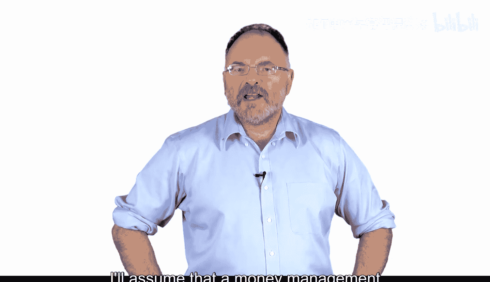
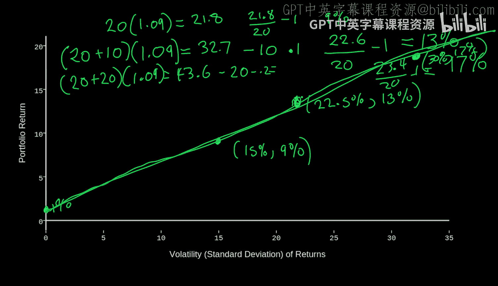
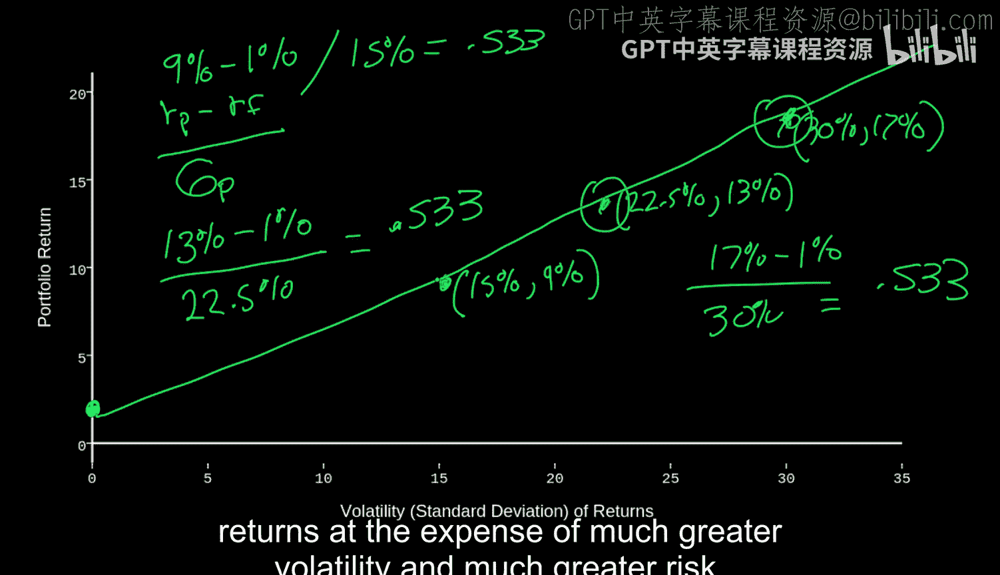
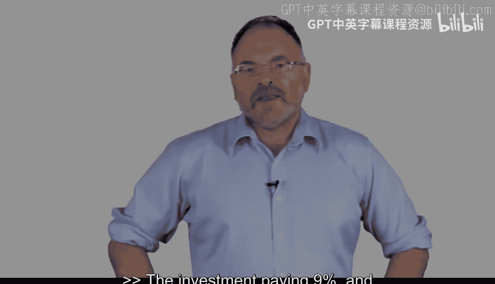
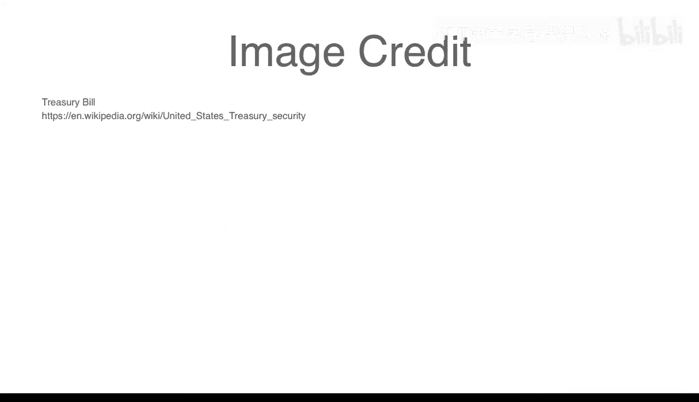

# 杜克大学《Excel 到 MySQL：商业分析（5课全）｜Excel to MySQL： Analytic Techniques for Business》中英 p33 33_04_02_不同收益率的等效性：夏普比率.zh_en -BV1mS421X7yw_p33-

One very interesting fact that our metrics help reveal。

Is many different rates of return that a money manager might claim are actually equivalent to each other in terms of that manager's skill。

 and the only difference between them may be whether they use leverage or investing in part with borrowed money to achieve their results。

 Let me explain what I mean。In the following discussion。

 I'll assume that a money management firm can borrow at 1% rate of return。

Asum a manager has used his skill to find the stock。

That has an annual return of 9% with an expected volatility of returns of 15%。

So in this standard diagram， we have volatility on the x axis and portfolio returns on the y axis。

 so we're looking a point at x equals 15， y equals9， which would be just about all right about here。

Though it would say the volatility of returns is 15%。An expected return is 9%。

So let's assume that a manager is investing $20 million。And。

They've generated this return by investing $20 million and getting back。21。8 million。

 so they have 20 million。Is 1。09。Pluss 21。8 million。

And our discrete return is calculated as 2128 divided by 20。Wei。90%。Okay。Now， let's suppose。

That this same manager borrows money。At。1% interest。Let's say that they borrowed $10 million。

Now they have 20 plus 10 or 30。To invest at the beginning of the year。And。At the same return。

They would have。32。7。Okay。哎。But before we can calculate the return， they would need to。

Give back the $10，$10 million。 Excus me， that they had borrowed and pay back the interest of 1%。

So the actual amount that they would have would be。22。6 million。RightThat's 32。7 minus-10。1。Over 20。

I one。Which would be equal to。13%。So simply by borrowing $10 million。

 they were able to boost returns on the same stock to 13%。However。

 you don't get something for nothing。In investing。And the cost or the price that you would pay here。

Is that you would also increase your volatility by。5%， so you would have volatility of。22。5%。

I have a point here that is。At 22。5%。And 13%。Now I'm running out a room， but we could try one more。

 we could say， well， what if I borrowed？My investor borrowed $20 million。 So now that's。An initial。

Equity position of 20 million and 20 million of borrowing， or 100% leverage。So it is 20 plus 20。

Times 1。09。You give us。43。6 million。Minus 20。inus 0。2， which would give us。23。

4 million I'm running out of space。 but we'll weather right here，23。4。Bided by 20，-1。

Would be a return of 17%。However。The volatility of this return would be。30%。 So as like I said。

 I'm running out of space because I'm all the way over here at 30%。17%。

But what you'll notice if I've drawn this picture correctly。Is it all these points essentially lie。

On a single line。And what's happening is we're borrowing money at 1 per。

 and we can actually achieve a return that is anywhere on this line。

 What that means is that in theory， a money manager could generate any return they wanted if they took enough leverage。

But their volatility of return would increase just as quickly。

This idea is captured in the sharp ratio。The excess return of the asset investment over the risk free rate。

Divided by the volatility of return of the investment asset。The sharp ratio is very interesting。

 it's a revenue metric divided by a risk metric， so it represents how many units of revenue can be achieved for how many units of risk。

Sharp ratio of the original investment。With return of 9 per cent。

And volatility of return of 15% is calculated as follows。9%。-1%。So this is the portfolio return。

Minus the risk free rate。Bided by。Vololaility of the portfolio return。So divided by 15%。Wols。

 point53，3。If I pick。The return of 13%。Now I'm going to have。And volatility of。

I'ming to have a return of。30% minus1%， so this is excess return over the risk free rate。

Divided by the volatility。To be 22。5%。And again， I get the same sharp ratio 0。

53B and finally for my 17% return。I'm going to have。7%， minus 1%。ByBy 30%。Equals 0。533。Logically。

 that all makes sense because we're talking about the slope。Of this line。

 we're talking about points that fall on this line with constant slope。

So any point on this line reflects the same skill level。And。

This is why you cannot compare to manager performance。Without knowing the volatility of returns。

Because otherwise， you could always have one manager increase their returns at the expense of much greater volatility and much greater risk。

The investment paying 9% and the one paying 17% are identical in terms of manager skill。

 and this equivalence is captured by the sharp ratio。

If I were hiring this manager， I would say focus on stock picking skill。

 and if I want to increase both my return and my risk。

I will borrow money and use it to invest in your fund。

 let me decide where I want to be on the revenue risk continuum。

You simply pursue the highest possible sharp ratio。

