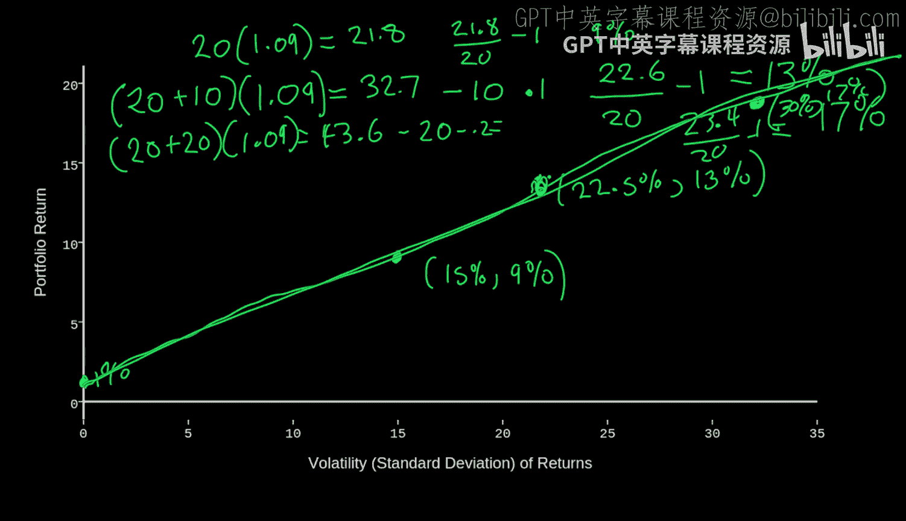
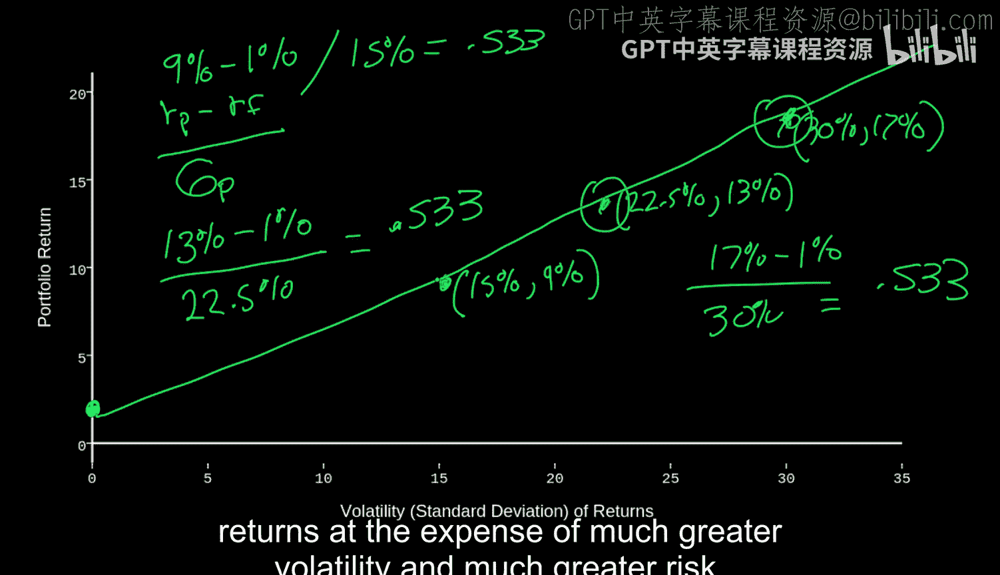
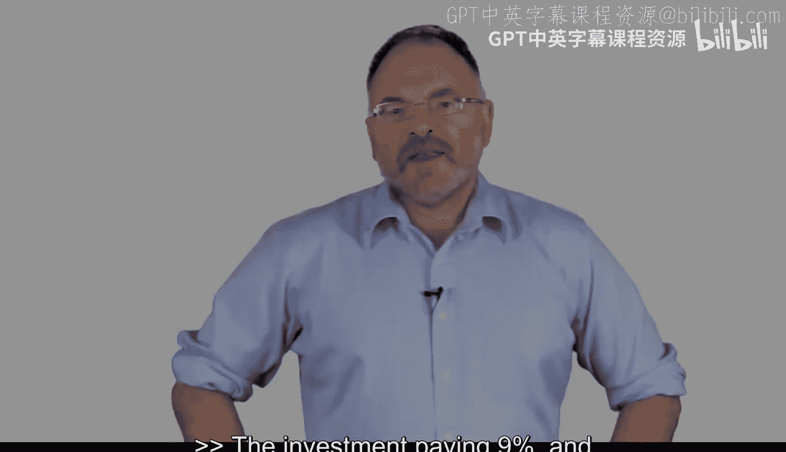

# 投资分析：第33章：不同收益率的等效性与夏普比率 📈


在本节课中，我们将学习一个重要的投资概念：不同收益率之间的等效性。我们将看到，基金经理声称的不同回报率，在衡量其投资技能时可能是等效的。关键在于，这些差异可能仅仅源于是否使用了杠杆，即通过借入资金进行投资。我们将通过夏普比率这一核心指标来量化这种等效性。

## 杠杆如何影响收益与风险


上一节我们介绍了投资回报的基本概念，本节中我们来看看杠杆如何改变投资的收益与风险表现。

假设一位基金经理运用其技能，找到了一只年化收益率为9%、预期收益波动率（风险）为15%的股票。我们通常用图表表示，X轴代表波动率，Y轴代表投资组合回报率。因此，这个投资点位于坐标（15%， 9%）附近。

现在，我们假设该经理管理着2000万美元的自有资金。通过投资，年末价值变为2180万美元。离散收益率计算如下：
```
收益率 = (2180 / 2000) - 1 = 9%
```

## 引入杠杆后的变化

接下来，我们假设这位经理决定以1%的利率借入1000万美元。

以下是引入杠杆后的资金变化步骤：
*   **初始总投资**：自有资金2000万 + 借款1000万 = 3000万美元。
*   **年末总价值**：以相同的9%收益率计算，3000万投资变为3270万美元。
*   **偿还债务**：需要归还1000万本金及1%的利息，共计1010万美元。
*   **最终自有资金**：3270万 - 1010万 = 2260万美元。
*   **计算新收益率**：
    ```
    新收益率 = (2260 / 2000) - 1 = 13%
    ```

通过借入1000万美元，经理将自有资金的收益率从9%提升到了13%。然而，投资中没有免费的午餐。为此付出的代价是风险也同步增加。因为借款放大了收益波动，新的波动率变为22.5%。于是我们得到了第二个投资点：（22.5%， 13%）。

我们可以进一步假设经理借入2000万美元，即使用100%的杠杆。

以下是100%杠杆下的计算：
*   **初始总投资**：2000万（自有）+ 2000万（借款）= 4000万美元。
*   **年末总价值**：4000万 * 1.09 = 4360万美元。
*   **偿还债务**：需归还2000万本金及1%的利息，共计2020万美元。
*   **最终自有资金**：4360万 - 2020万 = 2340万美元。
*   **计算新收益率**：
    ```
    新收益率 = (2340 / 2000) - 1 = 17%
    ```
此时，波动率进一步放大至30%。我们得到第三个点：（30%， 17%）。

## 理解夏普比率

如果我们把这三个点画在图上，会发现它们几乎落在一条直线上。这意味着，通过以1%的利率借款，经理理论上可以获得这条线上任意一点的回报，只要他愿意承担相应的风险。因此，基金经理可以通过增加杠杆来获得任何他想要的回报率，但回报的波动性（风险）也会以同样的速度增加。

这个核心思想被**夏普比率**所捕捉。夏普比率的计算公式为：
```
夏普比率 = (投资组合收益率 - 无风险利率) / 投资组合收益波动率
```
这是一个非常有趣的指标，它将收益指标除以风险指标，代表了每承担一单位风险所能获得的超额收益单位数。



## 计算与验证等效性

现在，我们来计算上述三个投资点的夏普比率，以验证它们的等效性。假设无风险利率为1%。


以下是各情景的夏普比率计算：
*   **情景一（无杠杆）**：收益率9%，波动率15%。
    ```
    夏普比率 = (9% - 1%) / 15% = 0.533
    ```
*   **情景二（借入1000万）**：收益率13%，波动率22.5%。
    ```
    夏普比率 = (13% - 1%) / 22.5% = 0.533
    ```
*   **情景三（借入2000万）**：收益率17%，波动率30%。
    ```
    夏普比率 = (17% - 1%) / 30% = 0.533
    ```

逻辑上这完全合理，因为我们计算的是那条直线的**斜率**。所有落在这条具有恒定斜率的直线上的点，其夏普比率都相同。因此，这条线上的任何一点都反映了基金经理相同的选股技能水平。

## 核心结论与应用

获得9%回报的投资与获得17%回报的投资，在衡量基金经理技能方面是**完全等效**的，这种等效性由夏普比率捕捉。

这解释了为什么在比较基金经理业绩时，不能只看回报率而忽略其波动性。否则，一个经理总可以通过承担更大的风险（波动性）来人为提高回报率。



如果我要雇佣这位经理，我会告诉他：请专注于你的选股技能。如果我想要同时提高我的回报和风险，我会自己决定借钱来投资你的基金，从而决定我想处于这条“收益-风险连续线”上的哪个位置。你的任务，就是追求尽可能高的夏普比率。



## 总结


本节课中我们一起学习了不同收益率之间的等效性原理以及夏普比率的核心作用。我们了解到，单纯比较投资回报率可能产生误导，因为高回报可能源于高杠杆带来的高风险。夏普比率通过将超额收益与所承担的风险相除，提供了一个衡量投资技能效率的统一标准。它告诉我们，落在同一条风险-收益直线上的所有投资组合，其经理的底层技能是相同的。因此，在评估投资表现时，必须同时考虑收益和风险，而夏普比率正是这样一个强大的综合度量工具。