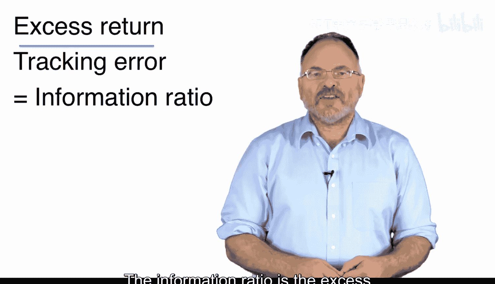
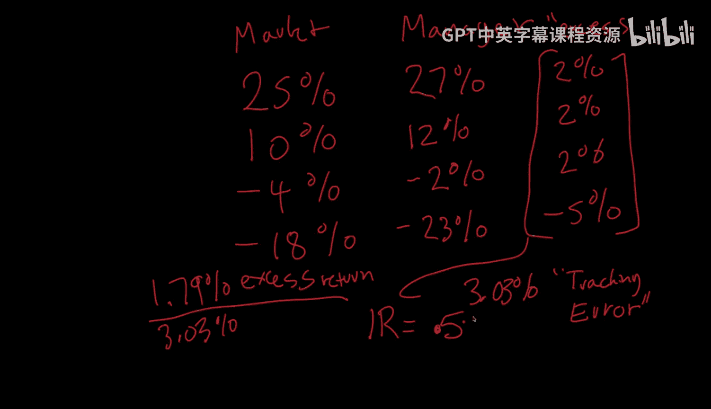
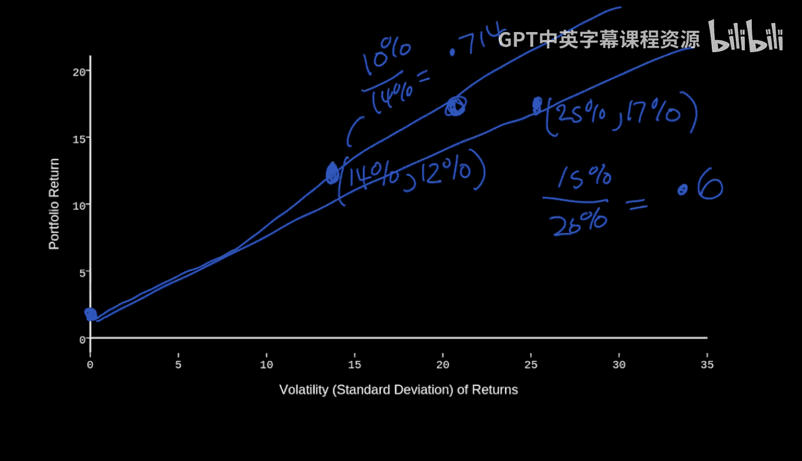
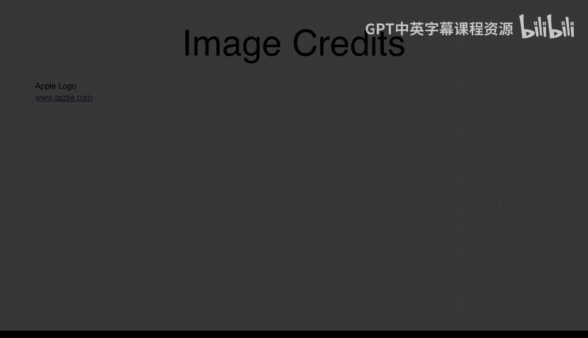

# 杜克大学《Excel 到 MySQL：商业分析（5课全）｜Excel to MySQL： Analytic Techniques for Business》中英 p34 34_04_03_四类资金管理者及其绩效指标.zh_en -BV1mS421X7yw_p34-

Different metrics apply to different types of money managers here will classify money managers into four basic groups。

First。Index fund managers。Second， mutual fund managers。Third。

 venture capital and private equity investors and fourth hedge fund managers。

Stock indexes are metrics used by investors to track the overall performance of an entire market rather than the performance of an individual stock。

For example， the S&P 500 index lookup symbol GSPC。Aggregates the stock price performance of the 500 largest companies in the US ranked by their market capitalization。

We should pause to explain that market capitalization is the current market price of one share of a company's common stock。

 multiplied by the total number of shares of stock of that company that potentially could be bought and sold。

 For example， a company with a share price of $52 per share and 5 million shares that could be traded would have a market capitalization of 52 times 5 million or $260 million。

The S&P 500 index is not a simple average of 500 stock prices。

 with each stock contributing 1500th or 0。2% to the total。This would be an equal weighted index。

 Instead， the S& P 500 index is a market capitalization weighted index。

 Each company's stock price changes are weighted by how much their market capitalization contributes to the total。

For example， because Apple has a current market capitalization of $666 billion。

 and all 500 companies together have a market capitalization of 15 trillion。

 then Apple stock price Apple stock price changes， contribution to the index。

 is weighted at 666 divided by 15，000 or 4。44% of the total。Now。

 one very popular type of investment strategy called passive investing is to buy and hold for the long term。

 an investment that tracks the performance of an index as closely as possible。

To do this for the S&P 500 index， one would buy units in State Streets Spidder S&P 500 EPF Investment Trust。

 Lookup symbol SPY。SPY is a $135 billion exchange traded fund that holds shares in all 500 index stocks in exactly the proportions they have in the index。

 SY was created in 1993 and is one of the most heavily traded assets in the world。

Index fund managers do not need to pick stocks； they are managing a passive investment。Nevertheless。

 they do have a challenging job， they are constantly working to rebalance and maintain the correct ratios of each stock to match a paper index exactly while at the same time minimizing transaction costs。

Index fund managers are judged on two factors， how closely their fund performance matches that of their index and how low their expense ratio is。

Most index funds track their index extremely closely。

 differences of even 1/10th of 1% in a year are unusual。

 so the primary focus in evaluating passive managers is on their expense ratio。

The expense ratio is the money spent on operating the fund。

Divided by the total market value of the fund assets。Operating costs include marketing。

 general and administrative expense， but mostly they're what the fund managers pay themselves。

The expense ratio does not include brokerage fees the fund pays to buy and sell its assets。

SBY has a current expense ratio of only 0。0945%。Which sounds good until you consider that that is over $127 million paid out every year。

Two more recently created competitors to the SBY， the Ishas S&P 500 Exchange traded funds， S IVV。

 and the Vanguard S&P 500 Exchange traded Fund， S V00， have significantly lower expense ratios， 0。

07% and 0。05% respectively。In so called efficient markets such as US publicly traded securities。

 a strategy of identifying a subset of stocks in one's universe。

That one's research suggests will outperform the market as a whole。

Then buying and holding those stocks。Almost never works over the long term。In fact。

 according to State Street， which markets SBY， over the past years。

 80% of professional active money managers who selected their stocks from among the universe of S&P 500 stocks。

And by the way， who are paid much higher fees typically than the 0。09% paid to Spise managers。

Performed worse than SPY。That's worse than random chance。

 If the managers pick their portfolios at random。Simply weighing them by relative market capitalization and held them。

 50% of managers would outperform the index。Nevertheless。

 many people still choose to invest their money with so called long only mutual fund managers。

People who pick equities from a universe， mutual fund managers are expected to specialize。

 Some of the ways that they specialize are by only buying stocks of a particular company size by market cap。

 large， small micro or the main categories， or in a particular market sector， such as mining。

 retail or information technology or in a particular country or group of countries such as the B。

 Brazil， Russia， India， China markets。The larger pool of 500 or 1。

000 or more potential investments from which a manager selects the 30 or so stocks he or she chooses to hold is known as his or her universe。

 the mean return of all the stocks in his or her universe is the relevant index that becomes the benchmark for evaluating the performance of that manager。

Mutual fund managers are judged primarily on three measures of how they perform relative to their benchmark。

 the first is excess return。So if the S&P 500 is their benchmark and it's up 8% and a manager selecting 30 S&P 500 stocks is up 12%。

 the manager's excess return over the benchmark is 4%。

One problem with the excess return methodology is that if the S&P 500 is down 20%。

 a manager with an excess return of 4% over his benchmark could still be down 16%。

In addition to excess return over their benchmark， managers are expected not to deviate too much from their benchmark。

The standard deviation of their excess returns is known as their tracking error。

 and it is considered undesirable to have a large tracking error。

Tracking error is a kind of risk metric。 It is the standard deviation of。

The difference between returns of the manager's portfolio and returns of their benchmark index。

The standard deviation of excess returns。The third metric。

 which combines excess return with the tracking error， is the so called information ratio。

The information ratio is the excess return divided by the tracking error。

We used the example of a market that over four years was up 25% one year， up to 10% one year。

Down 4% one year and down 18% one year。In addition to。XS return over the benchmark。

 managers are expected not to deviate too much from their benchmark。

And we can measure the degree of deviation by measuring the standard deviation of the excess return。

 So let's suppose that this is the market。And this is a manager。They the manager returns。

27% when the market returns 25。12%。-2% when the market returned-4% and-23% when the market returned minus 18%。

 So our excess returns。Would be。Two percent。2%。2% and minus 5%。Okayi。In this case， we would take the。

Standard deviation of the excess returns。And this would give us a value of。3。03%。

Which is known as the tracking error。A third metric combines excess returns with the tracking error。

 It's the socalled information ratio。So if we look at the geometric mean return of the manager over these four years。

It's an annual return that。Exceeds the market return by 1。79%。 So we have 1。79%。

Access return over the four years， annualized。Divided by the tracking error of 3。03%。

And this will give us an information ratio， an information ratio of our IR of。

An alternative approach to evaluating active equity managers。

One that， in my opinion， makes a great deal of sense is to look at their sharp ratio and in particular their sharp ratio compared to the sharp ratio of their benchmark。

For example。Suppose that the S&P 500 index returned 12% over a five year period with a volatility of returns of 14%。

 we can plot this on our standard chart at x axis equals 14%， Y axis equals 12%。嗯。

Now we want to compare that to a money manager。Who returned 17% per year。

So initially it sounds like that manager returned 5% per year more than the S&P 500 so that sounds good。

 however， when we look at that manager's volatility of return。

 it turns out that they had a volatility of returns of 25%。So to plot on our standard chart。

 we would have a position of 25%。17%。Now， let's suppose that over the time interval that we were talking about。

There was a risk free rate of 2%。What we would quickly see。Is that simply using the。

Passive index investment。But increasing leverage by borrowing money to buy the index。

Would have outperformed。Money manager。呃。The slope of the line is clearly less。嗯。

S&P return 10% more than the risk free rate of an annual volatility of 14%。

So the slope of that line is。And percent。Oh。14%。哦。714。And the。

Aanager's return and slope was significantly left。Their sharp ratio would be。15%。Bivided by 25%。Or。

We。We could have achieved the same 15% excess return。With a volatility of only 21%。

By simply buying the passive index fund。And paying for one third of it。With borrowed money。

And that would put us somewhere right about here。

In order for an active manager to outperform a passive index fund。They must maintain a higher。

 sharp ratio。Thenhan the index sharp ratio。

