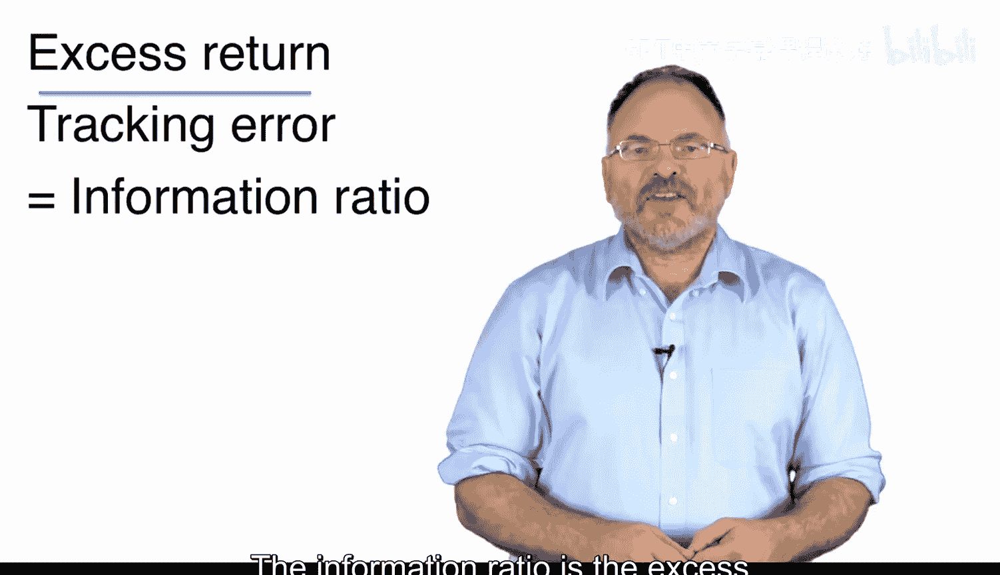
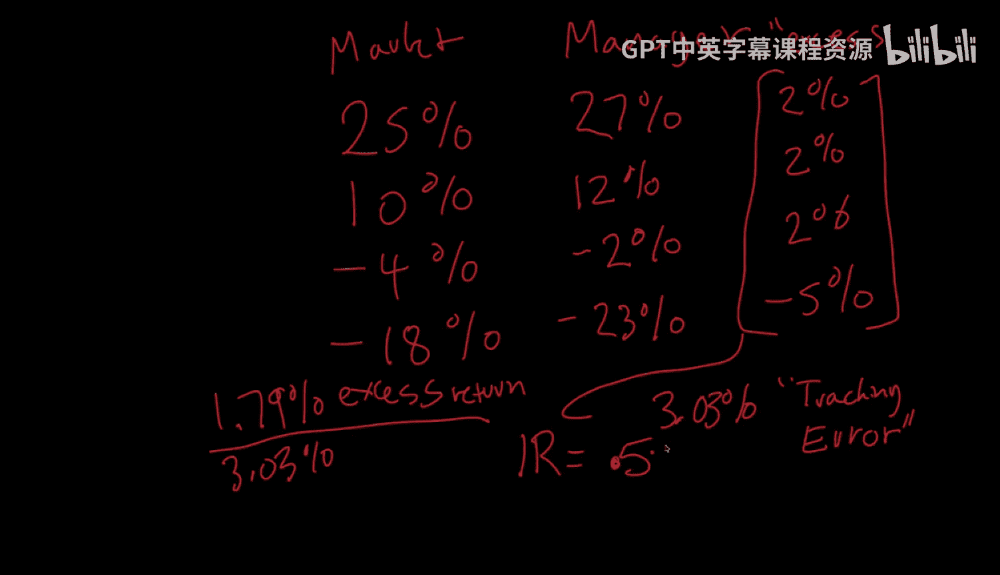
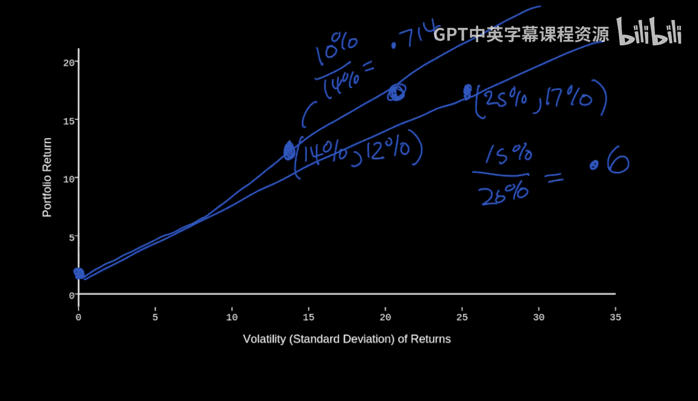
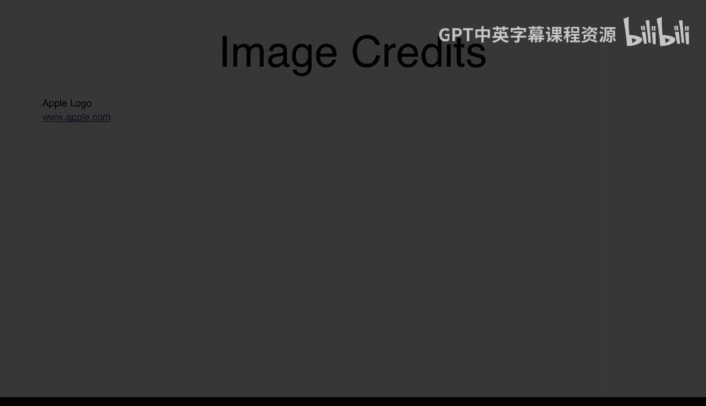

# 商业分析：第34课：四类资金管理者及其绩效指标 📊

在本节课中，我们将学习四种不同类型的资金管理者，并了解如何评估他们的绩效。我们将从最基础的指数基金管理者开始，逐步深入到更复杂的对冲基金管理者，并介绍用于衡量他们表现的关键指标。

## 概述

资金管理者负责投资他人的资金，但并非所有管理者都以相同的方式运作。不同的投资策略和目标需要使用不同的绩效指标来衡量。本节将资金管理者分为四个基本类别：指数基金管理者、共同基金管理者、风险投资与私募股权投资者以及对冲基金管理者。我们将逐一探讨他们的角色和评估标准。

## 指数基金管理者 📈

上一节我们介绍了资金管理者的分类，本节中我们首先来看看指数基金管理者。

指数基金管理者管理的是一种被动投资。他们的目标不是挑选个股，而是尽可能紧密地追踪一个特定市场指数的表现，例如标准普尔500指数（S&P 500）。

**市场资本总额**（简称“市值”）是一个核心概念，其计算公式为：
`公司市值 = 每股股价 × 流通股总数`

例如，一家公司股价为52美元，流通股为500万股，其市值即为 `52 × 5,000,000 = 260,000,000` 美元。

标准普尔500指数是一个**市值加权指数**，而非简单的股价平均。这意味着像苹果这样市值巨大的公司，其股价变动对指数的影响，远大于一家小公司。其权重计算公式为：
`公司权重 = 公司市值 / 指数总市值`

指数基金管理者通过购买指数中所有成分股来复制指数。他们的工作挑战在于精确维持与指数相同的股票比例，同时最小化交易成本。

评估指数基金管理者的绩效主要看两个因素：
1.  **跟踪误差**：基金表现与目标指数表现的接近程度。
2.  **费用比率**：基金运营成本占基金总资产净值的比例。公式为：
    `费用比率 = 基金运营费用 / 基金总资产净值`

例如，SPY（追踪标普500的ETF）的费用比率仅为0.0945%，但这笔费用每年仍超过1.27亿美元。更低的费用比率是评价被动型管理者的关键。

## 共同基金管理者 🏦

接下来，我们转向主动型管理者——共同基金管理者。与指数基金不同，他们试图通过研究来挑选能够跑赢大盘的股票。

在所谓的有效市场（如美国公开交易的证券市场）中，长期跑赢大盘非常困难。数据显示，超过80%的专业主动型管理者长期表现甚至不如简单的标普500指数基金。

共同基金管理者通常有自己专注的“投资领域”，例如特定市值规模的公司、特定行业或特定国家。评估他们时，会以其投资领域内所有股票的平均回报（即“基准指数”）作为参照。

以下是评估共同基金管理者的三个主要指标：

1.  **超额收益**：管理者投资组合的回报率减去基准指数的回报率。
    `超额收益 = 投资组合回报率 - 基准指数回报率`

2.  **跟踪误差**：这里指超额收益的标准差。它衡量了投资组合回报偏离基准指数回报的程度。较大的跟踪误差通常被视为风险较高。
    `跟踪误差 = σ(超额收益)`

3.  **信息比率**：将超额收益与所承担的风险（跟踪误差）结合起来考量的指标。它衡量了每承担一单位主动风险所获得的超额收益。
    `信息比率 = 超额收益 / 跟踪误差`

信息比率越高，说明管理者在承担相同偏离风险的情况下，获得了更高的超额收益。

## 夏普比率与主动管理评估 ⚖️

除了上述指标，另一种评估主动型股票管理者的有效方法是使用**夏普比率**，并将其与基准指数的夏普比率进行比较。

夏普比率衡量的是每承担一单位总风险（以波动率衡量）所获得的超额回报（超过无风险利率的部分）。公式为：
`夏普比率 = (投资组合回报率 - 无风险利率) / 投资组合波动率`

**核心观点**：一个主动型管理者要想真正跑赢被动指数基金，他/她的投资组合必须拥有比基准指数**更高的夏普比率**。

举例说明：
*   假设标普500指数年化回报为12%，波动率为14%，无风险利率为2%。则其夏普比率为 `(12% - 2%) / 14% ≈ 0.714`。
*   一位主动管理者年化回报为17%，波动率为25%。其夏普比率为 `(17% - 2%) / 25% = 0.6`。

虽然管理者的绝对回报（17%）高于指数（12%），但其夏普比率（0.6）低于指数（0.714）。这意味着投资者其实可以通过**投资指数基金并加杠杆**的方式，以更低的风险获得与管理相同的回报。因此，仅看绝对收益是不够的，经风险调整后的收益（夏普比率）才是关键。

## 风险投资、私募股权与对冲基金管理者 🚀

最后，我们简要了解另外两类管理者。

*   **风险投资与私募股权投资者**：他们投资于非上市公司。由于其投资标的流动性差、估值困难，评估其绩效更为复杂。常用指标包括内部收益率（IRR）和投入资本分红率（DPI）等，这些指标关注的是长期资本增值和现金回报。
*   **对冲基金管理者**：他们采用最广泛的策略，可以使用卖空、杠杆、衍生品等工具，投资范围也涵盖股票、债券、大宗商品等多种资产。其目标是无论市场涨跌都能获得绝对正回报。评估他们需要使用更复杂的阿尔法（α）、贝塔（β）以及各种风险调整后收益指标。

## 总结

本节课中我们一起学习了四类主要的资金管理者及其绩效评估指标。
1.  **指数基金管理者**通过紧密追踪指数进行被动投资，评估重点是**费用比率**和**跟踪误差**。
2.  **共同基金管理者**进行主动选股，使用**超额收益**、**跟踪误差**和**信息比率**来评估其相对于基准的表现。
3.  评估主动管理者时，**夏普比率**是一个重要工具，管理者必须拥有高于基准的夏普比率才算真正创造了价值。
4.  **风险投资/私募股权**和**对冲基金**管理者使用更专门的策略和评估指标。

理解这些分类和指标，是分析和选择投资产品、评估资金管理能力的基础。