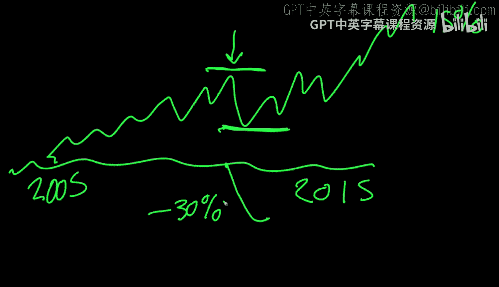

# 杜克大学《Excel 到 MySQL：商业分析（5课全）｜Excel to MySQL： Analytic Techniques for Business》中英 p35 35_04_04_风险投资与私募股权投资者.zh_en -BV1mS421X7yw_p35-

Venture capital and private equity funds differ from mutual funds and hedge funds in a number of important ways。

 For one thing， the fund managers do not collect all their cash from investors upfront。Instead。

 investors make commitments to provide a certain amount of cash over the five to seven year life of a typical fund。

With tranches of that cache being available on what's called a call basis。

 typically within 30 days being called。So a large institutional investor might make a $20 million commitment to a venture capital fund and expect eight calls of $ two and a half million dollars each spread out over four to five years。

The reason for this structure is that venture capital and private equity investments take a long time to source。

 develop and structure。And often multiple investments will be made in the same company over a period of multiple years。

 up to five years。Prior to the money actually being needed by the investors。

 the outside sources of capital don't want the money sitting around iddle。

 they'd rather invest it elsewhere。In liquid investments， that can be cashed out quickly。

Because investors are providing cash to the fund in various amounts over a period of several years。

The best metric for evaluating performance of these type of funds is the internal rate of return。

The discrete， compounded rate of return on just the money actually drawn by the funds。

Hedge funds have far fewer restrictions on what types of investments they can make than mutual funds。

 for instance。Hedge funds are permitted to short。Which means structuring a deal so that they make money when a stock price goes down。

And to invest in many different types of assets， including options and derivatives。

Hedge funds are not tied to a single sector universe。

 so it would not make sense to use a sector benchmark to evaluate them。In fact。

 to achieve maximum diversification， investors in hedge funds typically want hedge fund performance to have a low correlation to all the major equity markets。

A great hedge fund will be up in a bull market and up just as much in a bear market for equities。

Of course， the track record， a strong annual rate of return over multiple years， is a key metric。

 so is the sharp ratio。And。Because the holdings and working of hedge funds are less transparent than mutual funds。

 hedge fund investors are very wary of big drawdowns。Therefore。

 another key metric for hedge funds is the maximum drawdown from high watermark。

So it may look impressive。😡，If from 2005 to 2015， a hedge fund has an annualized rate of return of。

Let's say 15% per year。But if there was a 30% drawdown。Say during the big bear market in 2007， 2009。

Investors will think I could have been the unlucky one who invested first right there。

 and so then I would have lost。😡，in-30% of my money。哎。

So the reality with hedge funds is if they start to show losses in the 2025 and certainly 30 percent。

Range， people start redeeming their money immediately， and the hedge fund will generally collapse。

Metric related to maximum drawdown from high watermark。Is years to break even。

 And the way to think about this。Is to identify the worst high to low loss over sometime interval。

And what we're looking at here is the S&P 500 index。From。August 10th， 2007 to May 20th， 2015。

And our worst loss。Would be from。October 9th。Thous07。2。March 9。2009。Then the market was down。57%。

Needless to say no hedge fund would survive that kind of loss。

And then we calculate the annualized return from the beginning to the end。 So we're looking at。

The slope of this line， and this return would be 5%。

And then we take the absolute value of the maximum drawdown。Sivided by the annualized return。

And that gives us a number referred to as years to break even。Which is the number of years。

At the average return。That an investor would recover from the worst loss。 This， of course。

 would assume that they entered the fund at the worst possible moment， but somebody will， right。

 And you don't want it to be you。 So it's interesting to see that for the S&P 500。

 the years to break even is over 11。Hedge funds need to have years to break even in the two to three range maximally in order to continue to attract new investment。

Finally， to minimize correlation with equity markets。

 investors like to see a strong linear trend in the log value of wealth in a fund。

 if a fund is generating a steady， continually compounded return every day。

 its volatility of return would be zero。And its internal linear correlation of time and log wealth would be one。

