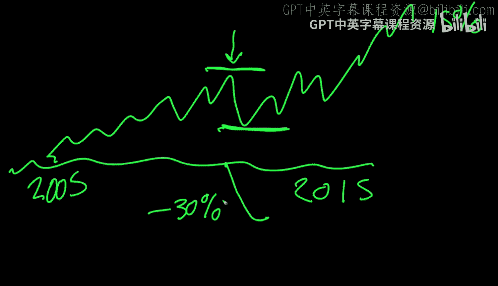

# 商业分析：P35：风险投资与私募股权基金评估 🏦

在本节课中，我们将学习风险投资与私募股权基金与共同基金、对冲基金的关键区别，并重点介绍评估这些另类投资基金绩效的核心指标。

## 基金结构与资金承诺 💰

上一节我们介绍了共同基金和对冲基金的基本特点，本节中我们来看看风险投资与私募股权基金在运作方式上的独特之处。

风险投资和私募股权基金在多个重要方面与共同基金和对冲基金不同。首先，基金经理不会在基金成立时一次性从投资者那里收取所有现金。相反，投资者会做出承诺，在一个典型基金为期五到七年的生命周期内，提供一定数额的现金。这些资金以“缴款通知”的方式分批次到位，通常在接到通知后30天内缴付。

以下是一个具体的例子：
*   一个大型机构投资者可能向一个风险投资基金承诺2000万美元。
*   他预期在四到五年内，会收到八次各250万美元的缴款通知。

采用这种结构的原因是，风险投资和私募股权投资需要很长时间来寻找项目、进行培育和构建交易。并且，通常会在多年内（最多可达五年）对同一家公司进行多轮投资。在投资者实际需要资金之前，外部资本来源不希望资金闲置，他们更愿意将其投资于其他地方，例如可以快速变现的流动性资产。

## 核心绩效指标：内部收益率 📈

由于投资者是在数年内分批向基金提供现金，评估这类基金绩效的最佳指标是**内部收益率**。它是基金实际动用资金所产生的离散、复合回报率。

## 对冲基金的评估要点 ⚖️

现在，让我们将目光转向对冲基金。与共同基金相比，对冲基金在投资类型上受到的限制要少得多。例如，对冲基金被允许进行**做空**操作，这意味着构建一种在股价下跌时也能赚钱的交易。它们还可以投资于许多不同类型的资产，包括期权和衍生品。

对冲基金并不局限于单一行业领域，因此使用行业基准来评估它们是没有意义的。事实上，为了实现最大程度的分散化，对冲基金的投资者通常希望其表现与所有主要股票市场的相关性都很低。一个优秀的对冲基金应该在牛市上涨，在熊市中也能为股票投资带来同样可观的收益。

当然，过往业绩记录（多年强劲的年化回报率）是一个关键指标，**夏普比率**也是如此。并且，由于对冲基金的持仓和运作比共同基金更不透明，对冲基金投资者对大幅回撤非常警惕。因此，对冲基金的另一个关键指标是**从高水位线起的最大回撤**。

## 理解最大回撤与盈亏平衡年数 📉

所以，如果一个对冲基金从2005年到2015年实现了年化15%的回报率，这看起来可能令人印象深刻。但如果期间出现过30%的回撤，比如在2007-2009年的大熊市期间，投资者会想：“我可能就是那个在最糟糕时刻入场的倒霉蛋，那样我就会损失30%的资金。”因此，对冲基金的现实是，如果它们开始出现20%-25%，特别是30%范围的亏损，人们会立即赎回资金，对冲基金通常就会崩溃。

与“从高水位线起的最大回撤”相关的另一个指标是**盈亏平衡年数**。理解这个概念的方法是：识别出在某段时间间隔内，从高点下跌到低点的最严重损失。

这里我们以标普500指数为例，观察区间为2007年8月10日至2015年5月20日。期间最严重的损失发生在2007年10月9日至2009年3月9日，市场下跌了57%。不用说，没有对冲基金能在承受这种损失后幸存。

然后，我们计算从起点到终点的年化回报率，即观察这条线的斜率，假设这个回报率是5%。接着，我们取**最大回撤的绝对值除以年化回报率**，得到的结果就是所谓的“盈亏平衡年数”。它表示在平均回报率下，投资者从最严重的损失中恢复过来所需的年数。这当然假设了他们在最糟糕的时刻进入了基金，但总会有人在这个时点进入，而你不希望那个人是你。

有趣的是，对于标普500指数，盈亏平衡年数超过了11年。而对冲基金需要将盈亏平衡年数控制在最多两到三年的范围内，才能持续吸引新的投资。

## 理想表现：稳定的复利增长 📊

最后，为了最小化与股票市场的相关性，投资者希望看到基金财富对数值呈现强劲的线性趋势。如果一个基金每天都能产生稳定、持续复利的回报，其回报率的波动性将为零，其时间与财富对数值的内部线性相关性将为1。

---

本节课中我们一起学习了风险投资、私募股权基金独特的资金承诺结构及其核心评估指标——内部收益率。同时，我们深入探讨了对冲基金的评估要点，包括其灵活性、关键绩效指标（如夏普比率），以及投资者极为关注的最大回撤和盈亏平衡年数概念。理解这些差异和指标，对于分析和选择另类投资基金至关重要。