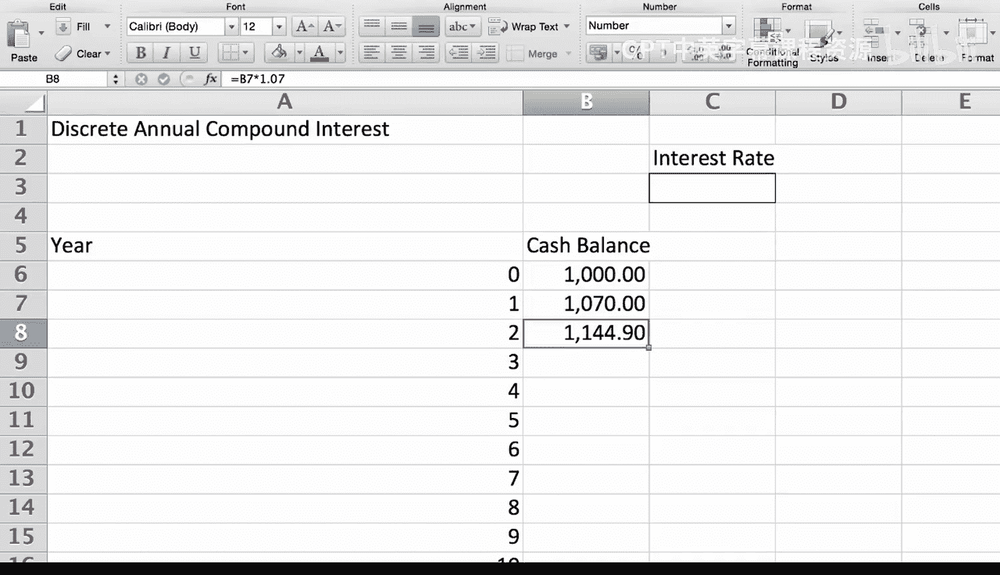
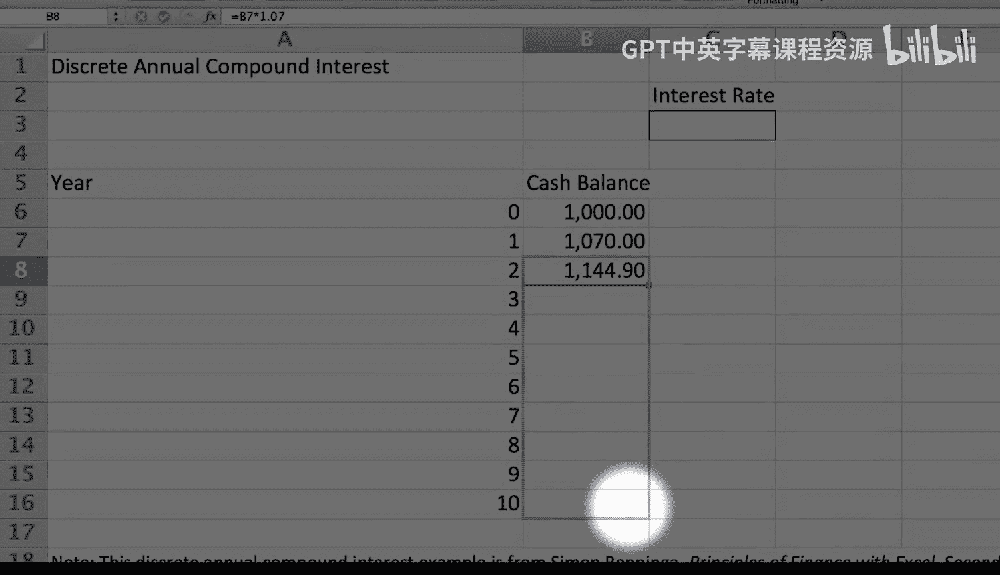
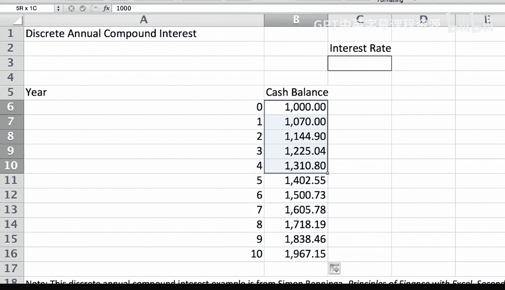
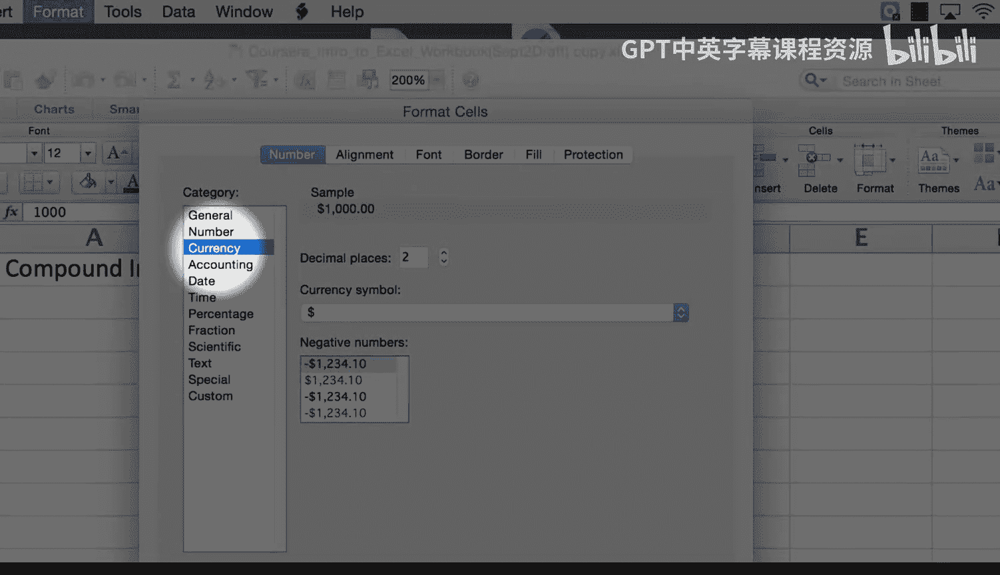
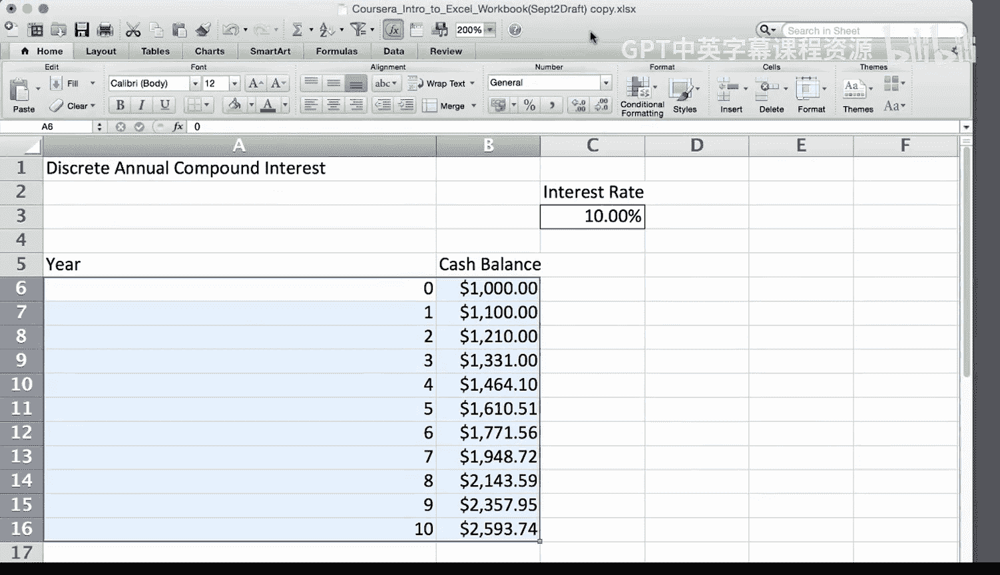
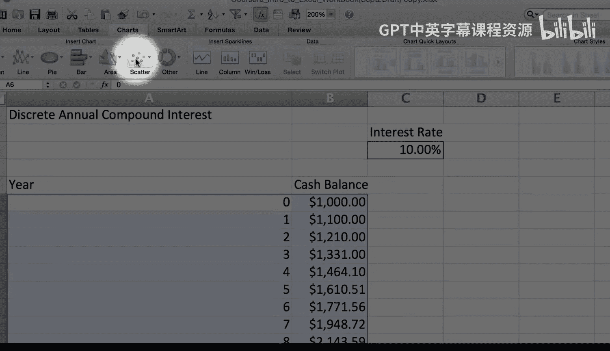
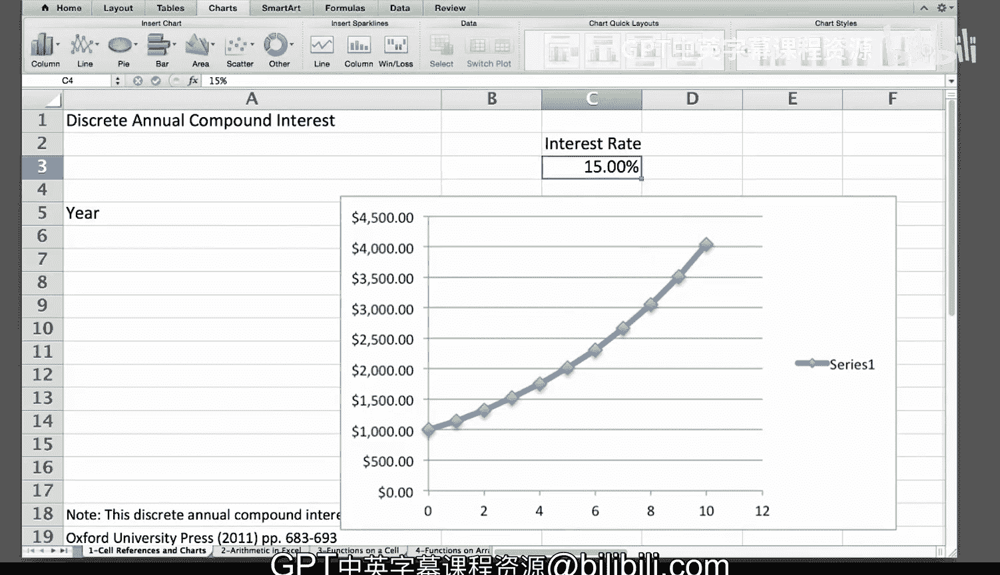
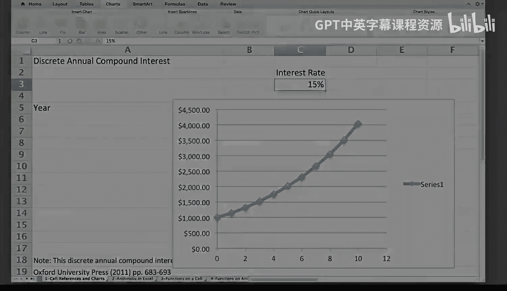

# 杜克大学《Excel 到 MySQL：商业分析（5课全）｜Excel to MySQL： Analytic Techniques for Business》中英 p39 04_02_03_Excel基础词汇与图表入门.zh_en -BV1mS421X7yw_p39-

So。We begin at the very beginning with the way that you identify locations on an Excel spreadsheet。

You'll notice that we have。Row numbers。And we have letters for columns。

So the way that you would identify a particular location would be to say， for example。

 if you look at the square that is currently highlighted in blue。This is cell， B7。

This would be cell B6。This would be cell C6 and so on。

What we'd like to do now is work a very simple problem。Where we have a。Fixed annual。Interest rate。

And our wealth compounds over 10 years， and we'd like to know how much wealth we have at the end of 10 years。

 given a particular interest rate。So let's assume that our interest rate is 7% per year。

One good way to solve this problem would be I will enter the cell where my initial$000 cash balance。

Fears， which would be。B7， notice also I type an equal sign。To activate a cell。

 that is what allows a formula to be effective。So I'm going to enter a cell B。6ix。Times。1。07。

And that should give me。1070， that's great。Now， what I've done is I've created what's called a relative reference。

What that means is that if I select。The cell that I have just entered a formula into。

And I drag it down。What happens？Excelel automatically changes my relative reference。

And now I'm referring to cell B7。In other words， here I'm referring to the cell directly above。

And so here I'm referring to the cell directly above and so on。 So if I drag this little square。

 which is called a handle I and I drag it， I grab onto it and I drag it down。

I will have my answer， 1，96715。And since these are supposed to be in dollars， I can select。

Notice how I select， I don't click on the handle， I click within the body of the cell。

And I drag， and I'm going to go to format cells。And then it will give me options for how to format。

 and I'm going to select the currency option， and in fact it even gives me options within currency but I'm happy with that one。

 so now I have currency values。

ok。That is a perfectly good and correct way to do the problem。

 but it's not the only way to do the problem。Okay。😊，So let's see how else we can do it。Now。

 a very handy shortcut that Excel has。Is that I can enter my formula。

And if I click double click on the handle。And there is something in the column immediately to the left。

 it will fill in all the squares down to where the last square where there is something on the left。

So with one double click， I can fill in this entire chart。Okay。

And if you look at each of these individual values， they're all relative references。By the way。

 you'll notice that this， whatever it is that I have selected also appears here。

This is known as the formula bar， and I can edit formulas directly in the formula bar if I prefer。

Okay， so that's pretty cool， that's pretty easy， and that's also a correct way to do the problem。

But there is a more generalizable way to do the problem。That I think is。

More the way that you should try to do problems in general when you can。

Which is to use what's called an absolute reference。

 you'll notice that if I want to change the interest rate。

 I've got to type something new into at least one square and I've got to repopulate all of those squares。

But I've set up a place to put an interest rate over here。So 7%。Alright， and now I am going to。

Use my relative。Reference， which is。B。6。Times。one。Plus。What's called an absolute reference。

Excel's symbol for an absolute reference is the dollar sign， so if you use a dollar sign。

Before each part of the reference and notice that it lights up for you to tell you where it is。

Now when I fill in the squares below row 7。That part of the formula will remain constant。

So let's see if it works。And it works beautifully。And what's cool about this is I can just change the interest rate right here。

And it immediately updates my whole result。Okay， pretty nice， very nice， right？Okay。Also。

 if you graph these results， now I've selected these cells together。I'm going to go to charts。

I am going to go to scatter。

And I'm going to use a straight marked scatter。Okay。😊，This is a picture。Of my data。Okay。

And if I change this interest rate。It automatically updates my chart。

And that is pretty convenient and pretty cool。

