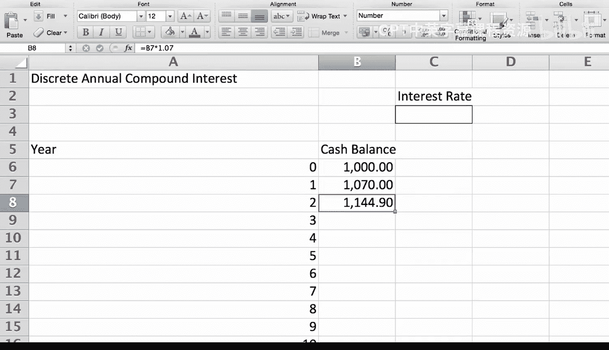
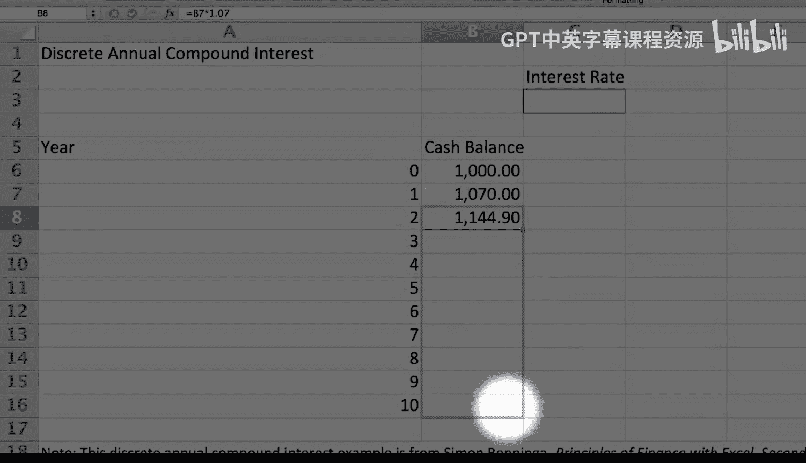
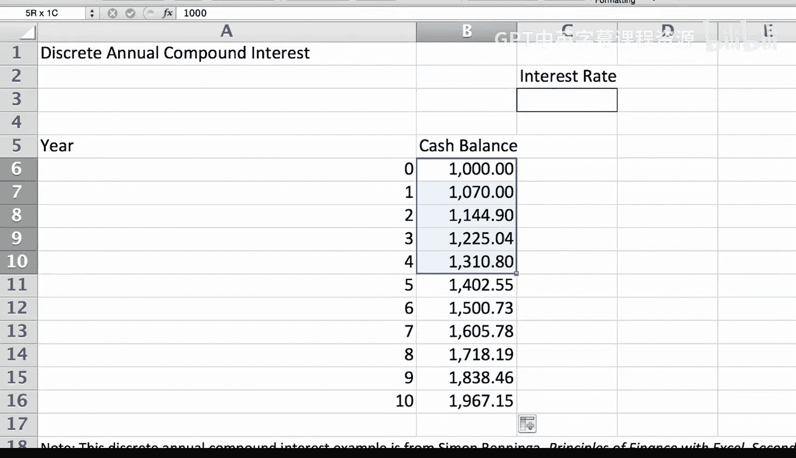
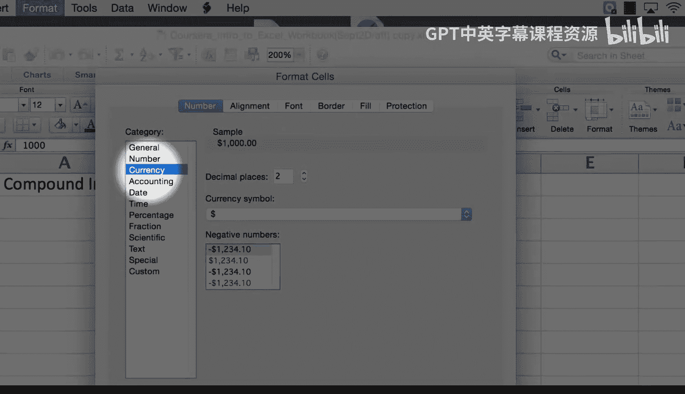
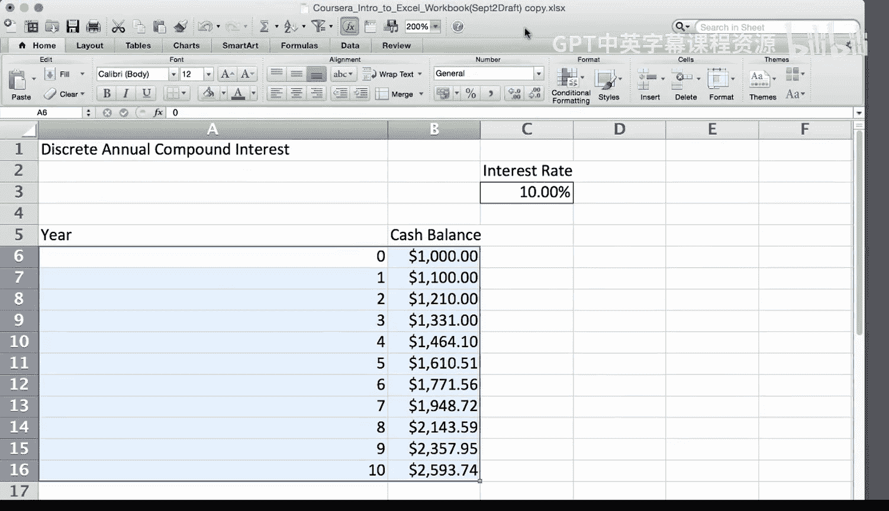
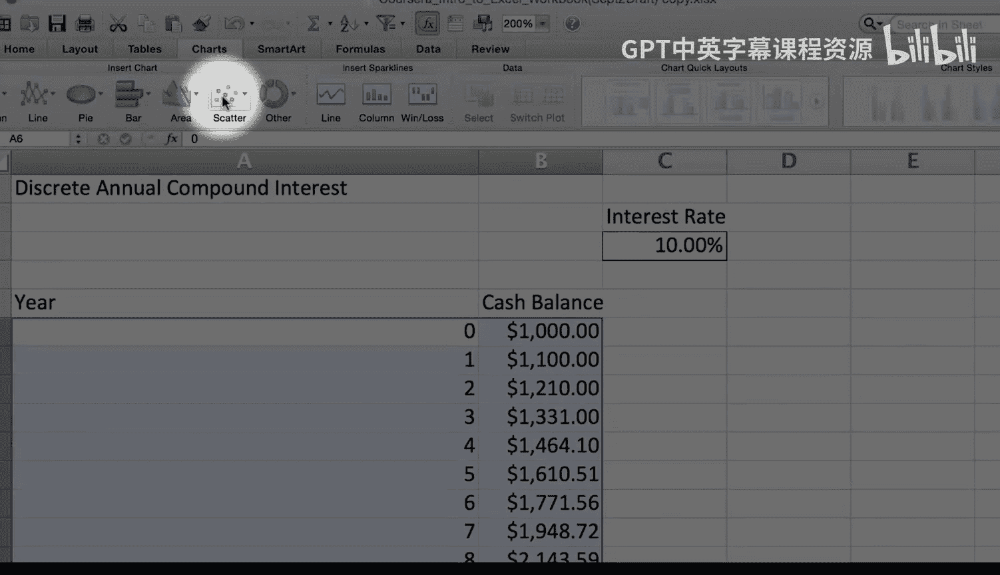
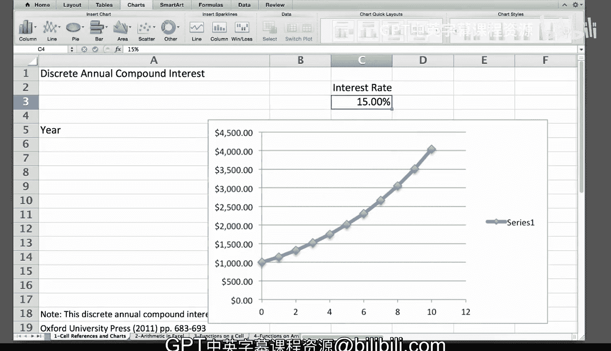
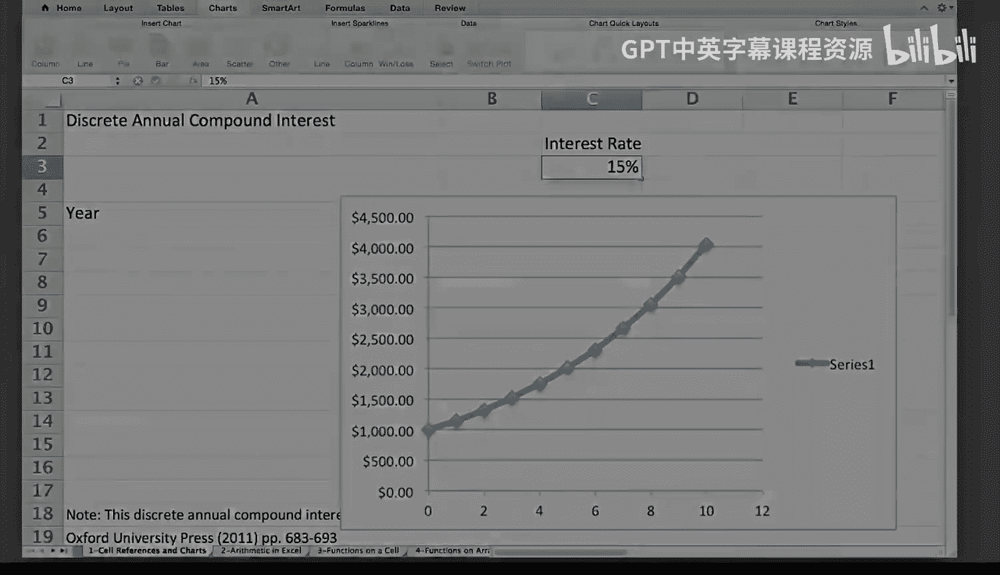

# Excel 到 MySQL：商业分析：04_02_03：Excel 基础词汇与图表入门 📊

在本节课中，我们将学习 Excel 电子表格的基础知识，包括如何定位单元格、使用公式进行计算、理解相对引用与绝对引用的区别，以及如何创建动态图表。

## 单元格定位与基础操作

我们首先从 Excel 电子表格中定位单元格的方式开始。

你会注意到表格有**行号**和用字母表示的**列标**。

因此，要标识一个特定位置，你可以这样描述：例如，当前高亮显示的蓝色方块是 **单元格 B7**。它上方的是 **单元格 B6**，右侧的是 **单元格 C6**，依此类推。

## 解决一个简单问题：复利计算

现在，我们来解决一个简单的问题。假设有一个**固定的年利率**，我们的财富在 10 年内复利增长。我们想知道在给定特定利率的情况下，10 年后我们有多少财富。

让我们假设年利率为 **7%**。

以下是解决此问题的一种方法：

1.  在初始现金余额 `$1000` 所在的单元格（即 **B7**）中输入公式。请注意，我输入了一个**等号**来激活单元格，这是使公式生效的关键。
2.  输入公式 `=B6*1.07`。这应该得到结果 `1070`。

这样，我就创建了一个**相对引用**。这意味着，如果我选中刚刚输入公式的单元格，并向下拖动其右下角的**填充柄**，Excel 会自动调整我的相对引用。例如，在下一行，公式会自动变为 `=B7*1.07`，即引用正上方的单元格。

通过拖动填充柄，我可以快速填充整个表格，得到 10 年后的最终结果 `$1967.15`。

为了使这些数字显示为美元格式，我可以选中这些单元格，进入“设置单元格格式”选项，选择“货币”格式。

## 使用绝对引用实现通用计算

虽然上述方法是正确且有效的，但还有一种更具通用性的方法，即使用**绝对引用**。

使用相对引用时，如果我想要更改利率，我需要在至少一个单元格中输入新值，并重新填充所有公式。但如果我们已经设置了一个专门存放利率的单元格（例如 `C2` 单元格存放 `7%`），就可以使用绝对引用来简化操作。

以下是具体步骤：

1.  在 B7 单元格中输入公式 `=B6*(1+$C$2)`。
2.  **美元符号 `$`** 是 Excel 中绝对引用的符号。`$C$2` 表示无论公式被复制到哪里，都固定引用 C2 单元格。
3.  向下填充公式后，公式中 `$C$2` 的部分将保持不变。

这样做的好处是，我只需在 C2 单元格中更改利率，所有计算结果和图表都会**自动更新**，非常方便。

## 创建动态图表

Excel 的另一个强大功能是创建与数据联动的图表。

以下是创建图表的步骤：

1.  选中包含年份和财富值的数据区域。
2.  转到“插入”选项卡下的“图表”功能区。
3.  选择“散点图”中的“带直线和数据标记的散点图”。

这样，我就得到了财富随时间增长的直观图像。当我更改 C2 单元格中的利率时，图表会自动更新，清晰地展示不同利率下的增长轨迹。

## 总结

本节课中，我们一起学习了 Excel 的基础操作。我们了解了如何通过行号和列标定位单元格，使用公式进行基本计算。我们重点区分了**相对引用**（如 `B6`）和**绝对引用**（如 `$C$2`）的用法及其适用场景，并掌握了通过填充柄快速复制公式的技巧。最后，我们学习了如何根据数据创建动态图表，使数据分析结果更加直观。掌握这些基础概念是进行高效商业分析的重要第一步。