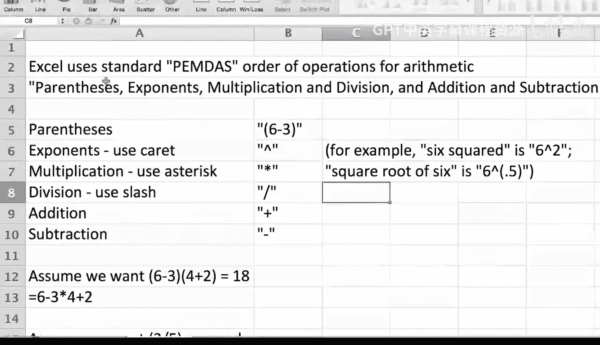
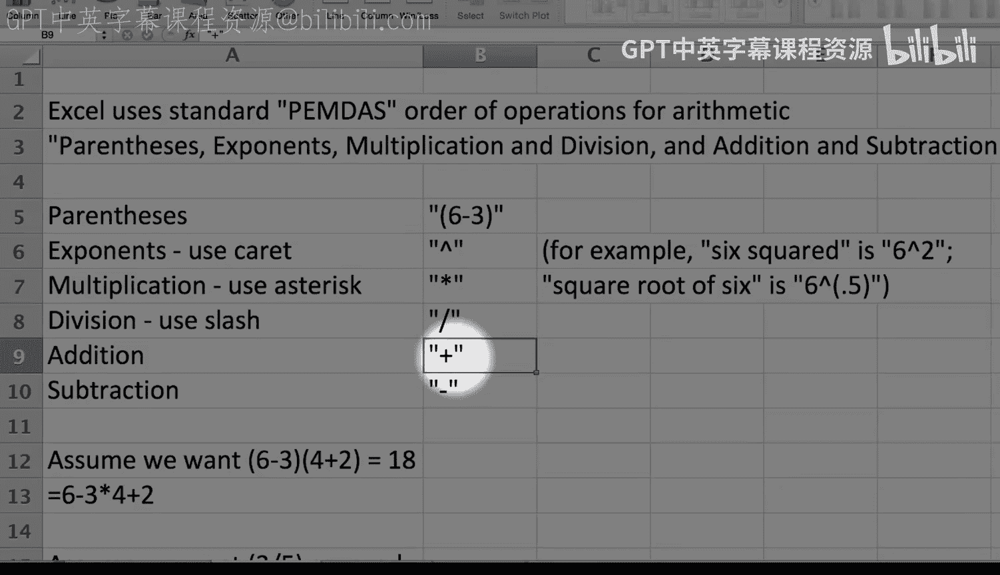
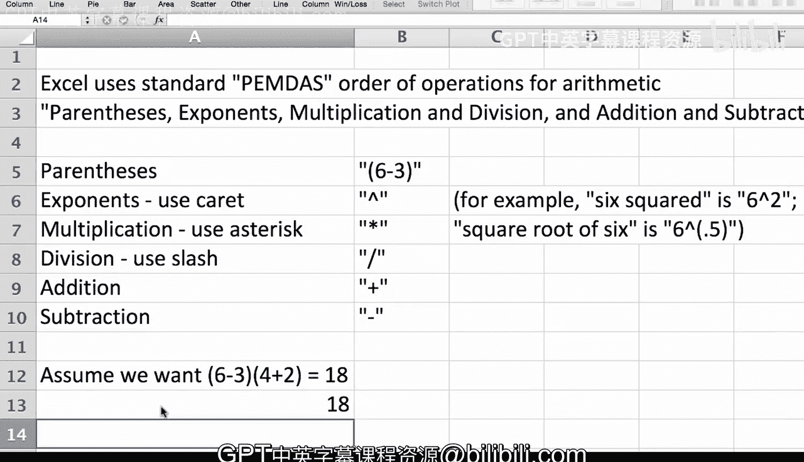

# 杜克大学《Excel 到 MySQL：商业分析（5课全）｜Excel to MySQL： Analytic Techniques for Business》中英 p40 05_02_04_Excel中的算术运算.zh_en -BV1mS421X7yw_p40-

Next we turn to how to do arithmetic in Excel。It is very similar to how we do arithmetic on pencil and paper。

We use the same procedure for order of operations， which you probably remember from elementary school。

 MDDs， parentheses， expons， multiplication and division， addition and subtraction。

 that's the order that things are done。Okay， parentheses look just like our usual parentheses。

For exponentence， we use the carrot symbol， which is on a standard keyboard is a capital above the six。

For multiplication， we use an asterisks， which is a capital above the eight。For division。

 we use a slash which is below the question mark， P plus we just use plus。

 which is above the equal sign and for minus， we just use minus。

 which is between zero and the equal sign。

So assume that we want a value for6 minus3 times 4 plus 2 or  three times 6 or 18。嘿。

If we write it out as I've written out here， we will get the wrong answer， oh， by the way。

 notice that。嗯。This formula is not active， even though it has an equal sign。

 which is what usually activates a formula， the reason for that is because I have put an invisible hyphen at the beginning of the formula。

 you can do this whenever you want to display a formula so other people can see it。

 even if it is not the selected cell that would appear in the formula bar。Okay。

So if I remove this hyphen， then the formula will execute， but it will not give me the right answer。

Because it's practicing Pemdas， it's multiplying three times four first。

So it's doing six minus 12 plus two。If I want the correct answer， I need to insert parentheses。

And then I will get the correct answer。

