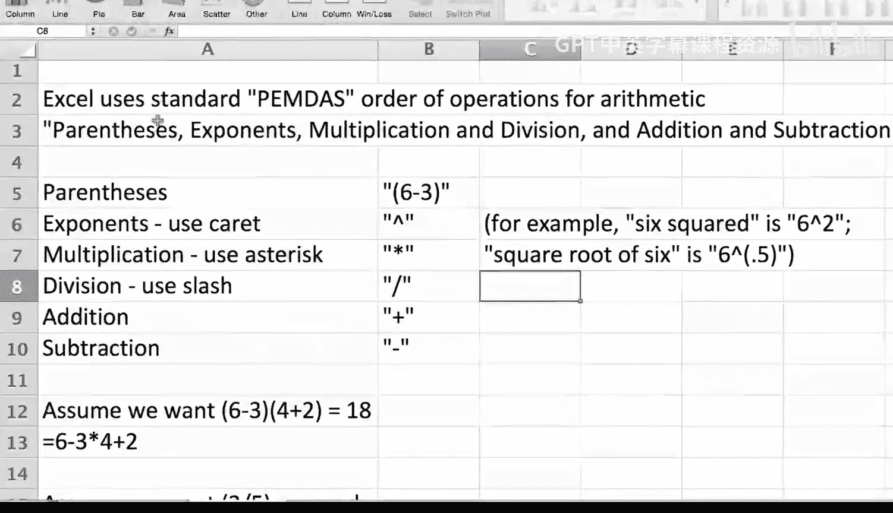
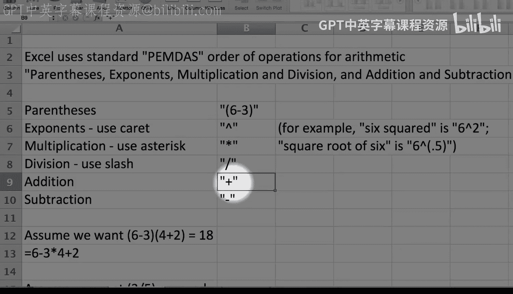
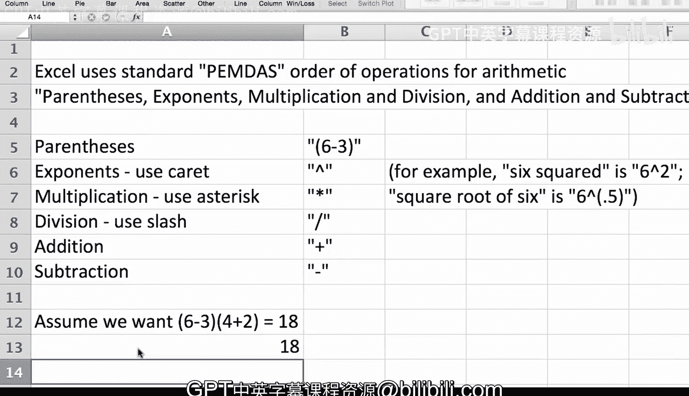

# Excel 到 MySQL：商业分析：1.2：Excel中的算术运算 📊

在本节课中，我们将要学习如何在 Excel 中进行算术运算。Excel 的运算规则与我们用纸笔计算非常相似，遵循相同的运算顺序。掌握这些基础是进行更复杂数据分析的第一步。

## 运算顺序规则

上一节我们介绍了 Excel 的基本界面，本节中我们来看看其核心的算术运算规则。Excel 遵循标准的数学运算顺序，即“PEMDAS”法则。

这个法则规定了计算的优先级顺序，具体如下：

*   **P** - 括号
*   **E** - 指数
*   **M** - 乘法
*   **D** - 除法
*   **A** - 加法
*   **S** - 减法

计算时，Excel 会严格按照这个顺序执行操作。

## 算术运算符

了解了运算顺序后，我们需要知道在 Excel 中代表这些运算的符号。以下是 Excel 中使用的算术运算符：

*   **括号**：`( )`。与常规数学中的括号用法相同。
*   **指数**：`^`。在标准键盘上，它是数字 `6` 键的上档字符。
*   **乘法**：`*`。在标准键盘上，它是数字 `8` 键的上档字符。
*   **除法**：`/`。位于问号键的下方。
*   **加法**：`+`。位于等号键的上方。
*   **减法**：`-`。位于数字 `0` 和等号键之间。

## 公式输入与括号的重要性

现在，我们通过一个例子来看看如何正确输入公式以及括号的关键作用。假设我们需要计算 `(6 - 3) * (4 + 2)` 的值，正确结果应为 `3 * 6 = 18`。

如果我们在单元格中直接输入公式 `=6-3*4+2`，Excel 会给出错误答案。因为根据 PEMDAS 规则，它会先计算 `3*4`，公式实际执行的是 `6 - 12 + 2`，结果为 `-4`。

为了得到正确结果，我们必须使用括号来明确指定运算顺序。正确的公式应写为：
`=(6-3)*(4+2)`
这样，Excel 会先分别计算括号内的 `6-3` 和 `4+2`，再将结果相乘，最终得到 `18`。

> **提示**：有时你可能想显示公式本身而非计算结果。可以在公式前加一个单引号 `‘`，例如 `’=6-3*4+2`。这样单元格会将其作为文本显示。要恢复计算，只需删除单引号即可。

## 总结

本节课中我们一起学习了 Excel 算术运算的基础知识。我们回顾了 **PEMDAS** 运算顺序规则，认识了 Excel 中对应的**算术运算符**（如 `^`、`*`、`/`），并通过实例强调了使用**括号** `( )` 来控制计算顺序的重要性。正确运用这些规则是确保公式计算准确无误的基石。