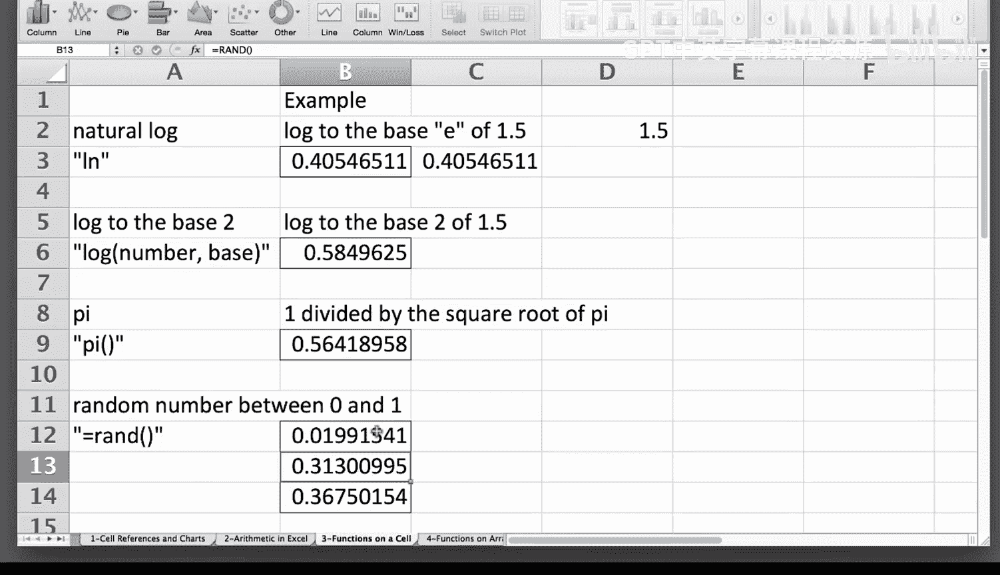

# 杜克大学《Excel 到 MySQL：商业分析（5课全）｜Excel to MySQL： Analytic Techniques for Business》中英 p41 06_02_05_单个单元格函数应用.zh_en -BV1mS421X7yw_p41-

The real power of Excel comes in when you look at all the functions way beyond arithmetic that are possible。

Okay。Excel has hundreds of built in functions。So I'm going to show you just a tiny set of examples here。

 just a couple examples， okay。If I want to take the natural log of something。

I use the Excel function LN， so I'm going to take log to the base E of 1。

5 and the way that I do that is again， my equal sign activates the formula and I use LN。

And then I enter the value，1。5。And that's all I need to do。And if I want to refer to another cell。

I can do that as well， so I could say equals L and。Of。D。2。And I would get the same result。系。

If you want to take log to a different base。Here you need to enter both your parameters as part of your setting up of the problem。

 so I'm going to type in。Equals log。And I'm going to take log to the base two of 1。5。

 I'm going to do log。2。Sorry。Log。1。5。Coma 2。诶。😊，And that's my answer。

If I want to use the value for pi。Excel has the value built in。

And so if I'm going to do something like one divided by the square root of pi。

 it would look like this。One， divided by parentheses， pi。

 these parentheses are just part of the way the word pi is written in Excel。To the 0。

5 meeting square root closed parentheses。And that's all there is to it。

Another very useful type of function that Excel has is a series of random number generators which generate pseudo random numbers that are quite adequate for almost all of our purposes。

And if you want to generate a random number between0 and1， you just use the Excel RA function。

 so you would say equals RA。Prenheses， close parentheses。

And each time we double click on this formula。We get a different value。

So we can use this to generate as many values as we want。So for example。

 if we needed a whole lot of random numbers。Every time we double click on any of them。

 we get new numbers。There is a preference setting in Excel where you can turn off that automatic feature if you want the random numbers to stay there when you。

When you click on something else， you don't want the random number to change， you can do that。

But that's。Basic examples of functions within a cell。Next。

 we're going to look at another very powerful feature of Excel。

 which is that it can do functions on sets of numbers。And in Excel。

 a set of numbers that's organized in a column。Or in more than one column。Is known as an array。

