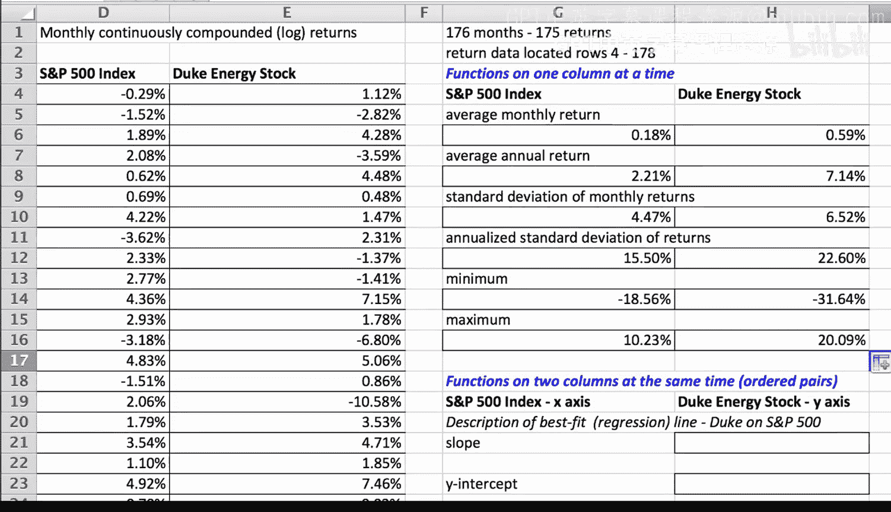

# 杜克大学《Excel 到 MySQL：商业分析（5课全）｜Excel to MySQL： Analytic Techniques for Business》中英 p42 07_02_01_数据集数值函数.zh_en -BV1mS421X7yw_p42-

Now we turn to the functionality that makes Excel quite powerful for more advanced problems。

We can apply a function to a large group of numbers that are all gathered in a single column or a single row。

So for example， we can calculate the average of a group of numbers。

 we can calculate its standard deviation， its minimum， its maximum， many other。

Descriptive statistics about that set of numbers。Right。

We also have functions that allow us to perform analyses on sets of ordered pairs of numbers。

 so here we would have an array that consists of two rows or two columns and we can pair the values in them and perform functions that are functions on two variables。

So let me show you what I mean。What I've done here is I've taken data that I've downloaded from Yahoo Fin。

For the standard I's 500 index， which is simply an index of 500 of the largest companies that are traded on US stock exchanges。

And then one particular large US company stock， Duke Energy。And I've taken data for。

The beginning of each month for the closing price， and I'm using something here called the adjusted closing price。

 which includes reinvestment of dividends。But in any case， I am looking at 176 months of price data。

 which would give me 175 monthly returns I'm going to calculate the continuously compounded。Or。Log。

Monthly return， the way that I do that is I take the natural log of the ratio of the two prices with the more recent price on top。

 so I'm going to take the natural log of。The price in August。Divided by the price in July。Okay。

 so it started at 1930 and it went to 1925， so I had a small loss that month of minus 0。29%。

Now we're going to do our very clever trick。Where we simply click on the handle and the data will fill in all the way down for all 170。

5 returns。Coolh？Not only that， but because we used。Relative references。

Both in the row direction and in the column direction。

I can take this formula and I can drag it over and you'll notice that the relative references have moved one to the right。

 so they now refer to data in column C， which are the Duke energy prices。And here。

Duke Energy's stock is slightly up。For the month。Okay。

So now I have two time series of monthly returns。For。

The index and for an individual stock and something that I often might want to be able to do。

Is to look at how one stock did compared to its。The indexex or the universe。

 the larger market of which it is a part。So first of all。

 I'm curious to know which performed better the index or the stock in order to calculate the average。

Of a series of values。That are all in one column or one row， what Excel calls an array。

I enter my function。Which in this case is average。Then I enter the cell location of the first value I'm interested in。

I。Separate。with a colon and I enter the cell value of the last cell that I'm interested in。

 and what I've done is I have selected those two cells and all the cells in between to calculate their average。

うん。And again， because I've used relative references。I should be able to drag。And you see here。

 I've calculated the value for the average return for Duke Energy stock。

So you see that Duke Energy has， on average， performed quite a bit better than the S&P 500 index over this time period。

This is my return for one month， so if I want to know my continuously compounded return for 12 months or one per one year。

 I simply multiply by 12， so I'm going to say equals。G6。Times 12。

And if I want the continuously compounded monthly return。For。I energy stock。

 I simply drag the formula and again， you see that。I'm indicating now。The value in。H6。Okay。

Another thing that I'm typically interested in when I'm looking at。

Financial return numbers would be the how spread out individual returns are。

And I usually use the standard deviation as my metric to evaluate how spread out they are。

So and again， Excel has a built in standard deviation function， so I'm going to say equals。

ST DevP stands for the Pulation Standard deviationation， which is what I want here。

And I'm going to use the exact same range， D4。To D178。And my monthly standard deviation。Is。

I'm going to convert this to a percentage， so I go to formatting sales percentage。Okay。And， again。

I can just drag this over to calculate the monthly standard deviation for Duke Energy stock。

If I want to annualize this value， the way standard deviations work is that I would multiply the standard deviation for one month。

Not by 12， but by the square root of 12。So I'm going to take my value for the monthly standard deviation。

 which is G10。Times。The square root of 12。And Excel actually has a built in function for square roots。

And similarly， I will drag this over。And I will get the standard deviation for Duke Energy。

 so you see that Duke Energy has a significantly better return than the S&P 500 index over this time interval。

But it is also quite a bit more volatile， or there's a much larger range of possible outcomes。

Another way of looking at the range of possible outcomes would be look to look at the worst month and the best month for each of these values and we have in Excel we have。

Functions for minimum and maximum， so。Let's take a look at the minimum of D4，2， D178。

And this tells us the worst month during this time period， I would have lost 18。5% that's pretty bad。

And。My best month。Who would have gained 10。3%。This is the average or the index as a whole。

Duke Energy stock had a month where it lost 31% of its value。 That's quite a lot worse。

But it also had a month when it gained 20。9%， which is quite a lot better。

So from a descriptive statistics point of view， I can already draw some conclusions。

 I can say Duke Energy stock。Seems to have。Then a much。

Higher paying investment than simply investing in the S&P 500 index。

Over this time interval of a little over 14 years。But。

I would have had a higher standard deviation of returns。

 I would have had bigger lows and bigger highs and so from a point of view of risk adjusted return。

 Duke energy stock is not a free。

Deal， there's some cost to be paid for the higher return。

