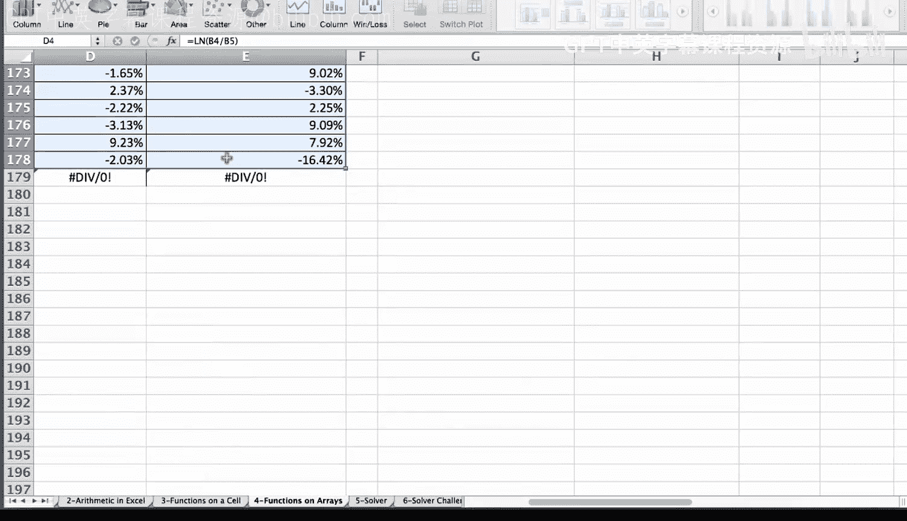
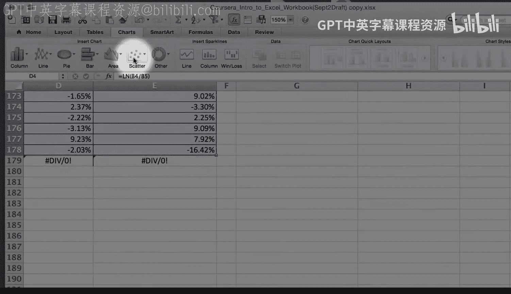
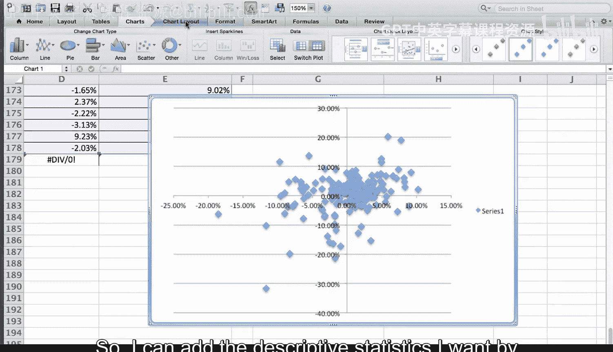
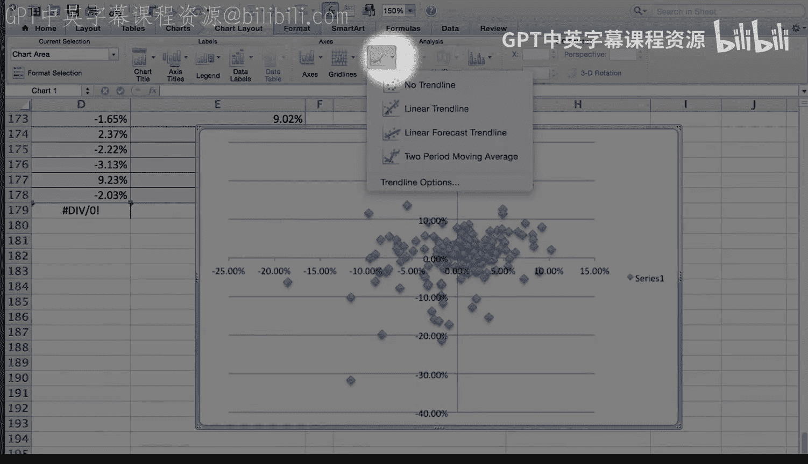
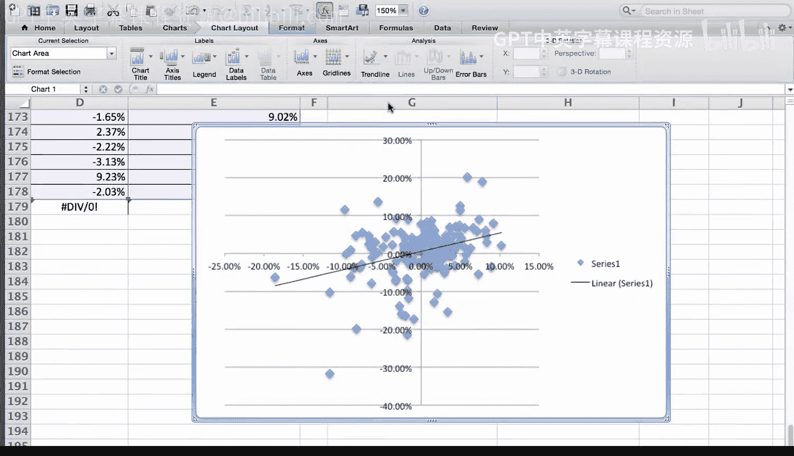
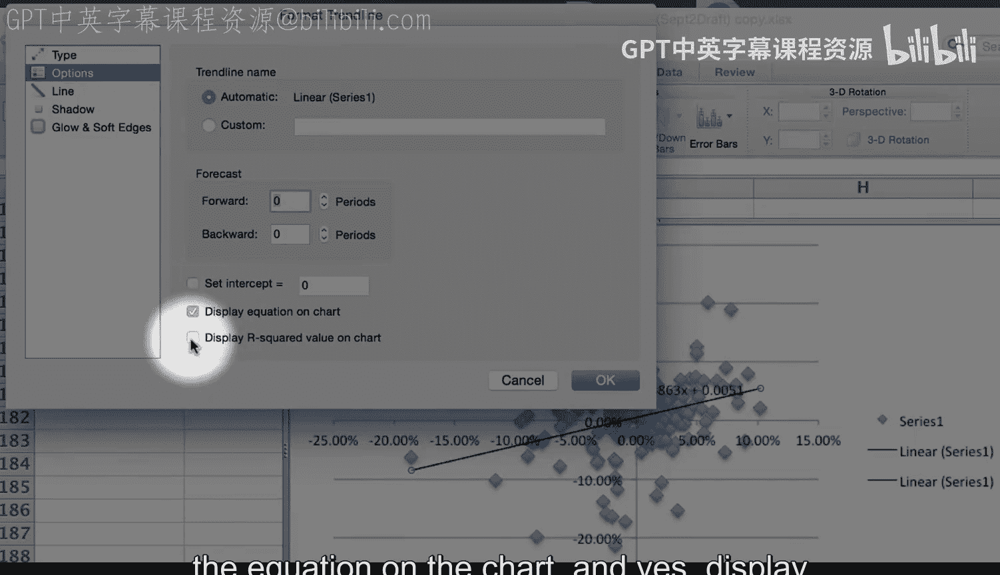
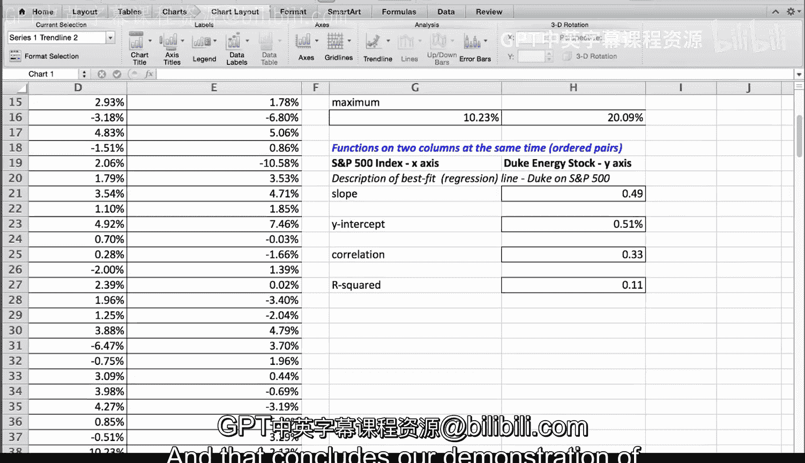

# 杜克大学《Excel 到 MySQL：商业分析（5课全）｜Excel to MySQL： Analytic Techniques for Business》中英 p43 08_02_02_有序数据对函数.zh_en -BV1mS421X7yw_p43-

Next we will look。At Excel functions that are designed to operate on two columns of data。

Or two rows of data at the same time。In other words， they're designed to operate on ordered pairs。

Okay， so let's assume that our。X axis values are the returns of the S&P 500 index。

And our Y axis values are our returns of Duke Energy stock for the same month。

So we're creating ordered pairs each ordered pair represents。One month of time。

 two different returns。And I'd like to know what the best fit line。That fits that data looks like。

Okay。😊，If they were perfectly correlated， you'd have quite a steep line。

 if they had no correlation at all， you'd have a very flat line。嗯。

We are going to see what the slope of that line is。And the way that we do that is we。

Do the Excel slope function。Notice that it asks you to enter the known wise first。

 So here we have to enter E 4。To E 1。78 first。Just as we did before。

 we indicate the top and bottom of the array and all the cells in between with a colon now we separate with a comma。

And now we're going to put in the second array。Okay， and this value we don't want。As a percentage。

We just want it as a number。So I'm going to go back to restore the number for that。Okay。

Now I'd like to know。On average。Did Duke Energy stock outperform the S&P 500 index。

 And one way of calculating that is to calculate the Y intercept or what would be the expected return of Duke energy when the S&P 500 index。

Had a return of 0% or was flat。And the Excel。Command for that function is。Intercept。Intercept。

And again， I'm going to do my known Ys first， so I'm going to do E42， E178， comma D42 D178。

And my intercept， as you can see， is slightly positive and here I think I would like a percentage value。

So。Over this period of 14 years。On average， Duke Energy stock was returning。

 would return about a half percent。If the。嗯。Stock market itself was returning nothing。Okay。

 now we've seen that these values move。Different。But a common question is how differently do they move。

 are they always up together， are they always down together and。

Duke Energy just moves up more and down more， or do they have some independent movement？For this。

 we are going to calculate the correlation。ok。And here it doesn't matter what order we enter them in because the correlation of x against y and y against x is the same。

 but we'll just do it the same we've been doing it。And we see that the correlation is。Significant。

But not overwhelming。There's a lot of independent movement here。

 So what this tells us is that Duke Energy stock often goes its own way。

 It's often down when the overall stock market is up and up when the overall stock market is down。

For a well performing stock， this is a desirable characteristic because it allows us to create greater diversification。

By having assets that are not all highly correlated with the stock market index as all。

R squared can be calculated two ways。It has its own function in Excel。

 or we could simply take the square of the correlation。But I will just show you。

The R squared function。RSQ。Which is again。I generally recommend。Just as a matter of。

Keeping spreadsheets clear and orderly that you limit numbers to a reasonable number of digits because after about two digits。

 they are not significant in any case。So I just formatted and reduced this to two digits to the right of the decimal sign。

And there you have our answers。There's another way to calculate statistics about our best fit line。

That relates。Duke Energy returns。Against S&P 500 returns。

And the way that we would do that is we would select both。Columns of data。Okay。😊。

Then we go to charts scatter。

We're going to choose the mark scatter。And this is a picture。Where each dot。Represents。

One month's activity。And the X axis represents the returns of the S&P 500 and the Y axis represents the returns of Duke Energy stock。

This picture doesn't give us the descriptive statistics， but it gives us a general picture。

 which suggests that there's some association here， though not a high amount of association。So。

I can add the descriptive statistics I want by going to charts， chart layouts。

Trend line。And now I am going to add a linear trend line。

ok。

And again， I'm going to go to trendd line options。And I am going to go to options and I am going to say yes。

 display the equation on the chart and yes， display the arch squared value on the chart。

And now that may be a little bit small， but if you can see that， you'll see that we have。

A formula for y in terms of x of point。4863 x plus。0051。

What that means is the slope of the line is 0。486， which is exactly what we found before。

 and the y intercept is 0。0051， which is exactly what we found before， and the R squared value is 0。

11， which is exactly what we found。Before。And that concludes our demonstration of how you can use Excel on arrays of data。

