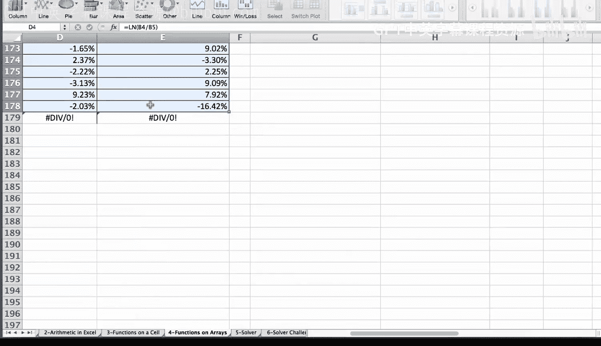
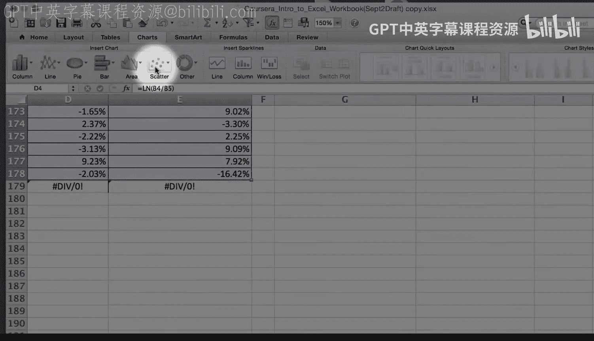
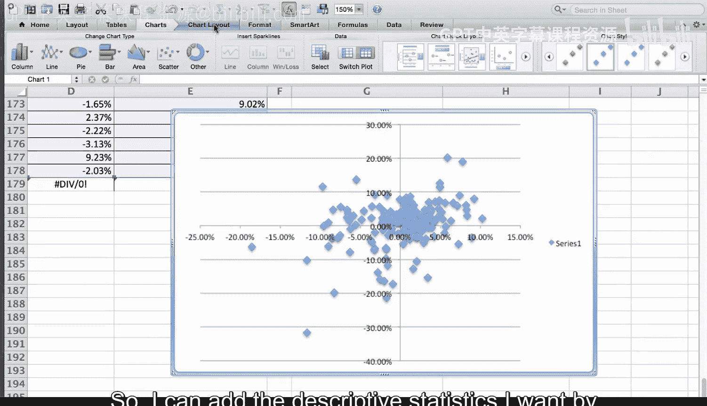
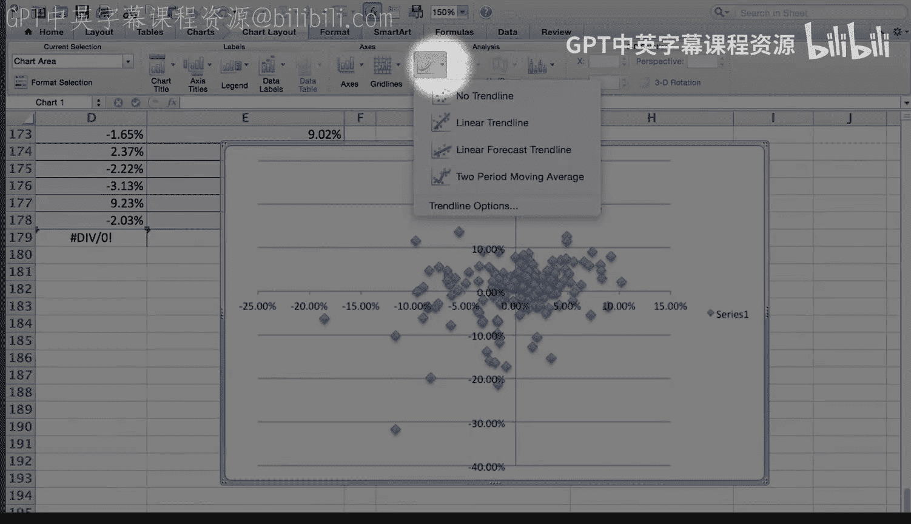
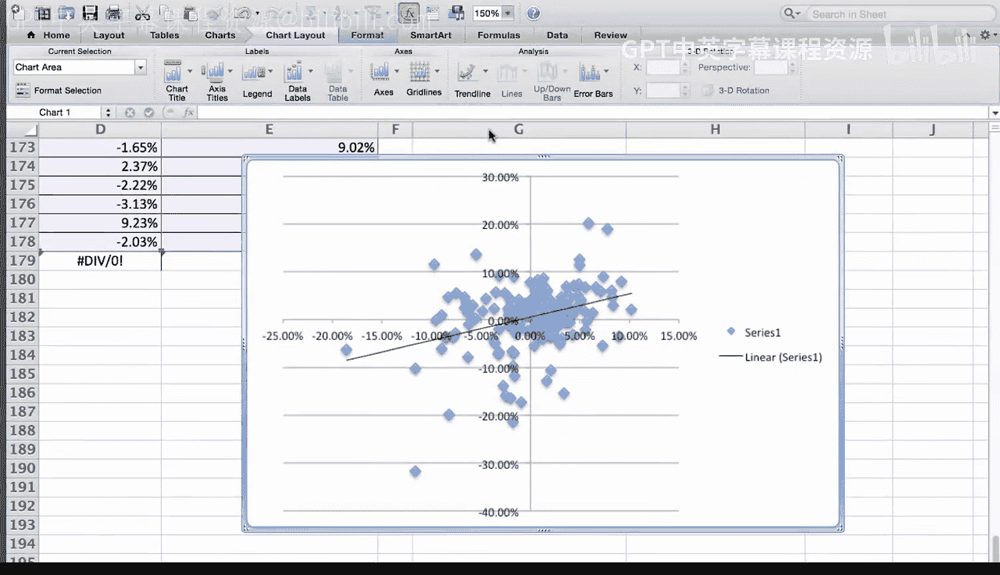
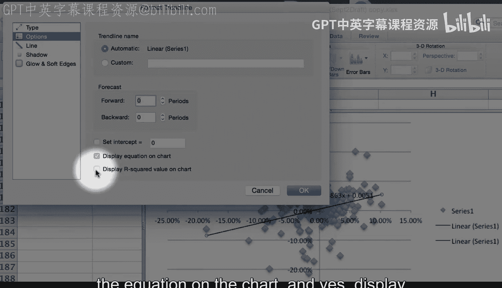
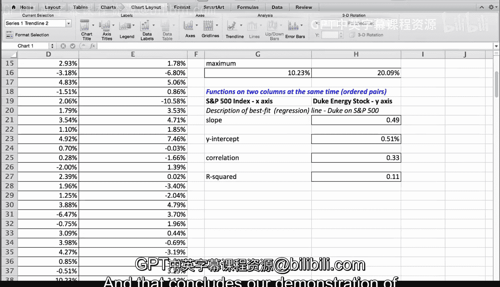

# Excel 到 MySQL：商业分析：5：有序数据对函数 📊

在本节课中，我们将学习如何使用 Excel 中专门为处理两列或两行数据而设计的函数。这些函数用于分析有序数据对，帮助我们理解两组数据之间的关系，例如股票回报与市场指数之间的关系。

上一节我们介绍了处理单列数据的函数，本节中我们来看看如何同时分析两组相关的数据。

## 理解有序数据对

我们假设 X 轴的值代表标准普尔 500 指数的月度回报率，Y 轴的值代表杜克能源公司股票在同月的回报率。这样，每一对数据（X, Y）就代表了一个月内两种不同的回报率。我们的目标是找到最能拟合这些数据点的直线。

如果两组数据完全相关，拟合线会非常陡峭。如果完全不相关，拟合线则会非常平缓。我们将计算这条拟合线的斜率。

## 计算斜率

我们使用 Excel 的 `SLOPE` 函数来计算最佳拟合线的斜率。该函数要求先输入已知的 Y 值。

以下是计算斜率的步骤：
1.  输入函数 `=SLOPE(`。
2.  首先选择 Y 值的数据范围，例如 `E4:E178`。
3.  用逗号分隔，然后选择 X 值的数据范围，例如 `D4:D178`。
4.  函数将返回一个数值，代表斜率。

公式如下：
`=SLOPE(E4:E178, D4:D178)`

计算出的斜率值是一个数字，而不是百分比格式。

## 计算截距

接下来，我们想知道杜克能源股票平均是否跑赢了标准普尔 500 指数。一种计算方法是求 Y 轴截距，即当标准普尔 500 指数回报率为 0%（持平）时，杜克能源股票的预期回报率。

我们使用 Excel 的 `INTERCEPT` 函数。

以下是计算截距的步骤：
1.  输入函数 `=INTERCEPT(`。
2.  同样先输入已知 Y 值范围，例如 `E4:E178`。
3.  用逗号分隔后，输入已知 X 值范围，例如 `D4:D178`。

公式如下：
`=INTERCEPT(E4:E178, D4:D178)`

结果显示，在这 14 年间，当股市本身没有回报时，杜克能源股票平均回报率约为 0.5%。我们可以将此单元格格式设置为百分比以便阅读。

## 计算相关性

我们已经看到这两个变量的走势不同。一个常见的问题是：它们的运动方式有多大差异？它们是总是一起上涨下跌，还是存在独立的运动？为此，我们需要计算相关系数。

我们使用 `CORREL` 函数。输入数据的顺序不影响结果，因为 X 对 Y 和 Y 对 X 的相关性是相同的。

以下是计算相关性的步骤：
1.  输入函数 `=CORREL(`。
2.  选择第一组数据范围，例如 `E4:E178`。
3.  用逗号分隔后，选择第二组数据范围，例如 `D4:D178`。

公式如下：
`=CORREL(E4:E178, D4:D178)`

计算出的相关性显著但并非极强，表明存在大量独立运动。这意味着杜克能源股票常常特立独行，在市场上涨时下跌，在市场下跌时上涨。对于表现良好的股票，这是一个理想特性，因为它有助于通过持有与市场指数不完全高度相关的资产来实现更好的投资组合多元化。

## 计算 R 平方值

R 平方值有两种计算方法：使用 Excel 的专用函数，或者直接对相关系数进行平方。

我们使用 `RSQ` 函数。

以下是计算 R 平方值的步骤：
1.  输入函数 `=RSQ(`。
2.  先输入已知 Y 值范围，例如 `E4:E178`。
3.  用逗号分隔后，输入已知 X 值范围，例如 `D4:D178`。

公式如下：
`=RSQ(E4:E178, D4:D178)`

为了保持电子表格的清晰有序，建议将数字格式化为合理位数。通常小数点后两位已足够，因为更多位数往往没有实际意义。

## 通过图表可视化与验证

另一种分析与验证最佳拟合线统计量的方法是使用散点图。

以下是创建带趋势线和统计信息的散点图的步骤：
1.  同时选中代表 X 轴和 Y 轴的两列数据。
2.  点击“插入”选项卡，选择“图表”中的“散点图”，通常选择带数据标记的散点图。
3.  生成的图表中，每个点代表一个月的活动，X 轴是标准普尔 500 回报率，Y 轴是杜克能源股票回报率。图表直观显示了数据间的关联程度。
4.  点击图表，在“图表设计”或“图表工具”下找到“添加图表元素”，选择“趋势线” -> “线性趋势线”。
5.  右键点击添加的趋势线，选择“设置趋势线格式”。
6.  在趋势线选项中，勾选“显示公式”和“显示 R 平方值”。

图表上显示的公式 `y = 0.4863x + 0.0051` 表明：
*   斜率是 0.4863，与我们之前用 `SLOPE` 函数计算的结果一致。
*   Y 轴截距是 0.0051，与我们之前用 `INTERCEPT` 函数计算的结果一致。
*   R 平方值是 0.11，也与我们之前用 `RSQ` 函数计算的结果一致。

本节课中我们一起学习了如何使用 Excel 的 `SLOPE`、`INTERCEPT`、`CORREL` 和 `RSQ` 函数来分析有序数据对，以量化两组数据之间的线性关系。我们还通过创建散点图并添加趋势线，直观地验证了这些统计结果。这些工具对于理解变量间的关联、进行预测和做出数据驱动的商业决策至关重要。